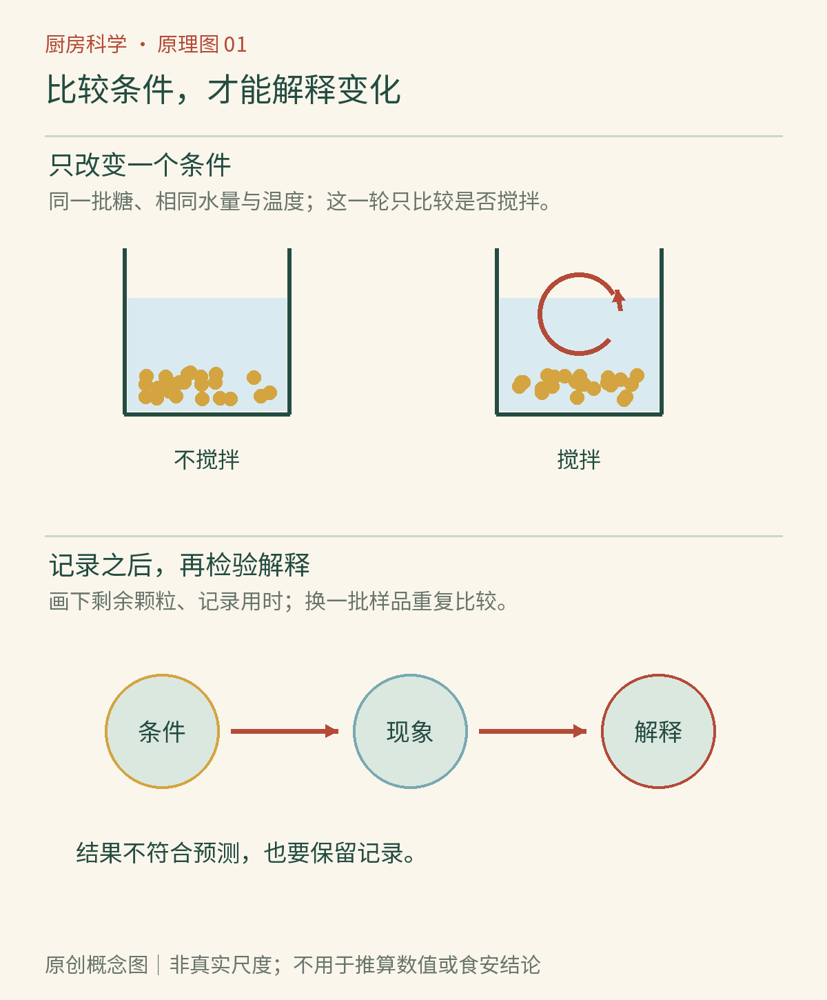

# 第01章　从现象开始：厨房里的观察方法

一片苹果切开时还是乳白色，放一会儿却蒙上棕色。锅里的水越烧越少，锅盖上反而积满水珠。白糖进水以后“消失”，油却浮在上面。厨房每天提供许多线索，只是我们往往急着把菜做好，没有停下来区分：看见了什么，又凭什么解释它。

这本书会反复使用三种视角。先看肉眼可见的颜色、形态、流动和气泡；再想象肉眼看不见的分子、细胞与微生物；最后用温度、质量和时间检查解释。微观图是帮助思考的模型，并不是把食材放大后必然看到的照片。宏观观察与微观解释之间的区别，是化学入门的重要起点。[资料：OpenStax《化学在情境中》](https://openstax.org/books/chemistry-2e/pages/1-1-chemistry-in-context)

*图1-1｜AI漫画教学示意。先辨认每幅画里真正能看到的变化，再给它命名。拟人表情只负责叙事，不能用“分子喜欢谁”代替相互作用的解释。*

## 先把“现象”写得具体

“苹果坏了”不是一个准确的初始记录。它把颜色变化、品质判断和食品安全混在了一起。可以先写：“同一只苹果切出的两块，切后都为浅色；其中一块表面涂少量柠檬汁，另一块不处理；放置一段时间以后，切面颜色出现差别。”随后才讨论可能的机制。苹果切面褐变可由酶参与的氧化反应推动，酸性处理在一定条件下可使它减慢；但一次颜色比较不能证明某种处理消除了所有食安风险。[资料：美国化学会《延缓苹果褐变》](https://www.acs.org/education/celebrating-chemistry-editions/2021-ncw/slowing-apple-browning.html)

具体记录能暴露原先没有注意的条件。如果一块苹果切得薄、另一块很厚，或者一块靠近阳光，结果就不只与柠檬汁有关。厨房不是理想实验室，却仍然可以把明显的差别控制住。使用同一个食材、相近大小、相同容器与相同等待时间，通常比增加复杂器材更有帮助。

## 只改变一件事，才能看清它的作用

假设你想知道搅拌是否让糖溶得更快。取两个相同的透明杯，放入等量、同温的水和等量、相近颗粒大小的白糖；一杯按大致相同的节奏搅拌，另一杯静置。比较的是糖粒不再肉眼可见所需的时间，而不是甜不甜。观察样品不需要品尝，也不要与日常饮用混用。

如果同时把搅拌杯换成热水，就无法知道快在哪里：温度与流动都变了。可以再安排另一轮比较，只改变水温。两轮比较比一组“热水搅拌对冷水静置”更容易回答具体问题。这里的操作是本书设计的观察方法，不意味着一次家庭比较已经足以建立普遍定律。

还要把测量对象写清楚。“一勺”并不稳定：平勺与满勺、细盐与粗盐，都可能有不同质量。日常做菜允许凭经验调整；要比较原因，电子秤和计时器就很有用。读数也有分辨能力的边界，精度到1克的秤不能可靠地告诉你两份样品差了0.1克。[资料：OpenStax《测量》](https://openstax.org/books/chemistry/pages/1-4-measurements)

*图01-2｜原创概念图。上方两杯保持糖、水量和温度相近，只比较是否搅拌；下方由条件、现象走向解释。记录剩余颗粒与用时后再重复检验，不符合预期的结果也要保留。颗粒为概念符号，非真实尺度。*

## 物理变化和化学变化会同时出现

冰融成水，状态改变而主要化学身份没有改变；糖溶在水里，糖分子分散进水中，也不是自动变成了另一种糖。烤面包则同时发生水分迁移、气体膨胀、结构变化和生成新物质的反应。把整道菜简单归类为“物理”或“化学”，常常不如逐项辨认过程有用。[资料：OpenStax《物理性质与化学性质》](https://openstax.org/books/chemistry/pages/1-3-physical-and-chemical-properties)

气泡尤其容易误导。沸水里的大气泡主要是水蒸气；汽水开盖冒泡，涉及原先溶解的气体逸出；食醋遇到小苏打，则会生成二氧化碳。都冒泡，并不说明都发生同一种反应。颜色也一样：叶菜变暗、面包烤黄、苹果褐变，各有不同的参与物和条件。现象是入口，不能代替机制。

## 把解释写成可以检查的预测

“温度影响过程”过于宽泛。“在其他条件相近时，提高水温可能缩短这份糖完全溶解所需的时间”就有了可以检查的对象。若预测失败，先查看糖量是否过多、水是否真的同量、杯子是否散热不同，再考虑原先的机制是不是不够完整。不同结果可能来自测量误差，也可能提醒我们存在新的变量。

家庭观察还应分清三个问题：样品看起来怎样、吃起来怎样、是否安全。前两个有时可以直接感知，第三个经常不能。不要为证明某种保存方法有效而放置生肉，不培养不明霉菌，也不通过试吃判断变质。涉及热锅、刀具、酸碱和清洁剂的内容，本书会把安全边界放在具体场景附近。

## 一个结果，可能允许几种解释

两杯糖水中，搅拌的一杯较快不见糖粒，支持“搅拌使这组条件下的溶解更快”，却不直接证明“搅拌改变了糖的化学性质”。若没有检查水温，也不能排除一杯原先更暖。好的结论与证据的范围相称：记录足以支持哪一步，就先停在哪一步。

可以给记录本留三列：第一列只写观察，例如“第3分钟仍有可见白色颗粒”；第二列写暂时解释，例如“局部浓度高，新的水接近较慢”；第三列写还需要的比较，例如“其他条件相同，改用较细糖粒”。第二列不是事实的同义改写，第三列也不保证一定支持原来的想法。这样的分栏能减少把猜测混进记录的机会。

重复比较同样重要。如果一次加盐黄瓜出水很多，另一次很少，首先要检查原料是否同一批、切法是否一致、碗底是否原先带水。厨房里很多变量难以完全控制，重复出现的趋势通常比一次格外醒目的结果更值得追踪。看不出差别也有价值：它可能说明在这次条件和观察精度下，差别太小，未必说明变量永远没有作用。

你可以从今天的一次做饭开始，选一个真正困惑自己的变化，记下原料、操作、现象和一个尚未证实的解释。保留“还不知道”并不妨碍学习；它能防止经验故事过早变成结论。下一章就从最常见、也最容易被忽略的原料——水——开始。

## 本章资料

- OpenStax：《化学在情境中》；《物理性质与化学性质》；《测量》，链接见正文。
- 美国化学会：《延缓苹果褐变》，链接见正文。
- 本章杯间比较与记录建议为原创教学设计；不以观察样品的感官表现判断食品安全。
