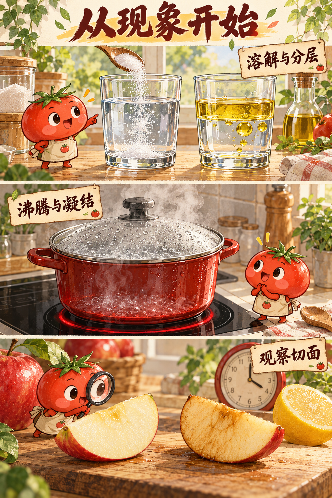
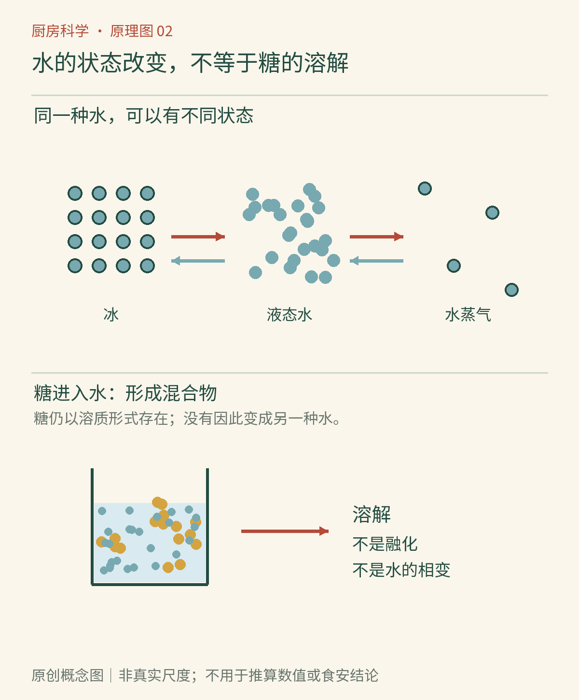

# 第02章　水的多重身份：溶解、沸腾与结冰

同样是一杯水，放进糖可以变成糖水，放进冰可以变冷，烧开又会变少。三个场景都有东西“看不见了”，却不是同一种变化。理解水，首先要把日常语言里的“化开了”拆开：是固体自己变成液体，还是一种物质分散进另一种物质，又或者液体进入了空气？

## 溶解不是融化

冰融化时，原先排列较有序的水分子进入能相互移动的液态。糖溶解时，水参与了过程：糖晶体表面的分子逐渐离开晶体，被水包围并分散。糖没有先变成一摊纯液态糖，也不意味着分子被磨碎成了原子。食盐的情形又不同，氯化钠晶体里的钠离子和氯离子可分别进入水中，周围的水分子参与稳定这些离子。[资料：OpenStax《溶解过程》](https://openstax.org/books/chemistry-2e/pages/11-1-the-dissolution-process)

水能承担这些工作，与它的分子结构有关。水分子内部电荷分布不均，可以与带电粒子及许多极性基团相互作用。糖分子上的羟基使它能与水建立相互作用；大量食用油分子的主要部分却不具备同样的特征。厨房常说“油不溶于水”，是在描述有限混溶的实际结果，并不是水有意排斥油。搅拌油水可以让油滴暂时散开，那属于分散，后面还会专章讨论。

*图2-1｜AI漫画教学示意。观察透明液体中是否仍有颗粒、是否出现上下两层，再区分“溶解”和“混合后暂时散开”。肉眼透明本身不能证明样品只含一种物质。*

## 一口锅里，蒸发和沸腾是两回事

晾在桌面的水不必烧开也会减少，因为液面一直可以有水分子进入气相，这叫蒸发。沸腾时，液体内部也能形成并维持水蒸气泡；泡内外的压力关系允许气泡长大并上升。开火初期锅底冒出少量小泡，其中还可能有原先溶解的空气，不能见泡就认定水已经沸腾。[资料：OpenStax《相变》](https://openstax.org/books/chemistry-2e/pages/10-3-phase-transitions)

在接近标准大气压的条件下，纯水的沸点约为100℃。这里每一个限定都重要：气压改变，沸点会改变；浓溶液也会偏离纯水；锅底、液面和食物中心并不一定同时具有一个温度。一般敞口锅里，水已稳定沸腾后继续加大火力，更多能量主要用于汽化和补偿散热，而不是让整锅液态水无限升温。汤会更快减少，翻滚也会更剧烈，但食材中心的加热速度仍受传热路径限制。

“白色水汽”也不是单个气态水分子的颜色。气态水本身不可见；我们看见的白雾通常是湿热空气冷却后形成的小液滴。锅盖较冷，气态水接近盖面时可以凝结成水珠。水珠积大后落回锅里，便构成厨房里可见的小循环。凝结会释放能量，蒸汽烫伤因此不能只按“看起来比水轻”来判断危险。

## 水温不等于所含能量的总量

一小勺热水与一大锅同温的热水，温度可以相同，却不能加热同样多的冷食材。温度描述热状态，能量转移还与质量及物质的比热有关。比热可以理解为：同样质量的物质，升高相同温度需要多少能量。水的比热较大，因此汤锅能携带不少热量，也让含水食材的中心升温需要时间。[资料：OpenStax《热传递、比热与量热》](https://openstax.org/books/university-physics-volume-2/pages/1-4-heat-transfer-specific-heat-and-calorimetry)

这个区别解释了几个操作。向很小一锅水里加入一大批冷面条，温度容易明显回落；同样一批面条放进更大一锅水，水温变化可能较小。这里不是“大锅的水更热”，而是它在降温过程中能够提供更多能量。比较锅大小时，还要考虑炉灶功率、锅盖和蒸发，不能只由水量推出煮面时间。

*图2-2｜原创概念图。固、液、气之间的箭头表示水的状态转换；“糖进入水中”的支线表示混合物形成。颗粒只是概念符号，不代表真实尺度、分子形状或完整氢键网络。*

## 结冰不是把一杯水按下暂停键

水结成普通冰时，分子形成相对开放的晶体结构，因此冰的密度小于液态水，能够浮在水面。冻硬的食材却远不止一块纯冰：它还含有蛋白质、糖、盐、脂肪与细胞结构。一部分水先结晶，剩余液相中的溶质浓度可以上升；因此食物通常在一段温度范围内逐渐冻结，不是到某个刻度就所有部分整齐地变成冰。[资料：OpenStax《相变》](https://openstax.org/books/chemistry-2e/pages/10-3-phase-transitions)

把冰块放在室温水里观察，可以同时看见融化和杯外凝露。杯外水珠主要来自空气中的水分，而不是杯里的水穿过了玻璃。若想比较，可以使用两个相同的干燥杯，一个放常温水，另一个放冰水，放在同处，过一会儿看杯外差异。不同天气湿度下表现会不同；不要把一处干燥环境里水珠不明显，理解成凝结机制失效。

## 快慢与终点，要分开观察

往水里加一小块糖，再把等质量糖敲成较小颗粒加入另一杯，常能看到颗粒大小对过程的影响。但如果两杯有同样多的水、同样温度，并有足够时间到达相应平衡，先后快慢不应自动理解为最终容纳能力不同。若一杯里出现持续未溶的晶体，应同时考虑加入量，而不是只归因于“没搅够”。这为下一章的饱和概念留下了位置。

蒸发也可以用类似方式分析。把同样少量的水放在宽盘与窄杯中，开放液面大小不同，放置后质量变化可能不同；若一份又被放到风口，就不再只是在比较面积。家庭称量时还要先称容器，避免把容器重量差误认成水量差。这个观察不需要热水，也不需要把容器放在电器或阳光暴晒处。

观察水时，尤其容易把“干净、透明”与“纯水”画上等号。糖水、盐水和许多矿物质溶液都可以透明；透明只是可见光下的外观。我们用透明杯帮助观察，并不是借它建立饮水安全标准。食品和饮用水是否合格，仍依赖合适来源及相应质量控制。

水在厨房的角色不断变化：它是溶剂、传热介质、气体的来源，也是食物结构的一部分。下一章加入盐和糖，看看这些常见小颗粒怎样改变它的行为。

## 本章资料

- OpenStax：《溶解过程》；《相变》；《热传递、比热与量热》，链接见正文。
- ACS：[《温度会影响溶解吗？》](https://www.acs.org/middleschoolchemistry/lessonplans/chapter5/lesson6.html)，可延伸比较糖与盐。
