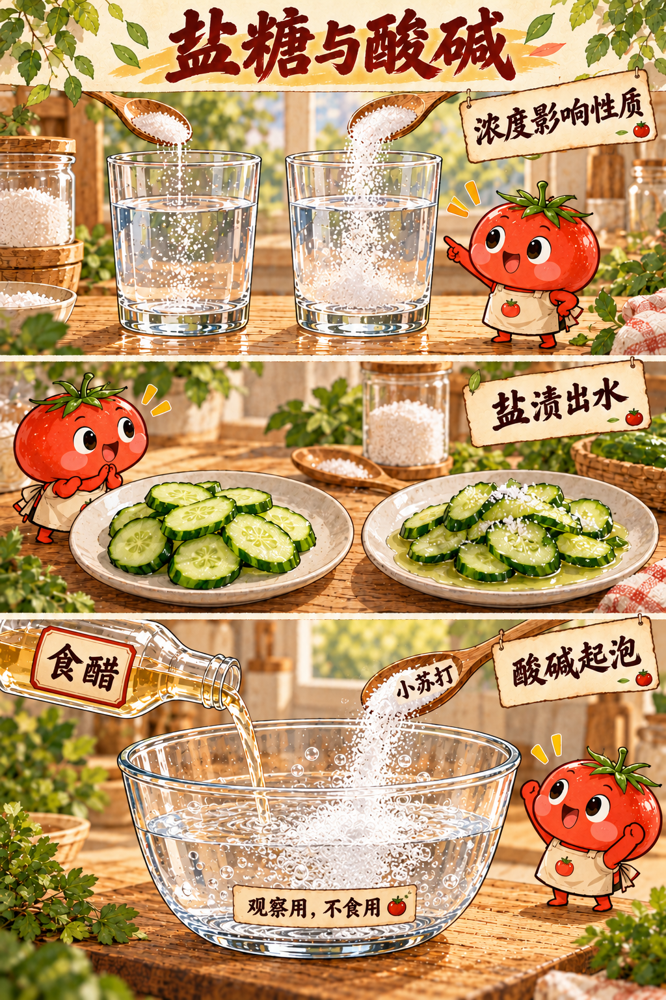
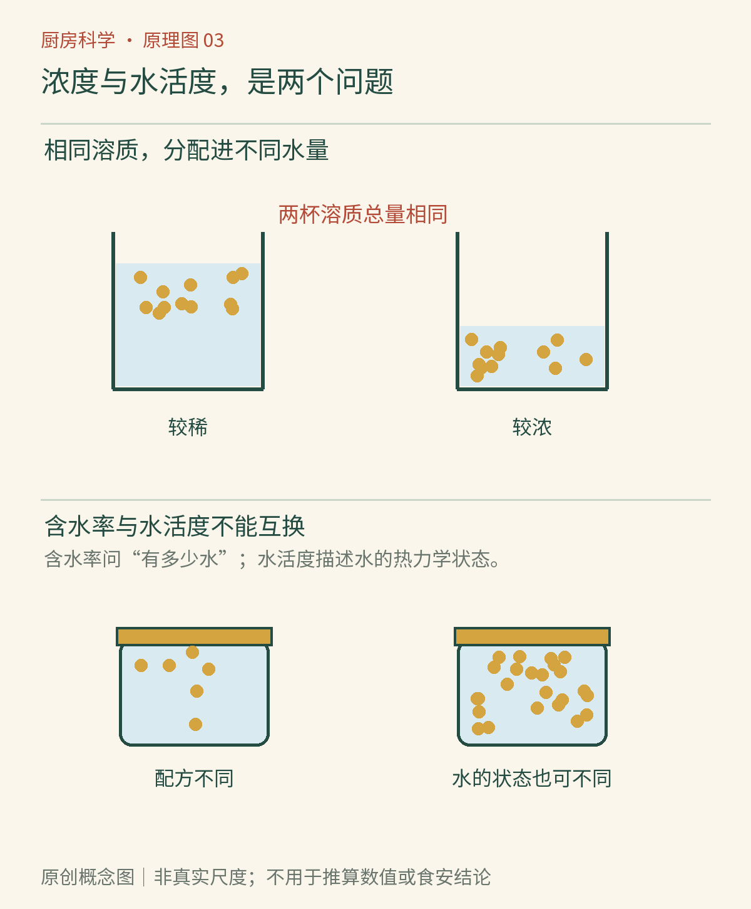

# 第03章　盐与糖：浓度、结晶和水的去向

一小勺盐放进一碗汤会很咸，放进一大锅汤可能刚好。看起来只是凭口味增减，背后却有一个反复出现的概念：浓度。盐与糖的影响不只取决于“放了多少”，还取决于它们分布在多少水、多少食物以及怎样的结构中。

## 同样的用量，可以是不同的浓度

质量分数是一种直观的浓度表达。例如10克糖与90克水混合，得到100克糖水，糖的质量分数为10%；若10克糖与190克水混合，得到200克糖水，质量分数就是5%。这里分母是溶液总质量，而不是水的质量。两杯含糖总量相同，每一小份溶液中所含的糖量却不同。

这个算例帮助理解烹饪中的“收汁”。假设盐没有随汤汁飞溅损失，也没有新增水或食材吸收等变化，蒸发主要减少水，盐量仍在，留下的汁就更浓。给已经偏咸的汤继续熬煮，通常不会靠“煮久一点”把盐煮没。加水可以降低浓度，却不减少整锅盐的总量。这些是质量守恒和混合比例的应用，不是对任何复杂汤汁的完整预测。[资料：OpenStax《溶液浓度》](https://openstax.org/books/chemistry-2e/pages/3-4-other-units-for-solution-concentrations)

*图03-1｜AI漫画教学示意。上方糖入水、中间黄瓜出水、下方食醋与小苏打起泡，是三种不同现象。图中没有提供可比较的精确用量；下方夸张的泡沫用于提示产气，观察样品不作餐食。*

## 溶得快，与最后能溶多少，不是一个问题

细糖往往比大块糖溶得快，因为相同质量下暴露给水的总表面积较大。搅拌可以把晶体附近较浓的液体带走，让更多尚未饱和的水接近晶体。它们影响的是过程速度。若温度、水量不变，单纯多搅几分钟，并不能让无限多的糖永久留在同一杯平衡溶液中。

一定温度下，溶液与未溶晶体共存并达到相应平衡，便涉及饱和。升温能显著提高蔗糖在水中的溶解度；食盐的溶解度随同样温度变化的增幅则小得多。不能把“热水能多溶糖”的经验机械移植到所有粉末。[资料：ACS《温度会影响溶解吗？》](https://www.acs.org/middleschoolchemistry/lessonplans/chapter5/lesson6.html)

糖浆冷却或失水后，原先溶着的蔗糖可能重新排列成晶体。晶体需要开始生长的机会，容器壁上的残留糖粒就可能成为起点。我们把糖浆返砂称为“糖又出来了”，实际是分子重新聚集成可见固体；不是糖被创造出来。某些糖果需要细小晶体提供口感，另一些糖果则尽量抑制晶体形成。是否结晶、晶体多大，属于配方和过程共同控制的结构问题。[资料：Exploratorium《糖是什么？》](https://annex.exploratorium.edu/cooking/candy/sugar.html)

## 黄瓜出水，不等于盐是一块海绵

盐撒在切开的黄瓜上，表面先形成较浓的盐水。细胞内外环境不同，水会跨过仍有选择透过能力的膜发生净迁移；切割损伤、组织变化以及后续盐的扩散也参与最终结果。厨房里的出水现象可以借渗透理解，却不能把整片黄瓜假定成一个完整、永不受损的理想细胞。[资料：OpenStax《被动运输》](https://openstax.org/books/biology-2e/pages/5-2-passive-transport)

可以做一个只观察、不品尝的比较：把同一根黄瓜切出大小接近的两份，分别放在同样的小碗里，一份加少量食盐，另一份不处理；同时开始计时，记录碗底是否出现液体。不要预设具体分钟数或出水量，因为黄瓜品种、切法和盐量都会改变结果。想进一步比较盐量，就另做一轮，保持切法和食材量不变。

*图3-2｜原创概念图。先比较“溶质总量相同、水量不同”，再区分含水率与水活度。点的疏密仅表达概念，不可直接换算成食品的实际水活度。*

## 保存作用还要看水活度

食品的含水率回答“有多少水”；水活度描述水在该体系中的热力学状态，常用食品上方平衡水蒸气压与同温纯水蒸气压之比表达。盐、糖等溶质可以降低水活度，从而影响许多微生物的生长条件。它不等于“还有多少未被绑住的水分子”，也不能靠看起来干不干来精确判断。[资料：FDA《食品中的水活度》](https://www.fda.gov/inspections-compliance-enforcement-and-criminal-investigations/inspection-technical-guides/water-activity-aw-foods)

这解释了为什么湿润的高糖食品与普通水煮食物可能有不同的保存表现，却不能推出“放一勺糖就能常温久放”。配方比例、酸度、加热、包装和污染状况都会参与。减糖果酱也不应直接沿用传统高糖配方的常温保存方法；家制保存必须依据经过验证的对应配方与处理流程，而不是靠本章原理自行推算安全期限。

## 读配方时，先找百分数的分母

“2%的盐”只有连着计算口径才完整：是按蔬菜质量、按水质量，还是按蔬菜与水的总质量？例如100克水加2克盐，盐与水的质量比为2%，但所得溶液中盐的质量分数约为1.96%。在普通调味里这个差别可能不大，放进保存或发酵配方却不应擅自改口径。本章算例只练习比例，不是制作腌菜的安全配方。

另外，一汤匙粗盐与一汤匙细盐可能有不同质量。颗粒之间的空隙、装填方式与是否堆满都会影响量取结果。想稳定复现配方时，优先使用配方给出的质量；只有体积用量时，要确认所指原料与量具。把体积自动当成质量，常比溶解原理本身更容易造成厨房误差。

还可以比较同样质量的完整糖块与碎糖块，记录残留颗粒的变化。为了观察速度，所用糖量宜少，不要做热糖浆。热而黏稠的糖液可能粘附皮肤造成烫伤，结晶机制并不要求读者先熬一锅高温糖。理解变量与亲手执行高温工艺，是两种不同的学习任务。

盐与糖还能改变感官：浓度不同，咸甜感受不同；溶解速度不同，入口时的分布也不同。它们会参与组织脱水、结晶与后续烘焙，却不是可互换的白色颗粒。接下来加入酸与碱，调味台上就会出现另一套变化关系。

## 本章资料

- OpenStax：《溶液浓度》；《被动运输》，链接见正文。
- ACS：《温度会影响溶解吗？》，链接见正文。
- Exploratorium：《糖是什么？》，链接见正文。
- FDA：《食品中的水活度》，链接见正文；该资料用于解释概念，不作为家庭保存配方。
