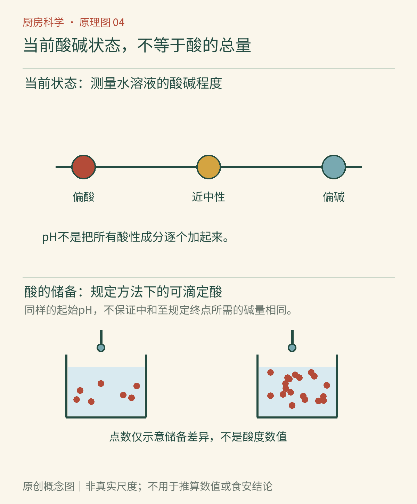

# 第04章　酸与碱：从食醋到小苏打

同一份紫甘蓝汁，加一点食醋会偏红，加一点小苏打水又会变成另一种颜色。颜色的变化很醒目，背后却藏着一组容易混淆的概念：酸是什么，酸得有多明显，以及一份食物到底含有多少能参与酸碱反应的成分。

## 食醋里的酸，不是一种抽象的“酸味”

食醋含有乙酸，柠檬中含有柠檬酸，发酵乳中可以含有乳酸。它们都是具体的化合物，不是同一瓶“酸性”换了名字。在水中，酸能够通过与水的反应提高水合氢离子的活度；碱则能接受质子，或通过相应平衡提高氢氧根离子的活度。入门时可以把质子看作参与转移的氢离子，不必将厨房中的酸碱想象成两种会相互搏斗的粒子。[资料：OpenStax《酸碱平衡导论》](https://openstax.org/books/chemistry-2e/pages/14-introduction)

“弱酸”也不等于可以任意接触或随意加量。强弱讨论的是在给定溶剂条件下的电离倾向，浓稀讨论的是含量。家庭食醋与高浓度乙酸的风险不能因为都含乙酸而混为一谈。本书的观察只使用正常食品与食品级小苏打，不用实验室酸碱、清洁剂或未知粉末替代。

*图04-1｜AI漫画教学示意。重点看下方食醋与小苏打接触后的起泡：本例涉及二氧化碳生成。上方溶解与中间盐渍出水并不等同这种反应；本漫画未画酸碱指示剂变色，对应原理在正文解释。观察样品不食用。*

## pH描述状态，不直接清点所有酸

pH通常用来描述水体系的酸碱状态，其严格定义与氢离子活度有关。在近似处理的稀水溶液中，可以联系到水合氢离子的浓度。它是对数刻度：pH差一个单位，对应相关活度约相差十倍，不能把pH 4简单理解为“比pH 8酸两倍”。中性pH还随温度改变；常说中性为7，通常隐含约25℃的条件。[资料：OpenStax《pH与pOH》](https://openstax.org/books/chemistry/pages/14-2-ph-and-poh)

更值得厨房读者记住的是，pH不等于可滴定酸度。可滴定酸度是在规定测试条件下，将样品滴定到指定终点所需碱量的表达，反映能被该方法中和的酸性成分。两份食品的起始pH可能接近，却需要不同量的碱才能到达同一终点。它们包含的弱酸种类、浓度与缓冲成分可以不同。[资料：加州大学戴维斯分校《可滴定酸度》](https://wine.ucdavis.edu/industry-info/enology/methods-and-techniques/winery-lab-techniques/titratable-acidity)

可以把pH比作这一刻的一个状态读数，把可滴定酸度比作按规定方法继续改变状态时会遇到的“酸性储备”。这个比喻帮助区分问题，并不意味着食品里真的分成两只独立的酸仓库。食物的酸味也不是一台pH计：糖、盐、温度、香气及口腔感觉都会影响体验，所以尝起来差不多酸的两份食物，不保证化学测量一样。

## 小苏打为什么会冒泡

食品级小苏打的主要成分是碳酸氢钠。它遇到足够的酸时，碳酸氢根参与反应，可以形成二氧化碳与水。二氧化碳进入气泡并逸出，便是宽口碗里看见的泡腾。是否泡腾明显还与加入量、接触方式和气体逸出速度有关。[资料：ACS《二氧化碳能使溶液变酸》](https://www.acs.org/middleschoolchemistry/lessonplans/chapter6/lesson10.html)

想观察时，在托盘上的宽口碗中用少量食醋接触少量食品级小苏打即可；样品不品尝，不用瓶盖密封，也不把它改成装气体的压力玩具。反应物之一用完后，继续加入另一种不一定继续产气。混合后的液体也不一定恰好中性：比例不同，可以剩余酸或碱。泡泡停了，只能说明当时的明显产气过程停止，不能充当pH读数。

烘焙利用的不是气泡本身的热闹，而是气体能否在恰当时机被面糊留住。小苏打与泡打粉不应逐克互换：后者通常还含配好的酸性成分及其他辅料，不同产品的释放方式也有差异。具体操作需要使用相应配方；只知道“都会产气”还不足以重写一个蛋糕。

*图4-2｜原创概念图。图中将“当前pH”和“按规定方法中和所需的碱量”并列，提醒它们不是同一种测量。符号与储备示意不表示真实分子数量，也不构成家庭滴定教程。*

## 用颜色观察，也要知道它不能回答什么

紫甘蓝中的花青素可随体系酸碱条件改变颜色，这使其适合做定性观察。可以把冷却后的紫甘蓝浸出液分成少量几份，一份不加处理，一份加少量食醋，一份加入少量食品级小苏打水，比较颜色。器具与样品独立放置，观察后弃去。[资料：ACS《紫甘蓝指示剂》](https://www.acs.org/education/activities/red-cabbage-indicator.html)

不过，指示剂的颜色还受浸出液浓度、照明和样品自身颜色影响。番茄汁、酱油和混浊食物很难用肉眼得到可靠pH；照片里的红色也不能与精密测量直接互换。食品保存需要关注酸在整个食品中的分布及平衡状态，不能见腌汁变红就断定每一块食材内部都安全。[资料：康奈尔大学《酸性与酸化食品》](https://cals.cornell.edu/cornell-agritech/partners-institutes/cornell-food-venture-center/acid-acidified-foods)

厨房里还有另一条必须清楚的界线：食品酸碱观察不能迁移到清洁剂混配。含氯漂白产品不得与其他清洁剂、酸或含氨产品混合；实际清洁遵守产品标签与通风要求。知道反应原理，是为了理解边界，而不是尝试所有可能的组合。

## 调味平衡不等于酸碱中和

一碗汤加糖后感觉不那么酸，可能是感官平衡改变，不能直接认定酸被糖“中和了”。酸与糖通常不是厨房里的一对酸碱反应物。稀释也有相似的误区：加水使每一口的成分分布改变，不代表整锅酸的总量自动减少。要分清口味调整、浓度变化和真正消耗酸的反应，才能选择合适方法。

同样，向偏酸的食品加小苏打，会改变的不仅是味道。二氧化碳逸出、残余碳酸氢盐或其他盐类，以及pH的改变，都可能影响质地、颜色与后续反应。为了让某一口不酸而不断追加，可能使其他性质偏离预期。配方里所需的酸还可能承担凝固、颜色或气体释放的作用，因此替换醋、柠檬汁或发酵乳之前，需要知道它在那道食物里的任务。

酸碱还会改变食材颜色、蛋白质和褐变速率，后面的章节会逐一展开。现在先离开调味碗，看看火怎样把能量送进一块食物。

## 本章资料

- OpenStax：《酸碱平衡导论》；《pH与pOH》，链接见正文。
- UC Davis：《可滴定酸度》；康奈尔大学：《酸性与酸化食品》，链接见正文。
- ACS：《紫甘蓝指示剂》；《二氧化碳能使溶液变酸》，链接见正文。
- CDC：[《使用漂白剂清洁与消毒》](https://www.cdc.gov/hygiene/about/cleaning-and-disinfecting-with-bleach.html)。
