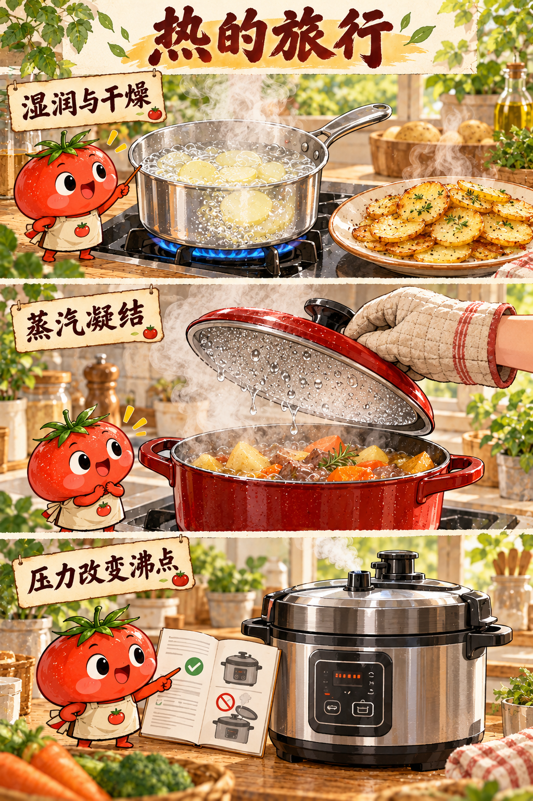
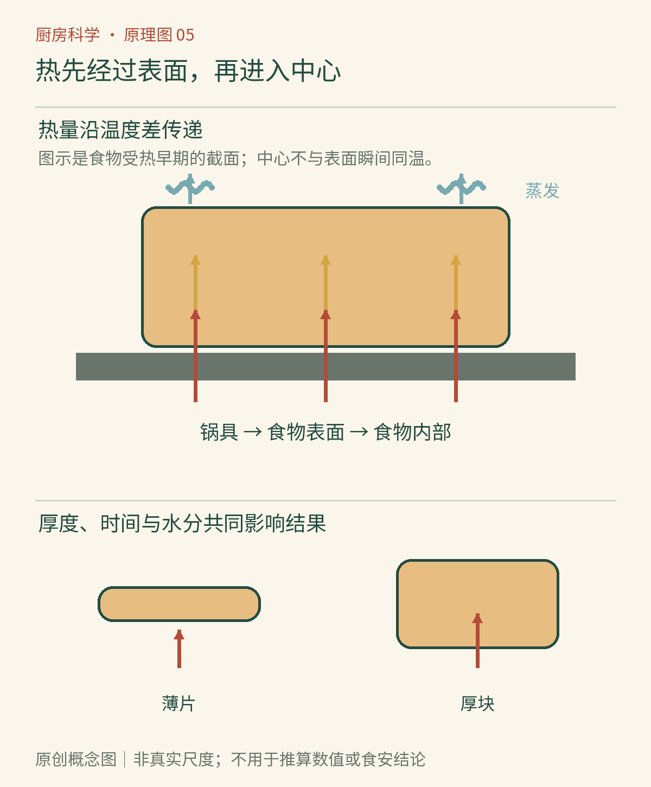

# 第05章　火候的物理学：热怎样进入食物

一块土豆表面已经变软，中心还可能坚硬；一片面包在烤箱里变干，在蒸锅里却变得湿软。同样是加热，差别不只在“火大不大”，还在能量走哪条路、食物多厚、表面有多少水，以及结构变化需要多久。

## 从炉灶到中心，中间有好几段路

炉灶先把能量传给锅，锅把能量传到水、油或食物表面，随后才逐渐进入内部。金属锅中的热传导很快，食物内部却不能因此瞬间获得同样温度。把土豆切薄，会缩短从表面到中心的路径；改用更强的火，主要改变边界条件，不会把这条内部路径取消。

传热常分为传导、对流和辐射。锅底接触食物的位置，传导很重要；流动的水、油和空气可以通过对流携带能量；加热元件和热的炉壁还会通过热辐射交换能量。真实烹饪通常是几种方式同时发生，而不是“煎只有传导，烤只有辐射”。[资料：OpenStax《传热机制》](https://openstax.org/books/university-physics-volume-2/pages/1-6-mechanisms-of-heat-transfer)

*图5-1｜AI漫画教学示意。比较相同食材经湿热与较干燥加热后的表面状态。金黄外观说明表面经历了不同条件，不能据此直接判断内部是否达到安全温度。*

## 温度高，未必意味着传进来的能量多

打开烤箱时，热空气很烫；手若碰到同温的金属烤盘，伤害可能更严重。这不仅是温度问题：材料的导热能力、接触方式、热容量和持续接触时间都会改变能量进入皮肤的速度。不要用身体测试这个差别，隔热手套和干燥工具仍然必不可少。

烹饪中也一样。相同设定温度下，流动热水、静止空气与接触金属提供的加热条件不同。油可以在普通煎炸条件下达到明显高于沸水的温度，但“油更热”仍不是全部解释；表面接触、流动以及食材放入后温度回落都很重要。一次下锅太多冷食材，会使油或锅表面暂时降温，释放的水又使表面较久保持湿润，最终可能更接近焖煮。

这里可以做一个纸面比较：同样一块土豆，切成两片厚片，或切成许多薄片。如果只比较单位表面积，薄片的中心离表面更近；若同时把薄片堆成厚厚一层，又增加了彼此接触与蒸汽排出的限制。切得薄并不自动保证整个锅里的所有片都同样快熟，摆放方式也是变量。

## 火候包含失水的过程

食物表面有充足水分时，许多输入能量会被蒸发带走。水不断汽化，能够限制表面温度上升；表面逐渐变干后，温度才更容易提高，并进入有利于某些上色反应的条件。煮土豆与煎土豆的差别，便不仅是有没有油，还包括水分补给和排出是否相同。[资料：OpenStax《相变与潜热》](https://openstax.org/books/university-physics-volume-2/pages/1-5-phase-changes)

盖锅会改变这套收支。湿热空气较容易停留，水蒸气可能在盖上凝结，部分水又落回锅里；开盖则通常更利于水分离开。对需要收汁的酱汁与需要保持湿润的炖菜，盖子的作用并不一样。普通盖子不是完全密封的压力装置，它通常不会把一口日常汤锅变成高压锅。

“封住肉汁”的说法需要谨慎。煎出的棕色表层不是一层完全不透水的密封膜，食物在后续烹饪中仍可能失水。先煎后炖可以建立风味与表面质地，却不能凭煎出的颜色保证肉汁不流失。更实际的观察是称量前后质量、比较切开后的组织，以及控制加热强度和时间，而不是给外壳赋予万能封口功能。

*图5-2｜原创概念图。沿锅具、表面和中心的路径阅读，同时看蒸发支路带走能量。箭头表示方向与联系，粗细不能当成实测热流；食物内部也不一定只有单一方向的传热。*

## 需要时间的不只是升温

有些变化在达到某温度后仍需时间。淀粉吸水和组织软化、肉中某些结缔组织的变化，都不能简化为“温度计一到刻度立刻完成”。相反，一直保持高温也可能使本来细嫩的组织失水、变紧。烹饪结果来自温度经历与持续时间的组合，本书以后会把这些具体机制拆开。

薄片和厚块因而需要不同策略。若只追求外表快速上色，可能使厚块中心仍然偏冷；若为了等中心而长时间维持强烈表面加热，外侧又容易过度干燥。较温和地让内部升温，再安排短时表面处理，是一种常见的过程分工思想，但具体安全条件仍需按食材与可靠食谱确定。

## 温度计应该回答一个明确问题

测锅中水温、烤箱空气温度、油温与食物中心温度，是不同的测量。探针放在接触锅底的位置，可能读到局部热区；只测汤汁温度，也不能自动代表大块固体的中心。需要判断内部状态时，应使用适用的食品温度计，按说明插入合适位置，不让探针随意碰到锅壁或骨头。

微波加热又提供一个提醒：热源作用并不总从外向内均匀推进。食物的形状、组成与微波场分布可能造成冷热不均；搅拌、翻动以及按说明静置，有助于温度更均匀，仍应在需要时检查多个部位。[资料：USDA FSIS《使用微波炉烹饪》](https://www.fsis.usda.gov/food-safety/safe-food-handling-and-preparation/food-safety-basics/cooking-microwave-ovens)

## 余热也是温度经历的一部分

关火以后，锅与食物不再从炉灶持续获得同样的能量，却不意味着所有变化立即停止。较热的外层可以继续向较冷的中心传热，厚锅也可能继续向内容物放热，同时整体又向环境散热。食物内部不同位置的温度曲线因此可能不一样：中心有时还在升温，表面却已经降温。具体幅度与形状、质量和容器有关，不能用统一等待时间保证结果。

这也是为何比较食物软硬时要尽量对齐出锅后的处理。一份立刻切开，另一份在热锅里多留一会儿，得到的差别包含余热与失水，不只包含原先设定的火力。把“何时关火、何时离锅、何时观察”写清楚，能让火候经验更容易复现。

下一次遇到“外面熟了、里面没熟”，可以先画出能量要经过的路，再决定改切法、摆放、温度还是时间。继续往前，蒸汽与压力会让这条路出现新的条件。

## 本章资料

- OpenStax：《传热机制》；《相变与潜热》，链接见正文。
- USDA FSIS：《使用微波炉烹饪》，链接见正文。
- 本章土豆切法、食材摆放与收支分析为原创教学解释，不提供替代具体食安要求的通用烹饪时间。
