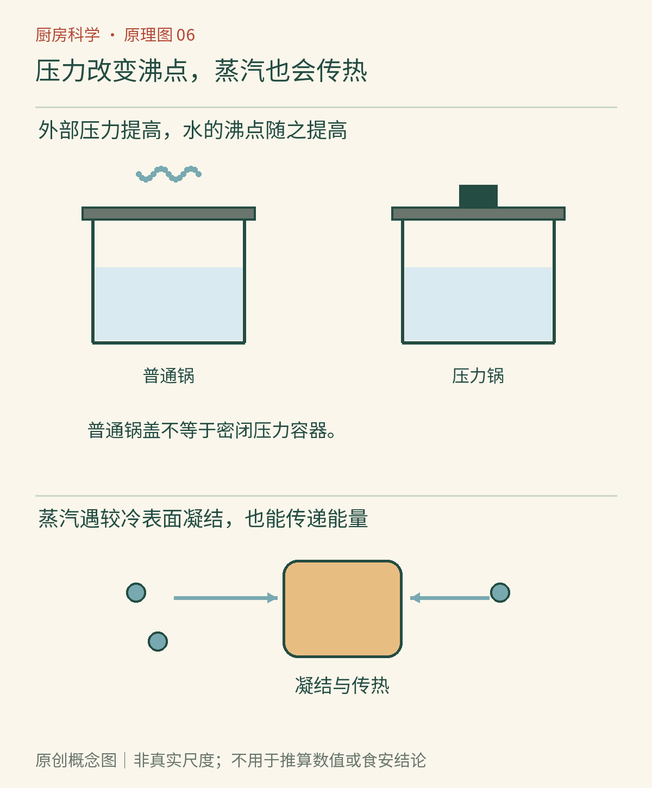

# 第06章　蒸、煮与压力：气体怎样改变烹饪

蒸笼里的包子没有泡在水中，也能热透；高压锅里的豆子往往比敞口锅里更快软化；到了高原，水已经翻滚，食物却可能还要多煮一会儿。这些现象把气体从厨房背景请到了台前。它不仅占据空间，也参与压力、能量传递与水的相变。

## 水不是永远在100℃沸腾

液体内部要持续产生并长大水蒸气泡，需要满足相应的压力条件。沸点与外界压力有关：外压降低，水在较低温度就能沸腾；外压提高，沸点随之提高。因此标准大气压下纯水约100℃沸腾，是带条件的知识，不是所有厨房的固定温度。[资料：OpenStax《相变》](https://openstax.org/books/chemistry-2e/pages/10-3-phase-transitions)

在高海拔地区，环境气压通常较低，敞口水煮食物便可能处于较低温度。把火开得更大，会让水损失更快，却不能在维持同样压力、稳定沸腾的情况下任意提高整锅水温。某些湿热烹饪因而需要调整时间或采用合适器具；具体调整随食材和海拔变化，不能只靠统一多煮几分钟。[资料：USDA FSIS《高海拔烹饪》](https://www.fsis.usda.gov/food-safety/safe-food-handling-and-preparation/food-safety-basics/high-altitude-cooking)

*图6-1｜AI漫画教学示意。比较食物是否接触液态水、蒸汽从何而来以及容器是否为专用压力设备。普通锅盖和压力锅是不同的结构，不应仅凭“都盖住了”视为相同。*

## 蒸汽怎样把食物加热

蒸锅下层的水汽化后，湿热气体进入蒸层。遇到较冷食物表面时，其中的水蒸气可以凝结成液滴，把汽化时吸收的能量释放出来。能量再从表面逐渐传入食物内部。蒸制因此不需要食材浸在水里，也不意味着内部升温会瞬间完成。[资料：OpenStax《相变与潜热》](https://openstax.org/books/university-physics-volume-2/pages/1-5-phase-changes)

常压蒸笼里流动的介质并不永远是理想、纯净、温度完全一致的饱和蒸汽。开盖会带走湿热气体，食材堆放过密会改变流动；边缘、中心与不同蒸层之间也可能有差异。蒸鱼的外面已经热，厚处仍然需要时间。蒸笼不直接接触锅底，不等于每一处食物都自动均匀受热。

我们看到的白雾主要是凝结的小液滴；真正气态的水本身不可见。开锅时贴着出口去观察，可能先接触到看不见的高温蒸汽。揭盖时使湿热气体远离身体，并使用干燥隔热工具；不把手伸向出汽口，也不以“白雾已经散了”作为安全依据。

## 压力锅改变的是边界条件

专用压力锅在设计允许的范围内限制蒸汽逸出，使内部压力提高，并通过控制与安全结构维持工作状态。压力提高后，锅内液态水能够在更高温度下存在，较高温度又使一些导致食材软化的过程加快。这比“压力把食物挤熟”更接近实际原因；食物内部仍需要经历传热与结构变化。[资料：NMSU《高海拔烹饪》](https://pubs.nmsu.edu/_e/E215/)

仪表中的压力还可能有两种口径。绝对压力从近似真空起算，表压则相对于周围大气压起算。读设备参数时不能把两者当成同一个数字，也不能用网上某一型号的压力直接推断另一台设备的温度。电压力锅显示的程序时间还可能不包括全部升温、加压和降压阶段；安排做饭要看完整过程。

普通锅盖通常允许气体从边缘或排气处离开，主要作用包括减少热量与水分流失，不能等同于专用压力控制。更不能通过压重物、堵排气口或改装密封来“升级”普通锅。压力设备的装量、适用食物、排气与开盖方法遵循具体产品说明；含泡沫或易膨胀食材尤其不能凭经验忽略限制。

*图6-2｜原创概念图。主链是“外部约束改变压力—沸点改变—湿热环境温度改变”，再连接食材变化。图不表示所有锅型有相同工作温度，也不是压力装置的操作或改装图。*

## 快熟不是一道通用的计时公式

同样重量的豆类，整粒大小、原料年龄、浸泡情况和酸性配料都可能改变软化过程。大块肉与一锅汤的温度分布也不同。即使锅内环境相同，食材中心达到某一状态仍需要不同时间。因此“某锅只用若干分钟”不能脱离装量、块形与程序直接移植。

如果比较压力烹饪与普通炖煮，应该记录的是完整流程：原料是否相同，是否预先浸泡，加入多少水，计时从什么时候开始，最后如何降压。否则一边记录纯保压时间，另一边记录从冷水到出锅的时间，就会夸大或掩盖差异。实验思路依旧是第1章的条件对齐，只是对象换成了气体与压力。

## 做熟和安全罐藏是不同目标

压力锅能把一顿饭做熟，并不等于它适合建立常温保存的罐藏工艺。罐中食品的冷点升温、排气、保温和降温过程都要被验证；仅知道锅内达到某个压力，不能证明每一个瓶罐内部经历了足够处理。USDA相关家庭罐藏流程不能任意套用到小型压力锅或电多功能压力锅。[资料：俄勒冈州立大学《压力罐藏器与压力锅的区别》](https://extension.oregonstate.edu/catalog/em-9152-safely-canning-foods-pressure-canners-pressure-cookers-electric-pressure-cookers)

## 沸腾得剧烈，不代表每个条件都更强

常压煮一锅汤时，轻微沸腾与猛烈翻滚都可能出现在接近该条件沸点的温度范围。翻滚程度显著不同，并不必然意味着两锅液态水相差很大的温度。它可能主要反映汽化速度与流动更强。对容易破碎的鱼块、豆腐和面团，流动产生的机械扰动也会改变成品，所以选择轻沸有时是为了保护结构，而不只是节省能量。

蒸和煮也没有脱离食材的固定胜负。蒸制时，食材没有整块浸入水中；水煮时，某些可溶成分会进入汤里。若汤汁一并食用，与把煮水倒掉，得到的成分去向又不同。比较方法时，应先说明希望保留的是形状、香气、可溶物还是最终汤汁，不用一句“某方法最营养”替代具体过程分析。

本书介绍原理，家庭保存采用经过验证、与相应设备和食物匹配的指导，不自行把炖煮程序变成罐藏程序。下一章回到锅里另一种常见介质——油脂。它不只改变最高能达到的温度，也改变结构、香气和保存方式。

## 本章资料

- OpenStax：《相变》；《相变与潜热》，链接见正文。
- USDA FSIS、NMSU：《高海拔烹饪》，链接见正文。
- OSU Extension：《压力罐藏器、压力锅与电压力锅》，链接见正文。
- CSU Extension：[《电压力烹饪的海拔调整》](https://extension.colostate.edu/resource/adjusting-for-elevation-when-pressure-cooking/)，该校测试表明不同食物不能机械套用同一调整幅度。
