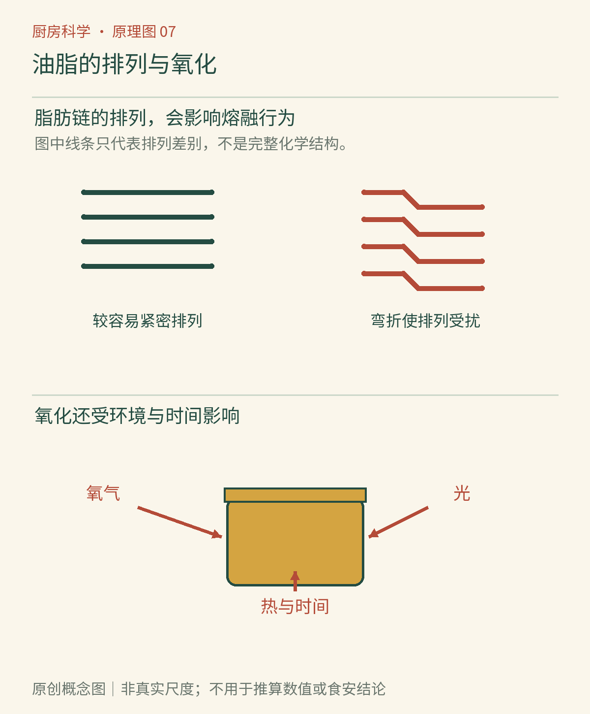

# 第07章　油脂的性格：熔点、氧化与香气

冬天的猪油像白色软膏，炒菜油却能从瓶口流出来。黄油能抹在面包上，换成同样重量的油，面团未必还能保持同样形状。这些差异说明“油脂”并不是一种统一的液体：分子组成、晶体排列和温度，共同决定它在厨房里的表现。

## 一瓶油里有许多不同的分子

常见食用油脂的主要成分是三酰甘油，也称甘油三酯：一个甘油骨架与三条脂肪酸形成酯键。三条脂肪酸不必一样，一种天然油脂中通常也混有许多不同的三酰甘油。因此我们说“橄榄油富含某类脂肪酸”，不是说瓶里每个分子都相同。[资料：OpenStax《蜡、脂肪与油》](https://openstax.org/books/organic-chemistry/pages/27-1-waxes-fats-and-oils)

脂肪酸碳链中有没有碳碳双键，是区分饱和与不饱和的重要依据。常见顺式双键会使链的形状不如对应饱和链容易紧密排列，这常与较低熔点有关，但熔融表现还受链长、双键位置、三酰甘油组成及晶型影响，不能只数双键就给整瓶油确定一个温度。[资料：密歇根州立大学《脂质》](https://www2.chemistry.msu.edu/faculty/reusch/OrgTxtBook/lipids.htm)

*图7-1｜AI漫画教学示意。比较同一环境下脂肪能否流动、能否保持形状。外观帮助观察状态，但不能单凭固态或液态判断营养价值，也不能把一种植物油的行为代表所有植物油。*

## 软化和融化可以跨越一段温度

天然油脂往往不是纯物质，常在一个温度区间内逐渐软化、部分融化，而不是像理想纯物质那样整齐地在一个点切换。冷藏黄油取出后先变得容易按压，随后才可能明显流动，便与其中固态脂肪比例随温度变化有关。后面的巧克力章还会进一步讨论晶体形式。

“植物油常温液态，动物脂肪常温固态”只能算粗略经验。椰子油等植物来源油脂在较凉室温下可以呈固态或半固态；鱼类脂肪也不能简单按猪油的表现理解。原料来源不是分子结构的充分说明。厨房判断最好同时看组成、实际室温和用途，而不是只看“植物”“动物”两个词。

用油替代黄油也不只是把固态变成液态。黄油除乳脂外还含水及乳成分；液态油主要提供脂肪，带入的水和其他成分不同。打发黄油时形成的结构、烘烤中蒸汽的来源、面团中的水油比例都会改变。因此等重量替换可能改变酥松、摊开程度和香气，需要有相应配方支持。

## 油脂在锅里至少做三种工作

第一是传递能量。油能铺展在食材与锅之间，改变局部接触与传热条件；煎炸时，热油还从多个表面加热食材。第二是参与结构：油脂可以润滑、形成晶体网络、分散在水相中，或者影响面粉颗粒与水的接触。第三是影响风味，一部分香气物质更容易分配进油相，随后又随温度、口腔混合和食物结构释放。

这三项不能互相代替。香油的强烈气味不能证明它适合任何高温处理；一块能维持形状的起酥脂，也不只是“有味道的油”。选择油脂时，先问这道菜需要的是传热、结构还是特定香气，再看具体产品与过程。所有香气也不都“只溶于油”，香气分子种类繁多，油水分配与挥发还会受到其他成分影响。

## 氧化不需要先烧到冒烟

油脂与氧发生反应，可以形成初级氧化产物，随后分解或继续反应，出现醛、酮等多种产物；其中一些会贡献陈旧、哈喇或纸板样异味。光、温度、氧暴露以及某些金属接触条件，都可能改变反应速度。磨碎的坚果更容易把内部油脂暴露出来，因此开封与加工方式也值得关注。[资料：美国加州杏仁协会《脂质氧化与油迁移》](https://www.almonds.org/tools-and-resources/food-safety-and-quality/lipid-oxidation-and-oil-migration)

油脂氧化与微生物腐败是不同的过程，可能出现于并不明显发霉的食品中；油变稠、颜色变深或持续起泡也可能反映高温使用中的复杂变化。感官异常可以成为弃用的理由，却不能反过来证明“没闻到异味就完全没变”。不要为了验证质量而试吃疑似酸败的油或坚果。

*图7-2｜原创概念图。排列疏密用于帮助理解状态差异；氧气、光与热的连接表示可能影响氧化的条件。链条是概念符号，不代表完整化学结构，也不意味着所有油脂有相同反应速率。*

## 烟点是一个指标，不是总分

烟点描述在规定测试或观察条件下开始出现持续可见烟的温度，受游离脂肪酸和其他成分、精炼情况及使用历史影响。它不等于油在此之前完全不发生变化，也不等于超过它才开始氧化。用一个烟点数字替代全部稳定性判断，会忽略脂肪酸组成、抗氧化成分、加热时长与反复使用。[资料：AOCS《油脂精炼》](https://www.aocs.org/resource/oil-refining/)

高温使用时，食材带入的水和碎屑也参与油的变化。一边反复添加新油、一边留下旧油，并不能让原来的降解产物自动消失。家用场景没有必要追求把一锅油“用够次数”；若出现明显异常，应弃用。油温过高冒烟时停止加热，不把水倒入热油，更不把这些原理扩展成油火实验。

## 让储存与使用互相配合

把油放在炉灶旁很顺手，却可能让它反复受热。更稳妥的是依产品要求密闭、避光并远离热源，选择能在合理时间内用完的包装，不把大量旧油长期放在透明敞口壶中。[资料：香港食物安全中心《进一步认识油脂：品质与安全》](https://www.cfs.gov.hk/english/multimedia/multimedia_pub/multimedia_pub_fsf_111_02.html)

油脂进入冰箱后变浑浊或出现部分结晶，可能只是组分状态改变，不能仅凭浑浊判定酸败；反过来，恢复透明也不意味着之前的氧化被逆转。把可逆的相态变化与不可简单逆转的化学变化分开，正是这一篇不断练习的观察方法。下一章让油重新遇见水：它们怎样在一碗酱汁里长时间相处？

## 本章资料

- OpenStax：《蜡、脂肪与油》；MSU：《脂质》，链接见正文。
- Almond Board of California：《脂质氧化与油迁移》，链接见正文。
- AOCS：《油脂精炼》；香港食物安全中心：《进一步认识油脂：品质与安全》，链接见正文。
- AOCS：[《提高煎炸油的氧化稳定性与货架期》](https://www.aocs.org/resource/enhancing-oxidative-stability-and-shelf-life-of-frying-oils-with-antioxidants/)，用于延伸了解反复煎炸的多种变化。
