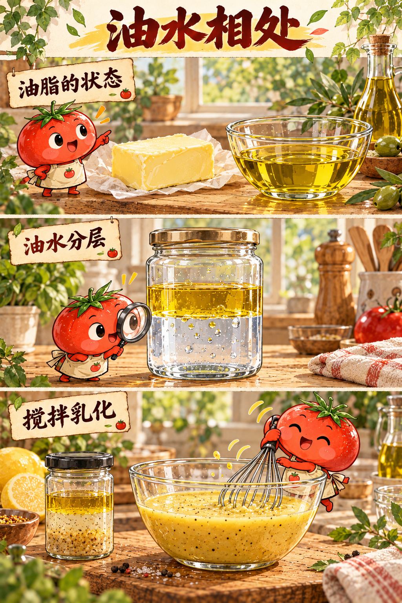
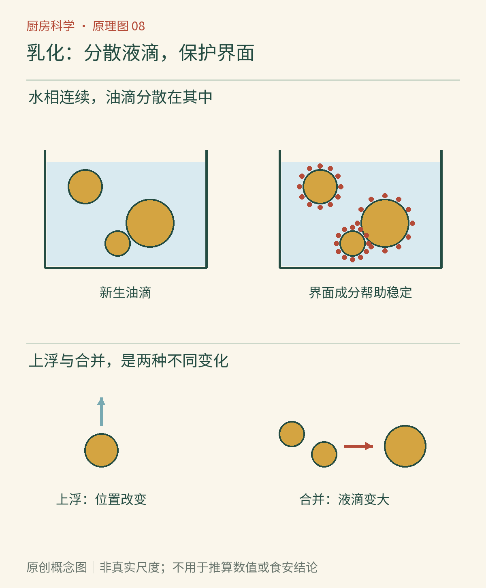

# 第08章　油水相处：乳化与酱汁

一碗油醋汁刚摇匀时浑浊柔和，放一会儿又分成上下两层；蛋黄酱却能保持浓稠。它们都含油和水，差别藏在肉眼看不清的界面里。

把油倒进水里，油不会像糖那样逐渐成为均匀的分子尺度溶液。搅打的作用，是把一大团油打碎成许多小液滴，使它们暂时分散在水中。这样的体系叫**乳状液**；制造它的过程叫乳化。美国油脂化学家学会以牛奶和人造黄油为例，区分油滴分散在水中的“水包油”和水滴分散在油中的“油包水”。名称中的“包”指连续相包围分散相，不是说每滴外面都套着坚固外壳。[资料：AOCS《乳状液如何形成》](https://www.aocs.org/resource/emulsions-making-oil-and-water-mix/)

*AI漫画教学示意：先看油水的明显边界，再看搅拌后出现的浑浊状态。浑浊说明光受到许多微小结构的散射，不能单凭颜色判定乳状液能够稳定多久。食材的表情只是叙事比喻。*

## 把大油滴变小，只完成了一半

油与水接触的表面叫油水界面。大油滴碎成许多小油滴时，总界面面积显著增加，因此搅打需要做功。停止搅打后，小液滴会相遇，其中一些重新合并，界面面积减少，最终又出现肉眼可见的油层。油滴向上集中与液滴相互合并是不同的失稳过程：前者可以只改变分布，后者会让液滴真正变大。

可以把一碗酱汁想成拥挤房间：把人分开站好，并不等于他们永远不会再聚在一起。乳化剂的作用发生在界面上。某些分子或蛋白质同时具有适于接触水和适于接触油的部分，可以吸附在液滴表面，降低形成界面的困难，并提供阻碍液滴合并的保护。保护来自分子层的性质，不是漫画里两位角色“交了朋友”。

蛋黄的磷脂与蛋白质都能参与稳定乳状液。卵磷脂是磷脂混合物的常用名称，不能把它误写成蛋白质。美国蛋业委员会还提醒，制作乳状液时逐渐加入油，可以给界面覆盖和液滴分散留下机会；这解释了配方为何经常要求细流加油，而不是一开始把全部油倒进去。[资料：美国蛋业委员会《乳化》](https://www.incredibleegg.org/professionals/manufacturers/real-egg-functionality/emulsification/)

*原创概念图：辨认连续的水相、其中的油滴，以及油滴边界。图中的颗粒与边界用于表示分散和界面保护，不代表实际分子尺度、完整化学结构或一张不会破裂的膜。*

## 浓稠、乳白、稳定，不是同一个指标

水包油体系不一定稀薄。即使油在总量中占很大比例，只要油仍以液滴形式被连续的水相隔开，它仍属于水包油。蛋黄酱的浓稠与大量液滴彼此拥挤有关，不能根据“含油多”就断言它是油包水。

反过来，一碗加了淀粉的酱汁很稠，也不代表油已经乳化得很好。增稠剂使连续相更难流动，可以减慢液滴移动；乳化剂主要处理界面问题。两种作用可以合作，但不能互相替代。判断酱汁时，最好分别问：小滴分散得怎样、液体流动有多快、静置后是否分层。只说“它变浓了”，会漏掉原因。

牛奶的乳白色也不是把白色颜料溶进水的结果；脂肪滴与蛋白质相关结构共同影响光的散射。透明与不透明描述光学表现，溶解与乳化描述物质分散状态。这两套词偶尔一起变化，却不是同义词。

## 厨房里的三种失败，应对三种问题

**油一下子加入过多。** 如果新界面形成得太快，已有体系可能来不及把油充分打散和稳定，出现大油滴与分层。继续加油通常不能修复这个原因；应先停下，依据可信配方调整连续相和搅拌方式。

**温度改变了食材。** 黄油酱中的脂肪会随温度改变结晶比例，含蛋黄的热酱又涉及蛋白质变化。过热造成的颗粒化，不只是“搅拌力度不足”。因此同样叫酱汁，冷油醋汁与需要温和加热的蛋黄酱汁不能照搬同一套补救办法。

**把风味变化误认为乳化失败。** 乳化状态良好并不能阻止油脂氧化，也不能保证微生物安全。外观均匀只是质地信息。家庭制作涉及未充分加热鸡蛋的酱汁时，应使用适合该用途的巴氏杀菌蛋制品并遵循可靠配方及冷藏要求，不能认为“加了醋就一定安全”。

## 一次只改变搅拌条件

取两个相同的透明小容器，加入等量饮用水和食用油。一个只轻轻转动，另一个用洁净工具充分搅动。记录刚停下时与数分钟后的外观：液滴是否细小、浑浊程度、上层油的出现速度。容器、用量和温度保持相同；只改变搅拌程度。这是观察分散和重新分层，不是制造可长期保存的调味汁，观察后不食用样品。

如果另做一组加入芥末的比较，必须承认变量更多了：芥末不只提供某种“单一乳化分子”，还改变固形物、黏度和界面环境。因此结论宜写成“这份芥末使这组混合物分层较慢”，而不是“证明所有乳化剂都一样”。

## 同样一勺油，放在哪里很重要

比较两份酱汁时，还要区分“总配方比例”和“局部结构”。同样重量的油，一份形成少量较大油滴，另一份形成大量较小油滴，舌头感受到的均匀性和流动表现可能不同。称量能控制成分，却不能完全控制结构；记录搅拌工具、加入次序与时间，才有机会解释差别。

一碗煮得乳白的汤，也是很好的提醒。乳白可以来自脂肪滴、蛋白质颗粒等分散结构，并不意味着骨中的钙已经大量进入汤里。颜色深浅不能当作某种营养素含量的测量工具。浓汤看起来像牛奶，也不表示它和牛奶有相同组成。

研究酱汁最有用的练习，往往不是寻找一个永不失败的诀窍，而是把观察拆开：分层是否发生、液滴是否合并、流动是否变慢、味道是否改变。几种现象可以同时出现，却应分别提出解释。

乳化把一类液滴留在另一类液体里；下一章将把油滴换成气泡。材料换了，界面问题还在，但气泡有自己的消失方式。

## 本章资料

- [AOCS：Emulsions—making oil and water mix](https://www.aocs.org/resource/emulsions-making-oil-and-water-mix/)，专业学会关于乳状液类型、界面与稳定性的解释。
- [美国蛋业委员会：Emulsification](https://www.incredibleegg.org/professionals/manufacturers/real-egg-functionality/emulsification/)，蛋黄成分与配方加工中的乳化作用。
