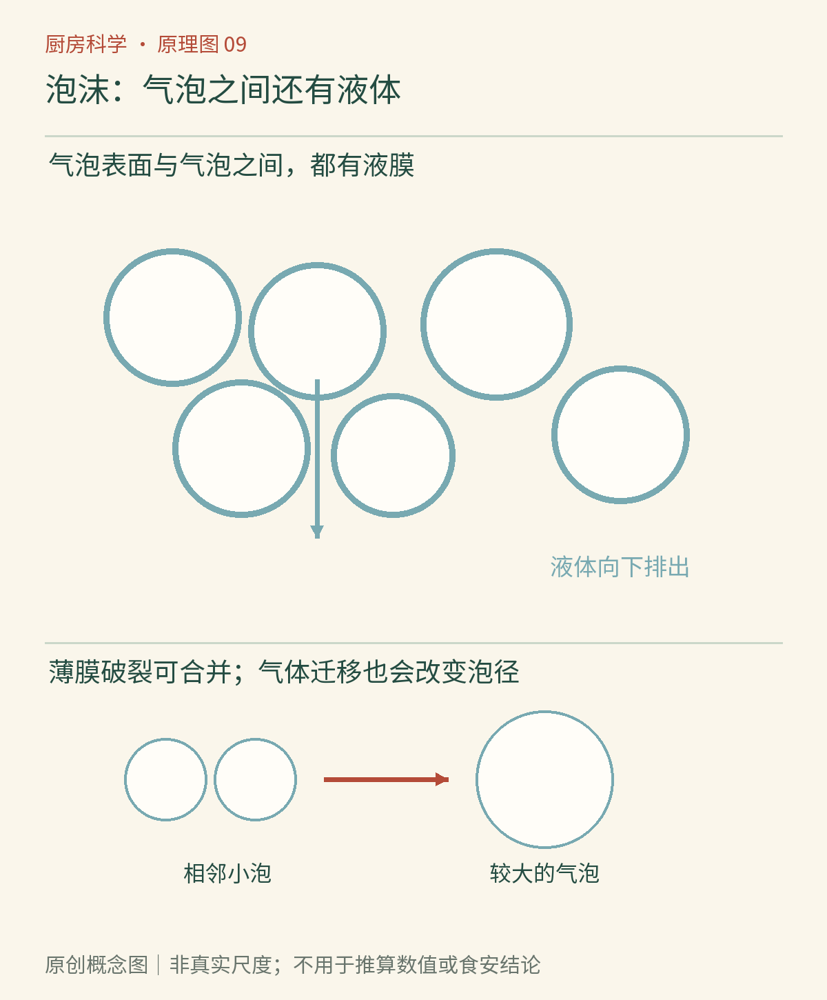

# 第09章　把空气吃进去：泡沫与打发

蛋清在碗里本来只是一层黏稠液体，打蛋器转动之后，却能堆出一座白色小山。体积增加的大部分来自空气，并不是凭空造出了更多蛋白质。奶油、蛋白霜和面包都能保留气体，但它们保留气体的方式不完全相同。

**泡沫**是气体以许多气泡分散在液体或固体中的体系。与上一章的乳状液相比，分散相从液滴换成了气泡。食物科学与技术学会指出，清水被搅动也能起泡，只是泡通常很快破裂；蛋清中的蛋白质能帮助气泡周围形成更稳定的界面层。[资料：IFST《蛋白质与泡沫形成》](https://www.ifst.org/lovefoodlovescience/resources/protein-foam-formation)

*AI漫画教学示意：体积变大表示空气被分散进去；提起工具时的形态帮助观察泡沫状态。食材拟人化不代表气泡有意寻找蛋白质，泡沫也不是完全由空气构成的空壳。*

## 气泡的外面仍然有水

打蛋器先带入空气，同时把大泡不断分割。蛋白质接触新形成的气液界面时，原有构象会部分改变，适于接触水与适于接触气体的区域重新安排。界面层相互作用，帮助气泡在邻居之间保持边界。实际蛋清含有多种蛋白质，不能把它想成一种分子按照同一方式整齐排列。[资料：探索馆《鸡蛋科学》](https://www.exploratorium.edu/explore/cooking/egg-science)

蛋白霜变白，与大量气液界面散射光有关。它变得能堆起形状，则与气泡数量、气泡间的薄液膜及整体流变性质有关。白与硬并不是同一个性质：一碗泡很粗的白色泡沫，也可能十分松散。

气泡变少有几条路。液体会在重力作用下向下流，薄膜因此变薄，叫排液；相邻泡之间的膜破裂，会让气泡合并；气体还可通过薄膜迁移，使一部分泡变大，另一部分泡缩小。因此“放久了塌掉”不是一种单独的反应，更不是空气全部突然漏出。

*原创概念图：沿气泡之间的边界辨认液膜，再观察液体向下移动和气泡变大的差别。圆圈与网络是结构示意，不是实际比例，也不能用图上的泡数估算食品的含气量。*

## 油为何会让蛋清打发困难

一滴油可能在界面上铺展、干扰蛋白质形成的保护层，或帮助薄膜局部破裂。蛋黄本来含有脂肪及其他成分，混入蛋清后会改变整个体系。这就是纯蛋清打发常要求碗与工具洁净、无油的原因。并不是所有含油食品都不能起泡；奶油恰好说明脂肪在另一套结构中能够帮忙。

奶油打发时，适当比例的脂肪处于结晶状态，脂肪球发生受控的部分聚结，形成能支持气泡的结构。若把“油破坏蛋白霜”推广成“脂肪必然消灭一切泡沫”，就无法解释打发奶油。研究乳制品泡沫的工作将这种部分聚结与完全油水分离明确区别。[资料：Goff《乳状液的部分聚结与结构形成》](https://pubmed.ncbi.nlm.nih.gov/9131189/)

温度因此具有不同作用：奶油太暖，脂肪结晶状态不利于建立所需结构；太冷又会影响打发速度与操作。应遵循具体奶油产品说明，而不是把任何温度数字当作所有脂肪的通用开关。

## 加糖以后，为什么更慢却可能更稳

糖溶于水相，会改变黏度和蛋白质所处环境。加糖时机与加入速度会影响起泡速度、气泡大小和成品结构。一次把大量糖倒进尚未起泡的蛋清，常比逐步加入更难迅速打出所需体积；这不意味着糖永远是坏事。烘烤或干燥后的蛋白霜需要糖参与建立口感与稳定性，目标不同，配方取舍也不同。

同样，配方中的少量食用酸可能帮助获得所需泡沫状态，但不能由此推导出“越酸越稳定”。酸度、浓度、蛋清状况和后续加热都相互影响。厨房里有用的经验常是条件句，不是无条件口号。

“硬性发泡”也不是越久越好。打发过度后，体系可能粗糙、干散并出现液体，难以均匀拌入面糊。把这种泡沫继续高速搅打，不会使它无限接近理想状态。判据应包括泡的细腻程度、光泽、提起工具的形态，以及配方需要的延展性。

## 从软泡沫变成固体泡沫

蛋白霜入炉后，气体受热膨胀，水分迁移和蒸发，蛋白质变化又帮助结构定形。若外壳很快固定而内部仍湿软，冷却时的收缩与压力变化可能造成裂纹或塌陷。成功烘焙需要让膨胀、失水与定形互相配合；“空气打得越多，成品越好”往往并不成立。

家庭观察可以只拍摄同一份泡沫在刚完成、静置后和完成烘焙后的状态，不必为了验证油的影响另外浪费生蛋。不要尝生蛋泡沫，也不要以“已经打得很白”判断卫生安全；选用适用的巴氏杀菌蛋制品并完成可靠配方要求的加工。若只是做观察样品，观察后直接处理，清洗工具。

## 起泡不一定来自打发

打开碳酸饮料时，气泡来自原先溶于液体的气体逐渐逸出；打发蛋清则主要依靠工具把外界空气带进去。两者最后都可能看到泡，但产生气体与保留气泡是两回事。饮料表面有很多大泡，也不等于它具有蛋白霜那样的持气网络。

比较泡沫时，不宜只用“最高时体积”排名。一个体系可能很快起出大量粗泡，却很快排液和塌陷；另一个增长较慢，细泡却保持更久。若目标是把泡沫拌进面糊，还要看它能否承受后续混合。最高、最硬、最稳定，往往不是同一个最优点。

同样，食物表面有泡不能用来判断是否发生发酵。沸腾、搅拌、蛋白质起泡和微生物产气，都可能让厨房里出现泡。先辨认气体的来源和环境条件，再谈泡沫为何存在，解释才不会被外观牵着走。

接下来把目光从气泡边界移向谷物。淀粉不会像打蛋器那样带入空气，却能让水变得难以流动，并帮助已经膨松的食品固定下来。

## 本章资料

- [IFST：Protein—foam formation](https://www.ifst.org/lovefoodlovescience/resources/protein-foam-formation)。
- [探索馆：Science of Eggs](https://www.exploratorium.edu/explore/cooking/egg-science)。
- [Goff，1997：Partial coalescence and structure formation in dairy emulsions](https://pubmed.ncbi.nlm.nih.gov/9131189/)，乳制品泡沫中脂肪结构的研究。
