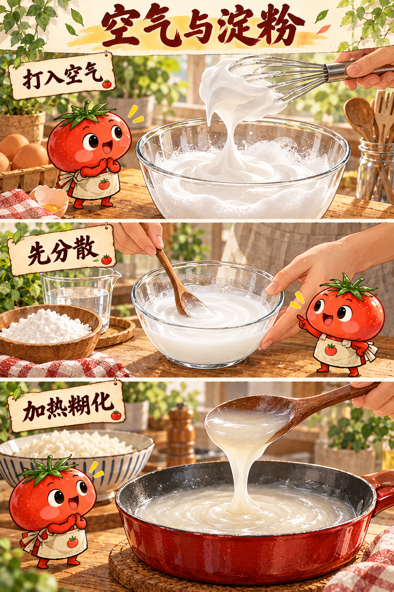
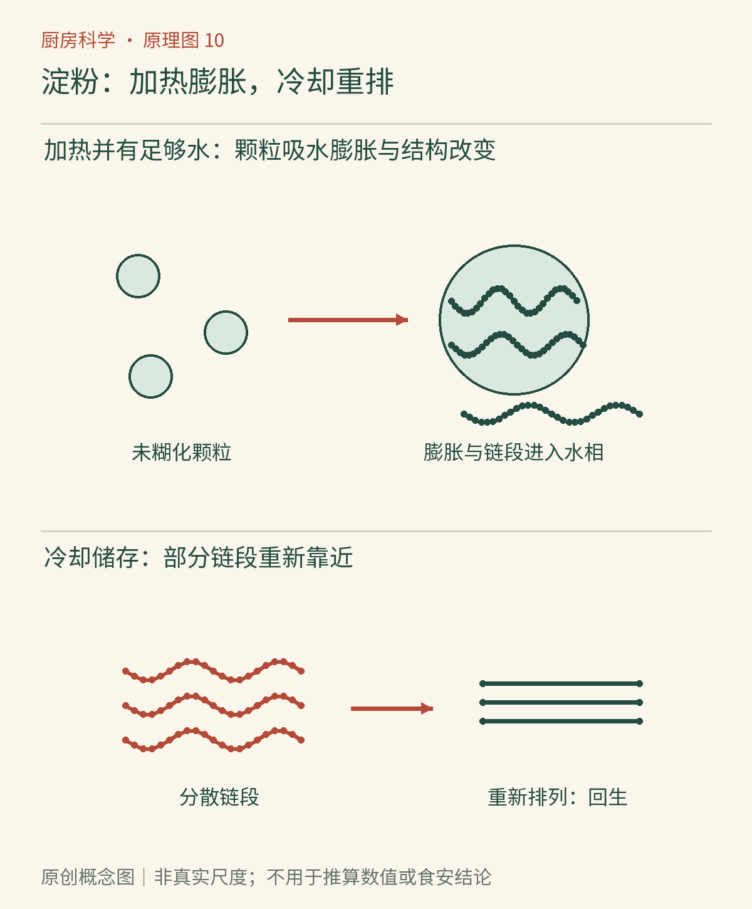

# 第10章　淀粉的旅程：米饭、面条与勾芡

一勺玉米淀粉放进凉水，会形成容易沉下去的白色悬浮物；加热并搅拌之后，液体可能变成能挂住勺子的稠芡。米饭由硬变软、米糕冷却后成形、面包隔夜变硬，都与淀粉有关，但不是同一件事反复发生。

淀粉是植物储存能量的一种多糖，主要由直链淀粉和支链淀粉构成。名称中的“直链”不是说它在食物里永远像拉直的绳子，只是说明连接方式以较少分支的链为主。植物把这些长链组织成颗粒；米、麦、玉米和马铃薯的颗粒结构与组成不同，因此不能把一种淀粉的表现推广到所有食材。

*AI漫画教学示意：从粉末、分散的浆液到加热后的稠糊，观察的是材料状态变化。米粒与稠芡不必拥有相同透明度；透明或乳白的外观还受淀粉来源、浓度和其他成分影响。*

## 糊化，需要水也需要热

原生淀粉颗粒在冷水里并不会像白糖那样迅速完全溶解。加热时，水进入颗粒，内部有序结构受到破坏，颗粒膨胀，一部分链段进入周围的水中；体系的黏度随之变化。把这组与颗粒内部有序结构损失有关的变化称为**糊化**。后续继续加热、搅拌、膨胀和破裂的表现，常又被放在“糊化成糊”或“糊浆化”的加工过程里讨论。[资料：美国烘焙学会《淀粉糊化》](https://asbe.org/article/starch-gelatinization/)

这里不存在对所有食物都有效的单一温度。淀粉品种、水量、糖与盐等成分都会影响观察到的转变。水很少的饼干与水充足的稀粥，即使同样在烤箱或锅里加热，淀粉也不一定达到同样的糊化程度。

稠芡像交通变拥挤了：膨胀颗粒与进入水相的长链让流动受到更多阻碍。这个比喻有助于理解黏度，却不意味着淀粉只是在吸水后保持原样；其内部排列已经发生改变。用“吸饱水”概括全过程，容易漏掉结构破坏和链段重新分布。

*原创概念图：把加热阶段的颗粒膨胀，与冷却储存阶段链段重新靠近分开看。图中的链条和颗粒不按实际尺度绘制，也不表示每种淀粉都有相同数量的分支。*

## 勾芡为何常先用凉水调开

干粉直接倒进热汤，外层粉末先遇热吸水、变稠，可能把内部尚未分散的粉包住，形成团块。先用少量凉水把粉均匀分散，再加入热汤并搅动，就能让许多颗粒较均匀地接触热水。凉水调浆主要解决分散问题，并不意味着凉水已经完成糊化。

加得越多也不一定越好。少量淀粉可以让汤汁附着在食材表面，过多则可能形成黏腻厚糊，掩盖原本的口感。持续猛烈搅动、长时间加热以及酸性条件，还可能改变颗粒和长链的完整性，使已经变稠的体系再次变稀。应根据配方在合适阶段加入，不能只盯着“第一次变稠”的瞬间。

同样的淀粉浆，刚离火与冷却后的流动性可能不同。因此要比较两种淀粉，须同时记录浓度、加热方式和观察温度；用一碗热浆去比较另一碗冷浆，容易把温度效应误当作品种差异。

## 米饭变硬，不只是水跑掉了

熟米饭放凉后，即使盖着盖子没有明显干燥，也会逐渐变硬。糊化后原先较分散的链段能重新建立部分有序排列，这叫**老化或回生**。它与重新形成有序结构有关，不等于变回完整的生淀粉颗粒。淀粉研究使用热学、结构和消化性等指标评估老化，说明这并非仅靠“摸上去硬不硬”就能完全描述的过程。[资料：原始研究《糊化与储存对米淀粉凝胶回生的共同作用》](https://ift.onlinelibrary.wiley.com/doi/10.1111/1750-3841.14633)

水分迁移、表面失水和淀粉重排可以同时发生。面包变陈也不只有“烤干了”这一个原因；因此把面包重新密封，并不一定能恢复新鲜时的柔软。再加热有时能使部分有序结构重新松动，口感暂时改善，但无法把所有储存变化完整倒转。

| 观察到的变化 | 主要要问的过程 | 不应直接等同于 |
|---|---|---|
| 凉水中粉末沉降 | 颗粒分散与沉降 | 完全溶解 |
| 加热后变稠 | 糊化及后续成糊 | 蛋白质凝固 |
| 冷却后更成形 | 链段建立网络、重排 | 食物已经变质 |
| 储存后变硬、析水 | 回生与水分迁移等 | 只有水分蒸发 |

## 从淀粉知识到日常判断

含较多直链淀粉与富含支链淀粉的食材，常表现出不同的黏弹性和冷却口感，但整粒米饭还受品种、加工、完整性与烹调水量影响。“长粒一定松、圆粒一定黏”可以是购买时的粗略经验，不能替代品种与做法信息。

冷却可能让部分淀粉对消化酶更不容易接近，但“放凉就没有热量”是错误推断。食物的总量、其他营养成分和个人消化反应仍然重要。更不能为了追求某种淀粉状态，让熟饭长时间放在室温。淀粉质地与微生物安全是两套问题，保存应按食安章节的及时分装冷藏方法处理。

一次安全的小观察可以用少量同浓度淀粉浆，拍下加热前、充分加热后和盖好冷却后的倾斜流动状态。不要用手接触热浆，也不要用观察样品试吃判断安全。真正的收获是看见：水没有消失，却因为其中材料的组织方式改变，变得难以流动。

## 糯，并不是含有另一种“胶水”

糯米的黏性与其淀粉组成、米粒结构及烹调过程有关，不能因为名字里有“糯”，就把它与小麦面筋混为一谈。糯米制品能够黏连，不代表它建立了与小麦面团相同的蛋白质网络。一个是以淀粉变化为核心的材料表现，另一个还依赖小麦蛋白质的黏弹性。

面条也不能只看淀粉。小麦面条中的蛋白质结构会影响煮制时的形状保持，米粉、粉丝又有不同的原料和加工历史。有些产品在制造时已经加热、冷却或干燥过，消费者下锅时处理的并非完全相同的起始材料。

因此，包上同样写着“淀粉”的两种粉，不应默认可以按同一勺数互换。先看原料与产品用途，再做小份比较，记录热时、冷时和储存后的表现。厨房里的选择不是寻找一包最好的粉，而是让结构适合菜肴。

## 本章资料

- [美国烘焙学会：Starch Gelatinization](https://asbe.org/article/starch-gelatinization/)。
- [Denchai 等，2019：Retrogradation and Digestibility of Rice Starch Gels](https://ift.onlinelibrary.wiley.com/doi/10.1111/1750-3841.14633)，糊化程度和储存条件的原始研究。
- [FAO：加工对膳食碳水化合物的影响](https://www.fao.org/4/W8079E/w8079e0j.htm)，关于淀粉加工与消化性的背景阅读。
