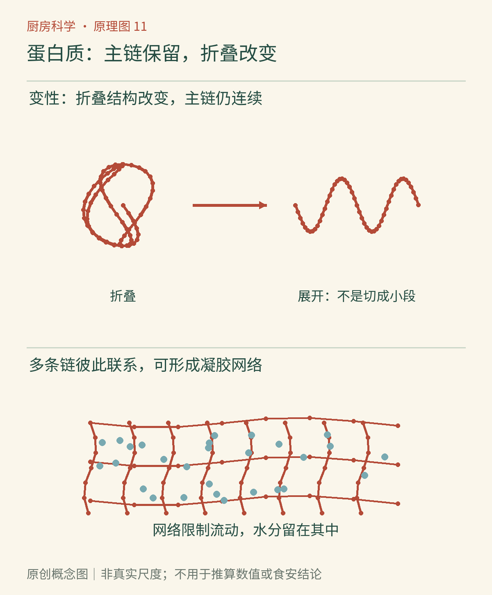

# 第11章　蛋白质的变化：鸡蛋、豆腐与肉

透明黏稠的蛋清遇热变白，豆浆经过加工能成为豆腐，肉在锅里收缩、变色。它们都包含蛋白质，但不能只用“蛋白质熟了”一句话解释。首先要把三个不同层次分开：一条分子的折叠、许多分子的聚集，以及食物整体的组织。

蛋白质由氨基酸连成的长链组成，氨基酸之间的主链连接叫肽键。链又会折叠成一定构象。当热、酸或其他环境因素使原有构象改变，叫**变性**。它通常不是把所有肽键切断；后者属于**水解**。夏威夷大学的营养学教材将烹调中的变性与消化时的蛋白质分解区别讨论，这是理解厨房变化的重要起点。[资料：夏威夷大学《烹调与蛋白质变性》](https://pressbooks.oer.hawaii.edu/humannutrition2/chapter/6-the-role-of-proteins-in-foods-cooking-and-denaturation/)

*图11-1｜AI漫画教学示意。上方生熟鸡蛋帮助辨认蛋白质凝固；中间豆浆与豆腐呈现网络形成前后的宏观差异；下方面团是另一种含蛋白质体系。画面省略加热、凝固剂等条件，不是完整制作步骤。*

## 鸡蛋凝固，是分子之间建立了关系

加热蛋清时，部分蛋白质构象改变，原来不容易接触的区域暴露出来，分子间的相互作用随之变化。许多分子聚集并建立贯通结构，水受到网络约束，宏观上就出现凝固。**变性描述单个或局部分子的结构变化，聚集与凝胶化描述分子之间和整体结构的变化**；它们相关，却不是完全相同的词。

继续强烈加热，网络可能变得更紧，排出一部分水，口感从细嫩转向韧硬。因此一个蒸蛋出现蜂窝孔洞或析水，不能简单解释成“水加少了”。蛋液组成、受热是否均匀、蒸汽和气泡、加热时间都可能参与。探索馆以温和与强烈加热蛋白质的对比说明：延长高热会让已经凝固的结构继续变硬、排液。[资料：探索馆《温和加热与鸡蛋蛋白质》](https://annex.exploratorium.edu/cooking/eggs/gentle.html)

一碗加水的蛋液也不是单纯被稀释的“蛋清”。蛋黄带来脂肪与乳化成分，水相比例影响可形成的网络，糖、盐和酸又会改变环境。各种蛋白质的热响应并不完全一致，所以“达到某个温度就瞬间全部凝固”只是过度简化。

*原创概念图：先辨认折叠状态改变，再辨认多条链之间形成联系。连续线表示主链仍然存在，节点与网络是概念表达，并非每个节点都代表某一种特定化学键，也不代表实际分子比例。*

## 豆腐不是把豆浆里的水全部挤掉

豆浆含有分散的蛋白质和油脂等成分。制作豆腐时，豆浆前处理、加热与凝固剂共同改变蛋白质相互作用。钙盐、镁盐等凝固剂与使用酸化机制的体系，作用路径有差异；最终形成能够保留大量水分的结构。压制可以进一步改变水分与孔隙，但不是豆腐形成的唯一原因。研究表明，豆浆蛋白质浓度和加热条件会改变凝固剂需求，说明配方不能只有“加一点凝固剂”这个变量。[资料：原始研究《豆浆特征和蒸煮条件对豆腐凝固剂需求的影响》](https://pubmed.ncbi.nlm.nih.gov/15161206/)

嫩豆腐与较硬豆腐的差异，要同时考虑豆浆固形物、凝固方式及压制等加工条件。用更多水泡一块硬豆腐，不会简单把它逆转成同样的嫩豆腐；已经形成的微观网络保留着加工历史。食材的性质不仅取决于“现在含多少水”，还取决于水被什么结构容纳。

豆腐也不因“已经凝固”而自动耐放。它含水多，购买、冷藏和开封处理仍须遵循产品说明；用于生食的适用性不能根据软硬程度判断。

## 肉的口感，来自两类结构的竞争

肉不是均匀的蛋白质糊，而是有方向的肌肉纤维及其周围结缔组织。烹调可使肌肉相关蛋白质变性、组织收缩和水分移动；另一方面，某些富含胶原的部位经过合适的湿热和时间，结缔组织会逐步软化。前一类变化可能使口感更紧，后一类可能使原本难嚼的部位更柔软。所以“肉越煮越硬”和“肉越炖越软”可以在不同部位与过程里都成立。[资料：FAO《肉的组成与质量》](https://www.fao.org/4/T0562E/T0562E02.htm)

这也解释了为什么不能给所有肉一个相同的最佳时间：薄片与大块的受热路径不同，里脊与筋腱较多的部位结构不同。切肉方向又影响咬断纤维需要经过的长度。烹调方案首先应识别材料，而不只是调大或调小火。

熟度风格与安全要求也要分开。肉色受肌红蛋白状态等因素影响，不能可靠代表中心已经达到安全条件；应使用食品温度计并遵循相应肉类的官方指南。[资料：USDA《肉类与禽肉的颜色》](https://www.fsis.usda.gov/food-safety/safe-food-handling-and-preparation/food-safety-basics/color-meat-and-poultry)

## 把观察写得更准确

下次比较两份按可靠方法充分加热的蛋羹，可记录表面是否光滑、切面孔洞、是否析水和勺舀时的断裂形态。不要只写“嫩”或“老”，因为这些词把几种性质混在一起。也不要把生食样品的品尝当成对照。

## 蛋白质变性，并不是营养凭空消失

蛋白质的折叠状态会影响功能，但改变折叠不等于把全部氨基酸变没。讨论营养时，要进一步区分蛋白质总量、消化利用和其他加工变化；仅凭食物变白或变硬，不能算出它还剩多少营养。把“变性”理解成“有毒”同样错误：这个词描述结构，不是健康评价。

用酸处理鱼肉或其他食材，表面可能变色、变得不透明，其中有蛋白质环境改变的作用；但外观像熟了，不等于获得与可靠加热相同的杀菌效果。本书把这种材料变化与食品安全分别判断，不把柠檬汁当作通用的生食安全保证。

同样一份食物，质地可以在冷却时继续改变。某些网络能够在温度改变后部分松开，另一些凝固过程则难以恢复原状；它们都叫蛋白质相关变化，却没有一个统一的“加水复原”办法。

蛋白质并不只是营养表里的一行数字。它可以形成边界、网络和纤维，而不同组织方式让鸡蛋、豆腐与肉拥有不同的烹调逻辑。到面团里，这种结构作用还会与气体和淀粉一起工作。

## 本章资料

- [夏威夷大学：Cooking and Denaturation](https://pressbooks.oer.hawaii.edu/humannutrition2/chapter/6-the-role-of-proteins-in-foods-cooking-and-denaturation/)。
- [探索馆：Effects of gentle versus high heat on egg proteins](https://annex.exploratorium.edu/cooking/eggs/gentle.html)。
- [Cai、Chang，2004：Effect of soy milk characteristics and cooking conditions on coagulant requirements](https://pubmed.ncbi.nlm.nih.gov/15161206/)。
- [FAO：Meat production and quality](https://www.fao.org/4/T0562E/T0562E02.htm)。
- [USDA：The Color of Meat and Poultry](https://www.fsis.usda.gov/food-safety/safe-food-handling-and-preparation/food-safety-basics/color-meat-and-poultry)。
