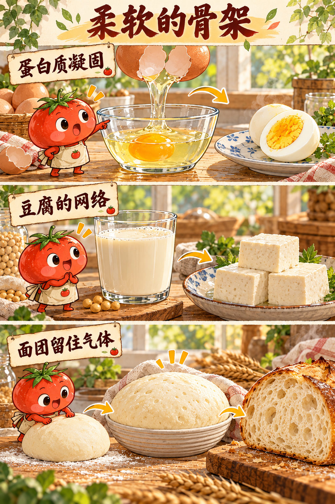
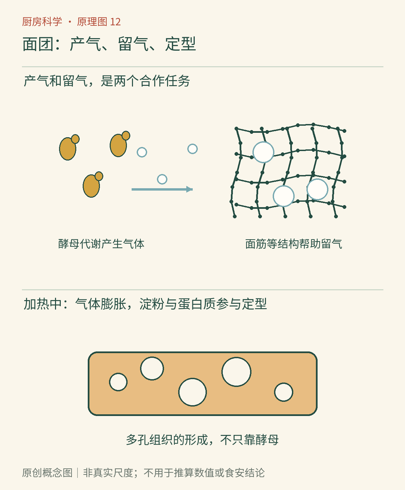

# 第12章　面团的骨架：面筋、酵母与膨松

同样是面粉和水，可以成为薄饼、面条、馒头或面包。差别不仅是有没有酵母，还在于面团怎样形成结构、气体从哪里来，以及何时被加热固定。把“发起来”与“撑得住”分开，就能读懂许多烘焙失败。

面粉不是单一的白色物质。它包含淀粉、蛋白质、少量脂质和其他成分。小麦粉中的麦谷蛋白与醇溶蛋白吸水后，在混合、揉制及静置过程中形成具有黏弹性的面筋网络。这里的**黏弹性**表示材料既能像黏稠液体那样缓慢改变形状，又能像弹性材料那样对拉伸产生回应。[资料：探索馆《面包科学入门》](https://www.exploratorium.edu/explore/cooking/bread-science)

*AI漫画教学示意：膨大说明气体使内部孔隙体积增加；成品切面则显示气孔被结构保留下来。外表变大不能证明发酵恰好，也不能由漫画中的孔洞推断某个精确配方。*

## 揉面不是把蛋白质“从无变有”

加水先改变蛋白质所处环境，使不同成分能够接触和重新组织。揉制帮助这种组织发展，也分散原先夹入的空气。静置时，水还会继续分布，体系发生松弛。所以刚混好的粗糙面团，放一会儿后可能更容易伸展，并不一定全靠再加水。

“筋度”也不是一个只由蛋白质总量决定的旋钮。面粉蛋白质性质、加工方式、配方水量和混合程度都重要。用相同重量的高筋粉和低筋粉，配同样水量后观察差别，有助于认识材料，但不能证明蛋白质含量是唯一原因。探索馆的面筋观察活动把吸水后的面筋作为结构材料展示，同时提醒不同面粉用于不同烘焙目标。[资料：探索馆《面筋观察》](https://annex.exploratorium.edu/cooking/bread/activity-gluten.html)

面条需要的延展与咬感，饼干需要的酥松，面包需要的持气与膨胀，并不相同。因此“面筋越强越好”不是普遍原则。油脂、糖和水的分配也会改变网络发展；它们不是只负责香甜的配角。

*原创概念图：把产气来源、保留气泡的材料和加热定形分别识别。线网表示整体黏弹性结构，不是均匀的真实蛋白质网格；气孔尺寸与分子尺度不能在同一图上按比例表示。*

## 酵母制造气体，网络保留气体

面包酵母是微生物，会利用可利用的糖进行代谢并产生二氧化碳等产物。面粉中的酶能把部分淀粉分解成较小的糖，为这个过程提供来源。产生气体与使面团膨大之间，还隔着一个必要条件：面团必须能保留和扩展已有气泡。

如果把产气看作给房间送入空气，面团网络就是能伸展的墙。墙太脆，气体逃走；墙太紧，难以膨胀；放得过久后结构状态改变，也可能撑不住。这个比喻说明分工，不意味着每个气孔都由酵母新造一个洞：混合时带入的微小气泡可成为后续膨大的起点。

酵母并不认识钟表。同一配方在不同温度、面团量和酵母状态下，发酵速度会不同；糖、盐及酸度也会影响环境。配方给的时间是条件下的参考，体积、触感和结构变化才是需要一起观察的过程信息。不能为了更快而任意提高温度，也不能以气味判断微生物是否安全。

## 泡打粉、小苏打和酵母为什么不能随意互换

小苏打是碳酸氢钠，常需配方中的酸和水等条件配合产生气体；泡打粉将产生气体所需的酸碱成分按产品设计组合，其中一些在混合和加热阶段有不同响应。酵母则依靠生物代谢，时间尺度和风味贡献不同。它们都可能使食品膨松，却不代表能用同样重量直接替换。

| 需要解决的问题 | 主要负责者 | 单独做好仍可能失败的原因 |
|---|---|---|
| 气体从哪里来 | 酵母代谢或化学膨松剂 | 面团保不住气 |
| 气孔如何扩展 | 黏弹性结构与水分条件 | 结构过弱或过紧 |
| 如何固定成品 | 受热后的蛋白质与淀粉变化 | 定形时机与膨胀不匹配 |
| 为什么有香气和表皮 | 发酵、加热和表面失水等 | 配方与加工条件不同 |

## 入炉后，气体仍在变化

烤箱里的最初膨胀，不全是酵母突然更努力。已有气体受热膨胀，部分水变成蒸汽；随后微生物不再继续活动，蛋白质和淀粉的变化使结构逐渐固定。表层与内部接触的温度、含水状态不同，形成面包皮和内瓤的差别。

蒸馒头与烤面包都能把面团变成定形食品，但周围环境不同：湿润蒸汽与较干燥的烘烤环境，让表面失水和上色表现不同。因此颜色浅不代表没有熟，颜色深也不能保证内部已经加工充分。

观察成品时，可以把一片面包轻轻按下，看看恢复程度；再拍摄切面，描述孔洞是否均匀、是否存在大空洞和黏湿线。诊断时先提出几个候选原因，再回看发酵、整形和烘烤记录，不要只凭一张切面给出确定结论。

未加热的面粉同样可能携带致病微生物，不要生尝面团，也不要把揉面或发酵当作杀菌步骤。FDA建议按配方充分烹调，并在接触生面粉、面团和生蛋后清洁手、工具及台面。[资料：FDA《安全处理面粉》](https://www.fda.gov/food/buy-store-serve-safe-food/handling-flour-safely-what-you-need-know)

## 没有面筋，也可以拥有气孔

面筋是小麦面包的重要结构，却不是所有膨松食品都必须依靠的唯一材料。米糕、部分无麸质烘焙食品，可以借助其他淀粉、蛋白质和配方结构保留气体；蛋糕还可能同时依赖蛋泡、油脂打发和化学膨松。它们需要的不是假装有小麦面筋，而是用适合的材料解决持气与定形问题。

这也解释了为什么把小麦粉全部换成另一种粉，常不能只改名称而保持配方不动。吸水、黏度、气孔扩展和定形过程可能一起改变。对有特定膳食需要的人，产品的原料标识与交叉接触管理又是额外问题，不能根据“看起来像米粉”判断适用性。

比较蒸制与烘烤时，最好用原本适合相应方法的可靠配方。否则成品差别可能来自配方不匹配，不能都归因于加热设备。控制变量的前提，是知道哪些条件本来就相互依赖。

面包把气体保存在已经定形的结构里；下一章的果冻则展示另一种柔软：不必大量含气，也能让一大份水获得形状。

## 本章资料

- [探索馆：Bread Science 101](https://www.exploratorium.edu/explore/cooking/bread-science)。
- [探索馆：Great Balls of Gluten](https://annex.exploratorium.edu/cooking/bread/activity-gluten.html)。
- [FDA：Handling Flour Safely](https://www.fda.gov/food/buy-store-serve-safe-food/handling-flour-safely-what-you-need-know)。
