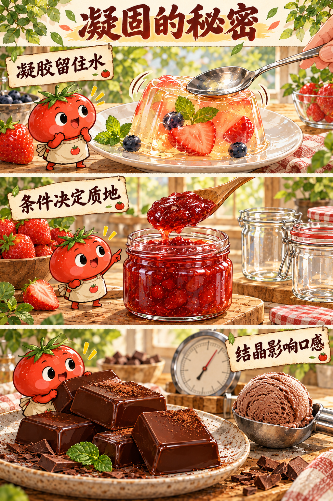
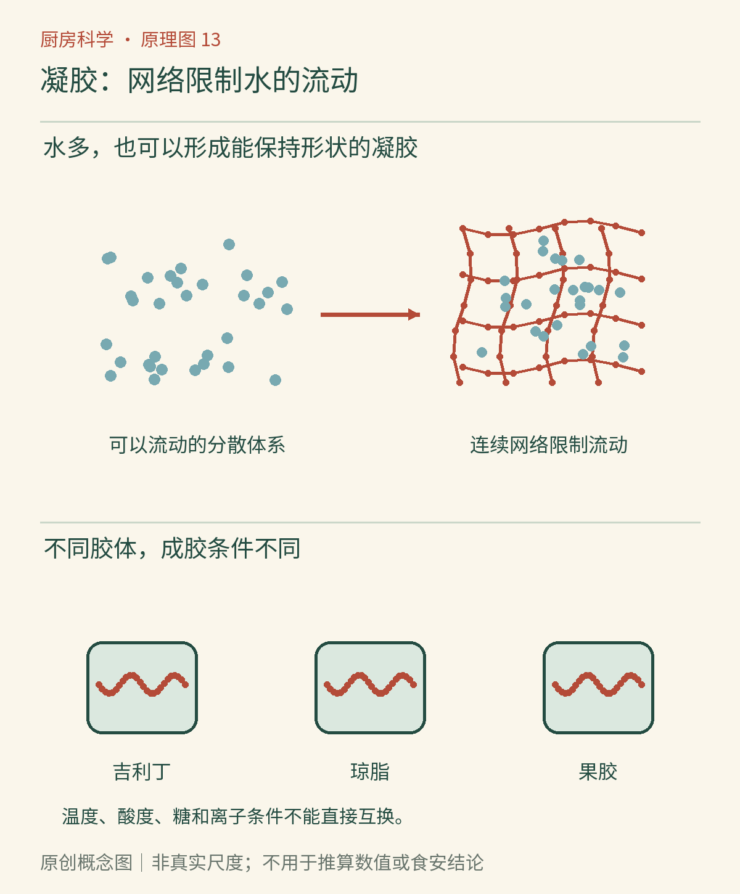

# 第13章　柔软的网络：果冻、果酱与凝胶

一杯果汁会流动，一块果冻却能摇晃着保持形状。果冻里面的水并没有全部变成固体冰。少量能建立网络的材料，让大量液体受到约束，形成了介于日常“流体”和“固体”直觉之间的口感。

**凝胶**通常由贯通的网络与其中的液体共同构成。网络可以由蛋白质、多糖或其他适合的材料形成；它对小幅变形有一定抵抗，却可能在更大作用力下断裂。稠糊与凝胶不完全相同：蜂蜜很稠，但静置时仍会缓慢流平；一块果冻能够在一定时间和条件下保持自身形状。

*AI漫画教学示意：观察舀取、切开和摇晃时形态的差别。柔软与坚硬不是两种凝固剂的永久标签，同一种材料也会因浓度、配方和温度改变口感。*

## 吉利丁：从胶原到可逆的柔软

吉利丁又称食用明胶，是动物胶原经适当加工得到的蛋白质材料，并不是把完整胶原直接撒进水里。它在温水等适当条件下分散、溶解，冷却后链段间形成连接区域，建立能保留水分的网络。加热可使网络松开，因此许多吉利丁凝胶具有热可逆性。凝胶强度与原料等级、用量、温度和处理过程有关，不宜把某个示例配方的用量当作统一比例。[资料：美国烘焙学会《明胶》](https://asbe.org/article/gelatin/?topic=ingredient)

吉利丁的柔软、弹性与口腔中的融化表现，使它适合某些慕斯和甜点。但“有弹性”不是判断是否成功的唯一标准：需要倒扣成形的甜点与杯装软冻，目标结构本来就不同。若用量过高，只追求牢固，可能得到不符合预期的韧口感。

## 琼脂：同样会成胶，却不是植物版吉利丁

琼脂主要来自某些红藻，属于多糖材料，与蛋白质吉利丁的化学组成不同。它需要按产品说明充分加热溶解，冷却后形成网络；其成胶与熔化发生在不同的温度范围。这种明显的温度滞后，使琼脂凝胶在温暖环境中通常比普通吉利丁凝胶更能保持形状。[资料：FAO《琼脂的性质与用途》](https://www.fao.org/4/y4765e/y4765e06.htm)

这不等于琼脂甜点能够放心常温储存。结构耐热描述凝胶是否熔化，微生物安全描述食品是否适合食用；牛奶、果汁或其他配料仍可能要求冷藏。更不能把琼脂、吉利丁按勺数直接一比一替换。两者的凝固条件、断裂方式和口腔感受不同，替换需要重新选择可靠配方。

*原创概念图：共同点是网络限制液体的整体流动，不同点是链的性质和连接条件。图中的网线与连接点不代表三种材料拥有相同分子结构，也不按真实尺寸绘制。*

## 果胶：水果中的材料，需要合适伙伴

果胶是与植物细胞壁有关的一类多糖。传统果酱中，某些果胶需要合适的酸度、糖含量和配方条件，才容易形成预期凝胶。煮制一方面释放和分散原料成分，另一方面浓缩水分，但“熬到足够干”不是唯一机制。果实成熟程度、品种和果胶种类都会影响结果。

低糖果酱并不必然意味着它没有凝胶结构。低甲氧基等特定果胶可借助钙离子等条件形成网络，适用于相应的低糖产品。美国国家家庭食品保存中心明确区分传统配方与采用特定果胶的低糖配方；减少糖之后，成胶和保存条件都需要重新考虑，不能自行删掉传统罐藏配方中的糖就宣称等效。[资料：NCHFP《果酱、果冻与橘皮酱的一般信息》](https://nchfp.uga.edu/how/make-jam-jelly/jams-jellies-general-information/general-information-on-canning-jams-jellies-and-marmalades/)

| 材料 | 主要来源与类别 | 理解配方时应关注 |
|---|---|---|
| 吉利丁／明胶 | 动物胶原加工所得蛋白质 | 溶解、冷却、用量与熔化表现 |
| 琼脂 | 红藻来源多糖 | 充分溶解、冷却成胶、成胶与熔化温差 |
| 果胶 | 植物来源多糖 | 具体种类，以及糖、酸、钙等条件 |

## 不凝固、过硬和出水，是不同问题

液体一直不凝固，可能是材料没有按说明充分分散或溶解，也可能是配方条件不匹配。吉利丁体系加入某些含活性蛋白酶的新鲜水果，会让蛋白质链受到分解，网络难以建立；换成经过合适热处理的水果，酶活性可能不同。这类变化的关键是原料加工状态，而不是某种水果“天生不能做果冻”。具体用法应依可靠配方，不能只凭水果名称调整。[资料：ACS《水果酶对明胶作用的教学研究》](https://doi.org/10.1021/ed076p624)

已经成形却太硬，则往往不是同一个问题。用量、总液体量和所需口感可能不匹配。凝胶静置后出水，又涉及网络收缩、水分重新分配或结构变化。它可以是一种品质变化，但不能反过来推断“只要不出水就安全”。

“加热能重新融化”也不等于可以无限次反复加工。长期高温或不适当酸度可能改变长链，重新加热还会改变水量与风味。厨房材料记得自己的加工历史，简单回到相同温度未必能回到相同状态。

## 用勺子描述材料

不必另外购买一排凝固剂。可以比较正规售卖的果冻、果酱和一份按可靠配方制作的熟制布丁，分别记录：倾斜时是否流动、勺子切入时是断裂还是拉伸、放回后能否流平。配料不同，不能把结果当成单一材料实验；但这种观察能让“Q弹”“浓稠”“入口化开”变成更具体的描述。

## 凝住水，与把水冻成冰不同

把果汁冻硬，主要依赖水形成冰晶；把果汁做成果冻，主要依赖凝胶网络。冷冻过的果冻解冻后可能出水或失去细腻，因为冰晶形成和水分重新分配会改变原来的网络。冷冻并不是普通冷藏的加倍版本，它可能给材料引入一类全新的结构变化。

凝胶还可以帮助理解“切得开”和“搅得动”的差别。一个体系能在勺子下断成整块，另一个沿勺子缓慢变形，即使两者都被日常语言叫作稠，也可能有不同的内部连接方式。观察断面、恢复与流平，比只比较摇晃幅度更有信息。

实际食品常包含不止一种成胶或增稠材料。配料表里同时出现果胶、淀粉或其他胶体，不应直接断定它们完全重复；配方可能需要分别控制悬浮、析水、入口感和加工耐受。判断用途应回到材料要解决的问题。

凝胶让我们认识了网络；巧克力和冰淇淋则还需要另一类组织方式：晶体。它们同样能决定柔软、脆裂和细腻，却不该与凝胶混为一谈。

## 本章资料

- [美国烘焙学会：Gelatin](https://asbe.org/article/gelatin/?topic=ingredient)。
- [FAO：Agar](https://www.fao.org/4/y4765e/y4765e06.htm)。
- [NCHFP：General Information on Canning Jams, Jellies, and Marmalades](https://nchfp.uga.edu/how/make-jam-jelly/jams-jellies-general-information/general-information-on-canning-jams-jellies-and-marmalades/)。
- [佐治亚大学：Pectin for Home Food Preservation](https://fieldreport.caes.uga.edu/publications/C1373/pectin-for-home-food-preservation/)，果胶类型与适用条件的进一步阅读。

- [ACS，1999：Soup or Salad? Investigating the Action of Enzymes in Fruit on Gelatin](https://doi.org/10.1021/ed076p624)。
