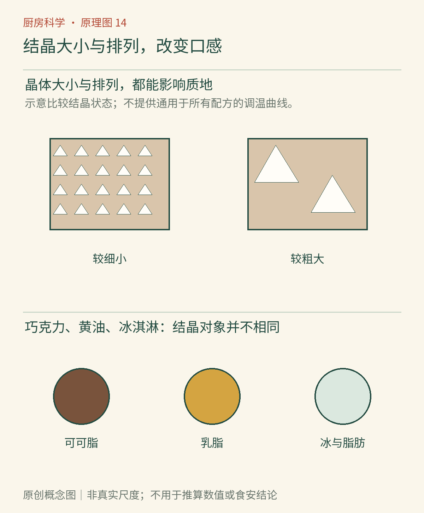

# 第14章　结晶的手艺：巧克力、黄油与冰淇淋

同一种巧克力，经过不同加热和冷却，可能一份光亮、掰开清脆，另一份发灰、柔软或带白纹；同一盒冰淇淋，储存稳定时细腻，反复温度波动后却有粗硬冰粒。配料没有明显改变，组织方式已经改变。

**晶体**是物质在一定尺度上有序排列形成的结构。厨房里的糖晶、冰晶和脂肪晶体，材料与性质各异。结晶不是“坏东西析出来”的统一名称；少量、合适种类与尺寸的晶体，恰好可能是好口感的基础。

*图14-1｜AI漫画教学示意。下方巧克力表面和冰淇淋形态引出结晶与口感；上方果冻和中间果酱则提示成胶也能改变质地。漫画没有展示实际晶体或粗细冰晶对照，不能仅凭光泽鉴定晶型或食品安全。*

## 巧克力并非只有一个凝固终点

巧克力包含可可脂，以及分散在其中的可可固形物、糖等颗粒；不同品种还含乳成分等。可可脂由多种甘油三酯组成，能够形成不同的晶体排列，也就是**多晶型**。物质化学身份相同或相近，排列方式不同，熔化表现、光泽和断裂性质就会变化。

调温的目标，是通过受控的熔化、冷却和再调整，建立适合成品的晶核和结晶结构。它不等于“融化后随便放凉”，也不只是把温度计停在一个神奇数字。配方、搅拌、已有晶体与时间都参与结果。ACS的巧克力调温综述还指出，仅盯着某一种理想晶型不足以解释所有起霜和微观稳定性问题。[资料：ACS《巧克力调温：一种研究视角》](https://doi.org/10.1021/acs.cgd.5c00269)

一块巧克力掰起来清脆，是整体材料的表现，不是用耳朵直接听到了某种晶型。家庭操作可依据产品建议和可靠调温方案，观察少量样品成形后的光泽与断面；不同黑巧克力、牛奶巧克力与白巧克力不应套用一条温度曲线。本章解释机制，不把某个示例温度误写成全部巧克力的通用处方。

*图14-2｜原创概念图。上方比较细小与粗大晶体的概念，下方区分巧克力中的可可脂、黄油中的乳脂，以及冰淇淋中的冰与脂肪。图形不是实际晶胞，也不是通用调温曲线；晶型与晶体大小是需要分别讨论的问题。*

## 两种“白霜”，不能与霉变画等号

脂霜与脂肪迁移、结晶和结构变化有关；糖霜则涉及表面糖被水分局部溶解，再重新结晶。冷巧克力接触温暖潮湿空气时，凝结水可能为后一路径创造条件。ASHRAE的食品储存资料将糖霜与潮湿、冷凝及水分迁移联系起来，说明储存不只要考虑温度，也要考虑湿度和包装。[资料：ASHRAE《巧克力与糖果的储存》](https://handbook.ashrae.org/handbooks/R18/SI/R18_Ch42/r18_ch42_si.aspx)

起霜通常首先是品质和结构问题，**但看到白色不能自动认定只是起霜**。巧克力夹心、受潮污染、包装破损和储存历史会改变判断条件。若有疑似霉状生长、异常气味或无法确认的污染，应停止食用，不用试吃验证。外观相似的结果可能来自不同机制，这是科学判断与“凭经验看一眼”的区别。

即使调温得当，温度波动和较长储存也仍可能影响品质。良好加工并不等于材料此后永远不变；晶体与脂肪的组织会继续随环境演变。

## 黄油为什么能抹开，又能支撑形状

黄油不是一块均匀纯脂肪。它包含脂肪、水滴和其他乳成分，脂肪也不是在单一温度一起熔化。某个温度下，部分脂肪为液态，另一部分形成晶体网络；两者比例与组织影响硬度及可塑性。太冷时难以抹开，太暖时结构支撑减弱，不能简单归结为黄油里“水多或水少”。

因此糕点配方指定软化黄油、冷黄油或融化黄油，是在指定不同材料状态。把软化步骤直接换成加热融化，即使最终称量相同，也可能改变打入空气、包覆粉粒或形成层次的过程。质量一样，历史与结构不一样，功能也就不一样。

这条思路同样适用于冷冻面团：升温后摸起来仍冷，不表示内部脂肪晶体比例、分布和面团网络都回到原来。工艺中的等待时间不是空白，而是材料继续改变的时间。

## 冰淇淋为什么不只是甜味冰块

冰淇淋同时具有冰晶、气泡、脂肪相关结构，以及没有冻结的浓缩水相。糖和其他溶质使水不在同一个瞬间全部冻结；冰晶尺寸又影响舌头感受到的颗粒。圭尔夫大学的冰淇淋教材把冰晶结构与储存中的再结晶作为独立主题，强调温度波动会改变晶体大小和分布。[资料：圭尔夫大学《冰晶所提供的结构》](https://books.lib.uoguelph.ca/icecreamtechnologyebook/chapter/structure-from-the-ice-crystals/)

较小、分布适宜的冰晶有利于细腻口感；温度波动中，一部分小晶体熔化，水分随后重新分配和冻结，较大晶体可能继续长大。重新冻硬并不能保证恢复原来的细腻。这个变化叫再结晶，不需要把整盒冰淇淋完全融成液体才开始发生。

空气与脂肪结构也不可忽略。某些冰淇淋即使部分冰晶已经融化，外形仍能暂时支撑；整体塌陷还与稳定泡沫的结构破坏有关。把“融化得慢”直接解释成“添加了不能吃的化学物质”，既忽略配方也忽略结构。[资料：圭尔夫大学《冰淇淋的融化与塌陷》](https://books.lib.uoguelph.ca/icecreamtechnologyebook/chapter/ice-cream-meltdown/)

购买与食用时，减少冷冻食品不必要的温度波动，有助于保持品质；但质地粗糙与食安风险也不能互相替代。是否能够继续食用，还取决于温度、时间和污染等信息，不以“再冻硬了”作保证。

## 细腻的颗粒，为什么仍然能被察觉

巧克力里既有脂肪晶体，也有糖和可可固形物颗粒；冰淇淋里则同时有冰晶和其他结构。吃起来粗糙，只说明某些结构已经影响口腔感受，不能只凭舌头就断定是哪一种晶体变大了。要做严谨判断，需要结合配方、处理历史与适合的测量。

这也是感官观察的长处与边界：我们能可靠记录同条件下样品是否更沙、更蜡、更脆，却不能把这些词直接换算成化学结构。调温观察可以设定相同厚度、同样冷却环境，再比较成形时间和折断表现，避免把薄片与厚块的差异误判成调温效果。

甜点制造把化学、物理与工艺接在一起。材料成分给出可能性，晶核和温度历史决定组织路径，最后才成为舌头感到的细腻。每一层都值得观察，也都不能由另一层完全代替。

这些甜点把一个共同道理变得可口：配料表告诉我们有什么，加工与储存决定它们怎样排列。下一篇将从结构转向反应，追踪烤香、颜色和新风味的来路。

## 本章资料

- [Stobbs 等，2025：Chocolate Tempering—A Perspective](https://doi.org/10.1021/acs.cgd.5c00269)。
- [ASHRAE：Chocolates, Candies, Nuts, Dried Fruits, and Dried Vegetables](https://handbook.ashrae.org/handbooks/R18/SI/R18_Ch42/r18_ch42_si.aspx)。
- [圭尔夫大学：Structure from the Ice Crystals](https://books.lib.uoguelph.ca/icecreamtechnologyebook/chapter/structure-from-the-ice-crystals/)。
- [圭尔夫大学：Ice Cream Meltdown](https://books.lib.uoguelph.ca/icecreamtechnologyebook/chapter/ice-cream-meltdown/)。
