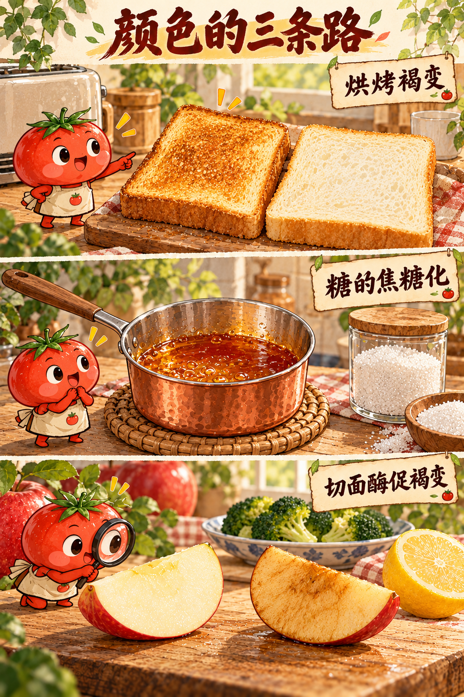
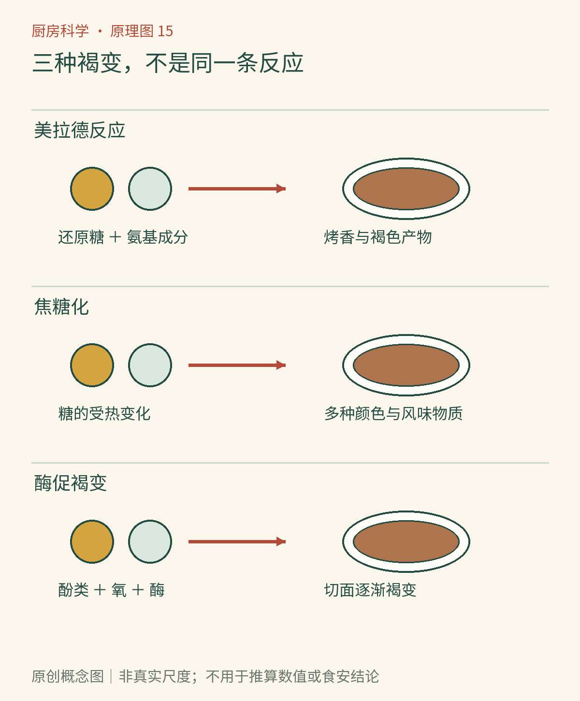

# 第15章　褐变的三条路：烤香、焦糖与切面

一片面包在烤箱里变成金黄，一锅糖浆慢慢转为琥珀色，一瓣刚切开的苹果却在餐桌上悄悄发褐。颜色相似，经历并不相同。厨房里的“上色”不是一个反应的名字，而是一组现象的总称。辨认它们，不能只盯着成品有多棕，还要看原料、温度、时间以及是否需要氧气。

*AI漫画教学示意。按图中原料与处理方式辨认三种情境：烤面包、加热糖、放置切开的苹果。拟人表情仅帮助记忆，颜色深浅不能用来反推具体反应比例。*

## 面包皮为什么比面包芯香

美拉德反应从还原糖的羰基与氨基化合物相遇开始，随后经历重排、分解和多条后续反应，产生一系列有气味的物质以及有颜色的产物。“糖加蛋白质”是容易记的入口，但真正参与起始反应的是其中合适的化学基团，游离氨基酸也能参与。它不是一种香味分子的制造公式。[美国化学会：美拉德反应](https://cen.acs.org/articles/89/i47/Maillard-Reaction.html)梳理了这类反应的发现背景；名称来自法国化学家路易—卡米耶·美拉德在20世纪初的研究。

同一片面包的外皮与内部，原料很相近，烤后的差异却很大。表面与热空气、烤盘接触，水分不断散失；内部仍含较多水，能量持续用于加热与水分变化。于是表面比较容易进入明显上色、释放烘烤香气的条件。把湿面包直接放在热锅里，最初的一段时间主要在赶走水，表面干一些以后，上色才往往显著加快。

水分的影响并不是“越干越好”。反应物需要有机会移动并相遇，极端干燥也可能限制反应；水太多又会稀释反应物，并限制开放湿表面的升温。温度、酸碱度、糖与氨基化合物种类共同决定结果。因此，“到了某个温度才突然发生美拉德反应”不是准确的通用开关：较低温度下也能缓慢发生，日常煎烤只是让变化快到能在几分钟内看见。[美国烘焙学会：美拉德反应](https://asbe.org/article/maillard-reaction/)可作为条件比较的旁读。

## 糖能自己变成焦糖

锅里只有糖与水，没有加入奶、蛋或肉，也能形成焦糖色。这条路主要是糖受热后的分解、脱水、重排与进一步组合，称为焦糖化。不同糖、不同酸碱环境与含水条件，变化速度并不相同，不能把一个温度数值当作所有糖浆的共同起点。[美国烘焙学会：焦糖化](https://asbe.org/article/caramelization/)特别强调其反应的复杂性以及与美拉德反应的区别。

湿法熬糖的前期，水逐渐蒸发，糖液越来越浓；继续加热才会进入明显的色香变化阶段。干法加热也能做出焦糖，但局部受热与混合状况更难控制。成品颜色来自复杂混合物，而非“糖分子被烤成棕色”这样单一的动作。加入奶油后，体系又出现蛋白质、脂肪和更多水，美拉德反应、乳化以及水分变化可能同时参与，不能再把整锅变化只叫作纯糖的焦糖化。

这也解释了洋葱炒甜的常见误会。受热会软化组织、释放和浓缩已有可溶性物质，并改变辛辣成分；如果继续炒到褐色，多种非酶促反应都可能发生。“焦糖化洋葱”是烹饪名称，不意味着锅里只有焦糖化。观察到甜味增加，也不足以证明刚刚制造了大量新糖。

*原创概念图。读图时依次核对“参与者—触发条件—可见结果”。美拉德反应与焦糖化可以并行；酶促褐变另有酶参与。示意箭头省略了大量中间步骤，不表示反应只有一步。*

## 苹果不必进锅也会变褐

完整苹果把许多物质分隔在细胞不同部位。刀切破坏组织后，原来隔开的酶与底物更容易接触，空气中的氧也到达切面。多酚氧化酶参与把酚类物质转变为较易继续反应的物质，后续形成有颜色的产物。这就是酶促褐变。它与烤面包的机制不同，也不要求表面高温。

用两块同一苹果的切片作观察，一块保持原样，另一块表面均匀薄涂柠檬汁，记录一段时间内切面的变化，通常能看出处理差异。柠檬汁的酸度及其中抗氧化成分会影响这条反应链，但它不是万能的“停止键”，效果还与品种、浓度和涂布状况有关。[美国化学会：减缓苹果褐变](https://www.acs.org/education/celebrating-chemistry-editions/2021-ncw/slowing-apple-browning.html)提供了对照活动。观察用样品不再食用，也不把褐变速度当作食品安全检测。

## 一个变量，比三句口诀更有用

做一次面包片观察时，可以取同一片面包切出的两块，保持厚度与初始温度相近，在可靠器具中用相同设置加热不同时间，记录表面干燥、颜色和边缘的变化。不要为了“对照”故意把一块烤到焦黑。若换成不同品牌面包，含糖量、含水量和配方都改变了，就不能把颜色差异全归给时间。实验结论越具体，越容易在下一次做饭时复用。

再想想煎蘑菇：装锅太满时，释放的水积在锅里，许多位置会经历较长的湿热阶段；分批处理则改变了水分蒸发与表面接触的条件。两次结果不同，并不需要解释成“锅把香气锁住”或“水把香气冲没”。把装锅量、原料大小与搅动方式写下来，我们就能用可观察的过程替代含糊的厨房传说。这样的推理仍有边界：仅靠肉眼不能量出美拉德反应、焦糖化各贡献了多少颜色。

## 用过程选择想要的颜色

想要面包表面烤香，应关心表面水分与受热是否均匀；想要浅色苹果，应关心切面暴露、酸度与放置时间；想要焦糖风味，才去观察糖液的浓缩与后续变色。把三类变化都叫“氧化”会丢掉关键区别，把它们都叫“烤焦”也一样。

褐色并不自动意味着有害，也不自动意味着更美味。适度上色与持续焦黑不是同一目标；不需要用烧焦程度证明火力强。熬糖尤其不能作为随意伸手触碰的观察：浓糖液黏附性强，温度高，试味和加液飞溅都会造成烫伤。本章建议用面包与苹果作低风险对照，不要求读者自行熬焦糖。

下一次看到菜变色，可以先记下四件事：原料里有什么，是否加热，表面是否湿润，是否接触空气。它们比一个孤立的颜色词更能帮助我们理解锅里的变化。蔬果还有另一组颜色故事：有时它们并未生成棕色产物，而是原有色素换了状态。

### 本章资料

- 美国化学会，[美拉德反应](https://cen.acs.org/articles/89/i47/Maillard-Reaction.html)。
- 美国烘焙学会，[美拉德反应](https://asbe.org/article/maillard-reaction/)与[焦糖化](https://asbe.org/article/caramelization/)。
- 美国化学会，[减缓苹果褐变](https://www.acs.org/education/celebrating-chemistry-editions/2021-ncw/slowing-apple-browning.html)。

