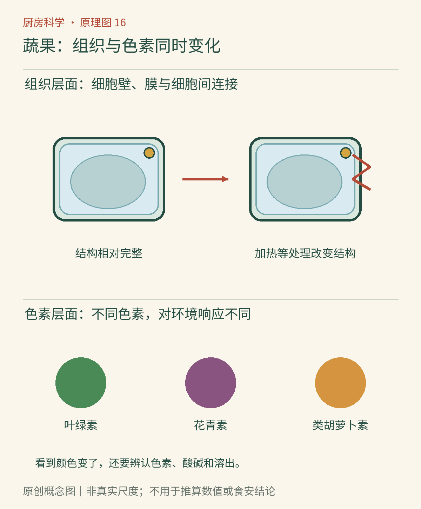

# 第16章　蔬果的颜色与脆度：细胞如何改变

青菜刚下锅时显得更绿，久煮后却暗淡；紫甘蓝遇到柠檬汁会偏红；黄瓜放久了会软，胡萝卜炖过以后也会软。颜色和软硬不是彼此无关的两张成绩单，它们都受食材内部结构与环境影响。但颜色好看不代表营养全保留，质地柔软也不代表细胞壁已经完全消失。

*图16-1｜AI漫画教学示意。关注下方苹果切面的颜色变化，再与上方烤面包和中间加热糖比较。它们都能变棕，却不对应同一种机制。本章另用原理图解释蔬果细胞与色素，不从本图推断所有蔬菜的最佳颜色。*

## 一口脆感来自多层结构

把一片生黄瓜想成许多装水的小单元组成的组织，比把它想成一块均匀的海绵更有用。植物细胞有细胞壁，内部液体对结构产生压力；相邻细胞之间还存在让组织连接的材料。当牙齿压下去，细胞与细胞间连接逐步破坏，水分释放，加上断裂产生的声音，形成“脆”的经验。

细胞壁不是只由一种物质搭成。纤维素等成分提供框架，果胶与相关多糖参与组织的黏结和结构。加热可以破坏膜的完整性，并改变果胶等物质的状态，细胞间更容易分离，蔬菜于是变软。联合国粮农组织的[果蔬结构与加工变化资料](https://www.fao.org/4/V5030E/V5030E06.HTM)把这些结构变化与实际加工连接起来。

失水与煮软会给出不同口感。放蔫的芹菜主要失去了一部分原有的饱满与挺度；炖软的芹菜还经历了热引起的膜和组织连接变化。把它们都归结为“水没了”会误判：炖菜周围明明有水，组织仍可能越来越软。相反，有些失水程度不大的食材，也会因细胞结构受损而明显变软。

## 绿色会被环境改变

青菜的绿主要与叶绿素有关。初入热水时，组织中的气体排出等变化会改变光的散射，使绿色暂时显得更鲜明；继续加热，色素本身会发生变化，酸性条件会促使绿色转为较暗的橄榄色调。锅里的酸不一定来自外加的醋，食材本身也含有机酸，组织破坏后它们的接触状况随之改变。

这不是说所有绿色菜都应生吃，也不是说加一点碱就能解决所有问题。碱性条件可能帮助维持较鲜明的绿色，却也可能使质地过软，并增加某些营养成分的损失。颜色、口感和营养是不同目标，不能用单一目标替代其余目标。[伊利诺伊大学推广部：植物色素的力量](https://extension.illinois.edu/blogs/simply-nutritious-quick-and-delicious/2026-04-17-power-plant-pigments)介绍了常见色素与烹调条件的关系。

实际做饭时，更值得比较的是相近大小的菜、相近装锅量与不同加热时间。一次大量下菜使水温明显下降，后续熟化过程会与少量下锅不同。把久煮的青菜和短时加热的青菜放在一起，看颜色之外，也要看菜梗是否容易弯折、叶片是否完整，不能只选最绿的一盘就宣布实验成功。

## 紫色、橙色和红色不是同一种颜料

紫甘蓝含有花青素，色调会随酸碱环境变化。用食品级材料做少量观察时，可把同一份紫甘蓝浸出液分成几份，分别加入少量柠檬汁或食用小苏打水；各杯浓度、颜色深浅以及光照都会影响判断。[美国化学会：紫甘蓝指示剂](https://www.acs.org/education/activities/red-cabbage-indicator.html)说明了这种现象。它只能粗略显示环境差异，不能像校准仪器一样读出准确pH值，样品也不再饮用。

胡萝卜中的橙色色素主要属于类胡萝卜素；甜菜的红色则主要来自甜菜色素。它们不能套用紫甘蓝的完整变色规则。红汤可能来自色素溶出，不一定意味着色素已经被彻底破坏；汤清也不保证所有成分都留在菜里。辨认颜色变化，第一步应是知道原来是什么色素，第二步才是判断酸、热、水和氧分别做了什么。

*原创概念图。先看组织层面的膜、细胞壁和细胞间连接，再看色素受到热与酸碱环境影响的路径。结构与色素变化可以同时发生；图中边界与颗粒均不代表真实尺度。*

## 同一根菜，也有不同的受热路线

以胡萝卜为例，薄片、粗条和整根放在同一锅里，表面都接触到热水，中心却不会在同一时间经历相同温度。较大的切块保留较长的内部传热路径，取出时外层已经软，中心仍可能较硬。这个差异不必先归因于“品种不对”，先检查几何形状往往更直接。比较烹调条件时，切块规格是容易被忽略的变量。

沙拉与炖菜对结构的目标也不同。沙拉常希望组织断裂清脆，炖菜则可能希望容易压碎、与汤汁融合；不存在适合所有菜的统一“最佳脆度”。把青菜煮得较软，可能适合特定菜式和食用需求；把所有软化都批评为失败，并没有科学依据。判断应回到预期用途，再分别讨论是否过度加热、风味流失或颜色不理想。科学提供解释与取舍，不替读者规定唯一口感。

## 焯水不是“洗一次热水澡”

为冷冻保存而进行的焯水，有明确的工艺目的：用适当热处理降低造成品质变化的酶活性，随后及时冷却，避免继续熟化。它与把蔬菜简单烫一下再立即食用不完全是一回事，具体时长需按蔬菜种类、大小和验证指南决定。[明尼苏达大学推广部：蔬菜焯水](https://extension.umn.edu/food/preparing/cooking-at-home/food-preservation/blanching-vegetables)列出了经过研究的处理建议。

热处理同时也会带来代价，例如水溶性物质进入水里、组织软化和部分热敏成分损失。于是“焯得越久越安全、越能保存营养”不是合理推论。对于日常一餐，重点是适合食材的熟化程度与卫生处理；对于准备冷冻的一批菜，重点还包括后续品质控制。两种任务应分别选择方法。

在厨房里保留好奇心，可以从一根胡萝卜开始：比较生片、适度煮熟和更久煮制的片，记录外形、弯折与断裂的差异；所有处理使用相同厚度，观察样品不拿来试吃。我们会发现，“蔬菜变软”里藏着许多不同过程。接下来，负责推动其中一些过程的酶，将从幕后走到台前。

### 本章资料

- 联合国粮农组织，[果蔬的结构特征与加工变化](https://www.fao.org/4/V5030E/V5030E06.HTM)。
- 伊利诺伊大学推广部，[植物色素的力量](https://extension.illinois.edu/blogs/simply-nutritious-quick-and-delicious/2026-04-17-power-plant-pigments)。
- 美国化学会，[紫甘蓝指示剂](https://www.acs.org/education/activities/red-cabbage-indicator.html)。
- 明尼苏达大学推广部，[蔬菜焯水](https://extension.umn.edu/food/preparing/cooking-at-home/food-preservation/blanching-vegetables)。

