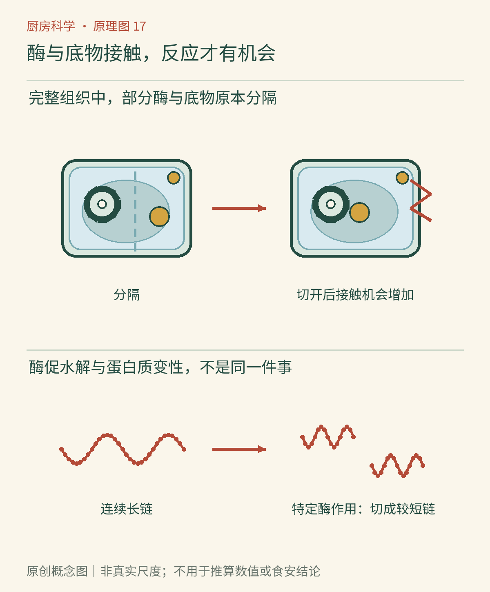

# 第17章　酶在厨房：从菠萝到洋葱

切开一颗洋葱，眼睛很快开始流泪；把鲜菠萝放进明胶甜品，原本预期凝固的混合物可能迟迟不成形。这些变化有一个共同参与者：酶。它们并不是只存在于消化道或实验室里的特殊材料。新鲜食材仍保留着许多原有的酶，切、压、加热和改变酸度，都可能改变它们的工作机会。

*图17-1｜AI漫画教学示意。上方未凝住的明胶与成形甜点提示鲜菠萝中酶的影响；下方面团和酸奶用于对照微生物参与的转化。云朵里的角色代表微生物的拟人示意，并非把酶画成活细胞。*

## 酶改变的是反应走过的道路

酶是生物催化剂。多数日常食品中讨论的酶是蛋白质，具有能与特定反应物相互作用的结构。它们让某些反应更容易进行，却不凭空创造原料，也不是给所有变化加速的万能药。把“酶”理解成有选择的工具，比理解成神秘的营养成分更接近它在烹饪中的角色。

反应物常称为底物。底物与酶在适合的条件下接触，酶帮助反应进行，产物随后离开。酶在一次反应中不会按底物的比例被消耗，但它并非永远不坏：热、酸碱环境以及长时间储存都可能改变其结构和活性。因此，少量酶可以在一段时间里处理较多底物，而最终效果仍然受接触面积、时间与环境限制。

这也解释了“低温让酶睡着，加热把酶杀死”的说法哪里不够准确。酶不是一个会睡觉的生物；冷却通常减慢反应，升温在一定范围内可能加快变化，但继续升温又可能使酶失活。不同酶的耐热性、最适条件并不相同，不能给所有食材套用同一条温度线。美国农业部的[焯水与酶活性说明](https://ask.fsis.usda.gov/article/What-is-blanching-and-how-does-it-relate-to-enzyme-activity-when-freezing-food)将这一点应用到果蔬保存中。

## 鲜菠萝为什么会妨碍明胶凝固

明胶来自胶原蛋白的加工产物。它在合适浓度与冷却条件下形成能限制水流动的网络，才表现出柔软的凝胶质地。鲜菠萝含有菠萝蛋白酶体系，其中的蛋白酶能催化蛋白质链水解；链段被切得更短后，原本期待形成的网络就可能不足以维持形状。[英国皇家化学会：酶与果冻](https://edu.rsc.org/resources/enzymes-and-jellies/815.article)用鲜果与凝胶对照说明了这种差别。

这里的关键不只是“菠萝很酸”。酸度、用量和水分也可能影响凝胶，但蛋白酶提供了另一条明确机制。因此，如果只比较有菠萝和没菠萝的两杯，变量其实改变了好几个。更有解释力的比较，是在相同配方中分别使用鲜菠萝与经过充分热加工的菠萝，并保留无果肉对照，同时承认水果品种和处理仍可能影响结果。

罐藏菠萝经历热加工，相关酶活性一般大幅降低，因此常能用于明胶甜品。[麦吉尔大学：鲜菠萝与明胶甜品](https://www.mcgill.ca/oss/article/general-science-you-asked/why-cant-i-use-fresh-pineapple-make-jell-o)解释了这类蛋白水解作用。换成琼脂做的甜品时，结果不能简单照搬：琼脂主要是多糖，不是同一种蛋白质网络。不能因为“都是果冻”，就假定底物相同。

## 嫩肉也有过头的时候

蛋白酶接触肉表面，会切断部分蛋白质链，改变组织承受咬合的方式。适度处理可以让某些部位更容易咀嚼，时间太长或接触过强却可能让表层松散、发糊，而内部变化有限。“把一大块肉泡久一点就会处处一样嫩”忽略了酶进入组织受到的限制。

家庭做饭不应把这种作用当作灭菌：肉变软不代表病原微生物消失，果汁酸也不能替代可靠的加热。腌制需按生肉的卫生要求冷藏处理，接触过生肉的腌液与器具应避免污染即食食物。对“嫩化”的判断属于口感问题，对“能否安全食用”的判断属于另一条管理线。

*原创概念图。注意“原先分隔—切开后接触—产生新物质或切断链段”的顺序。蛋白链被切短与蛋白质仅仅展开并不相同；图中酶形状仅表示选择性，不是完整分子模型。*

## 区分“有酶”与“正在发生反应”

一份食材含有某种酶，只能说明体系可能具备催化能力。若没有合适底物，或者两者仍被组织分隔，明显变化未必发生；底物存在但环境不适合，反应也可能很慢。厨房里许多貌似矛盾的经验，来自这些条件没有被一起记录。干燥、低温与完整组织能以不同方式改变接触或速度，不是给酶贴上一张永久的开关标签。

阅读商品介绍时，也可用这一点避免误解。“含酶”并不告诉我们在储存和烹调后还剩多少活性，更不能单凭这个词推导食用后的健康效果。反过来，热加工使某些酶失活，也不意味着这份食物从此“没有营养”。酶活性是一个具体的功能指标，维生素、蛋白质、矿物质与能量又属于其他讨论层面。把这些概念分开，才能理解为何保存蔬菜有时需要主动降低酶活性，而制作特定发酵食品时又会有意利用酶的作用。

## 洋葱的眼泪来自新生成的刺激物

洋葱完整时，部分反应物与酶处在不同位置。切碎破坏组织后，含硫前体进入酶促反应链，最终生成容易挥发的催泪因子，刺激眼部。2002年的研究明确指出催泪因子合成酶在其中的重要作用，而不是把全部过程归给一种简单的“洋葱汁”。[Imai等：使洋葱催泪的酶](https://www.nature.com/articles/419685a)是这项发现的原始论文。

重要的是，飘向眼睛的主要刺激物不是酶蛋白本身。切开释放或混合了反应体系，体系产生可挥发的小分子，再由它们到达眼睛；如果省略这个中间步骤，就很容易误以为厨房里飞着会催泪的酶。通风、减少脸部靠近切面等措施，是在改变刺激物到达眼部的机会，不需要拿眼睛主动验证。

从苹果褐变、菠萝蛋白酶到洋葱催泪，酶既能破坏想要的质地，也能帮助生成熟悉的风味。它们的效果取决于底物、位置与条件。下一章会加入另一层复杂性：当完整的微生物也参与进来，厨房里便出现了会随时间演替的加工系统。

### 本章资料

- 英国皇家化学会，[酶与果冻](https://edu.rsc.org/resources/enzymes-and-jellies/815.article)。
- 麦吉尔大学科学与社会办公室，[鲜菠萝与明胶甜品](https://www.mcgill.ca/oss/article/general-science-you-asked/why-cant-i-use-fresh-pineapple-make-jell-o)。
- Imai等，2002，[使洋葱催泪的酶](https://www.nature.com/articles/419685a)，*Nature* 419，685。
- 美国农业部，[焯水与酶活性](https://ask.fsis.usda.gov/article/What-is-blanching-and-how-does-it-relate-to-enzyme-activity-when-freezing-food)。
