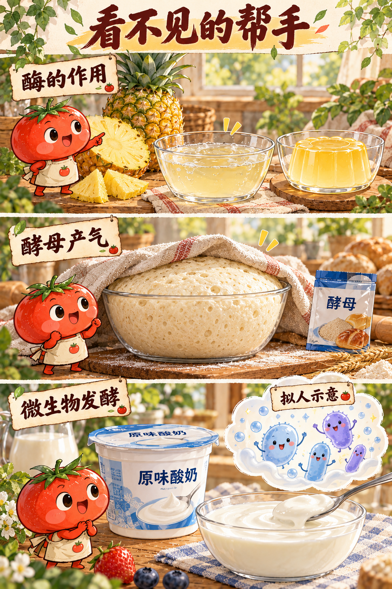
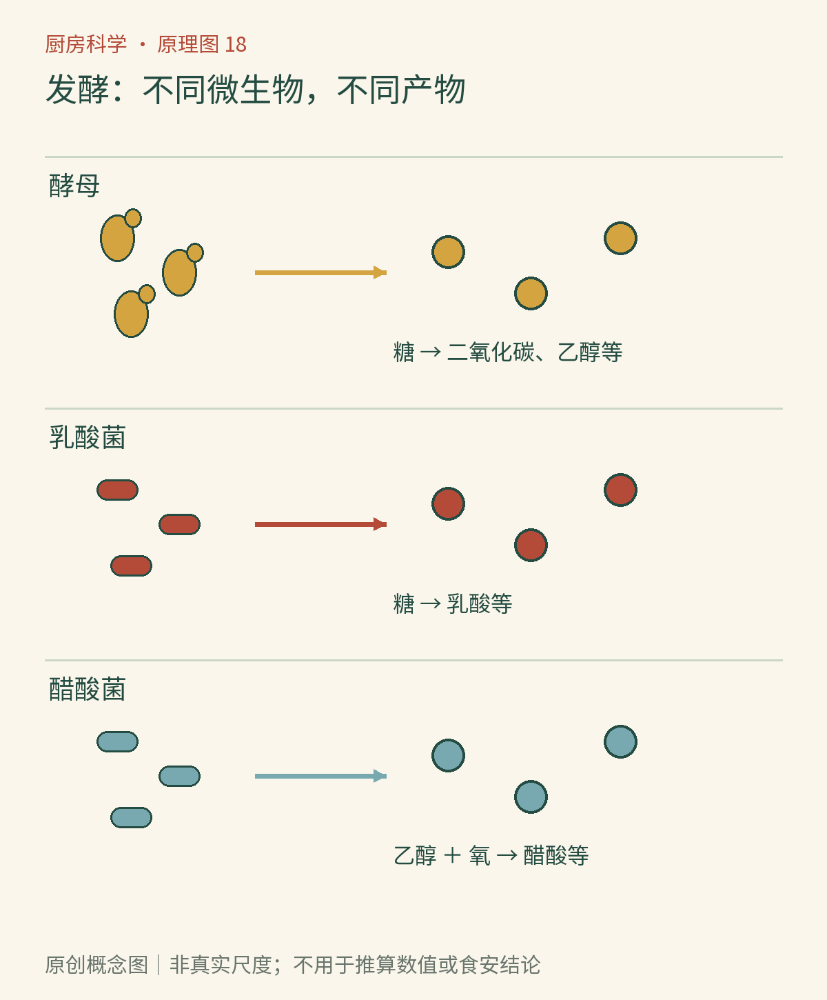

# 第18章　微生物上桌：发酵的分工与边界

面包变松，牛奶变酸稠，豆子变成酱，酒又可以成为醋。人类利用这些变化很久以后，才逐渐知道是谁在其中工作。发酵食物并非一种原料或一种味道，而是一大群由微生物及其酶参与加工的食物。它们能酸、能香、能产气，也能完全不以明显起泡为特征。

*AI漫画教学示意。面团膨胀和酸奶凝结是不同加工目标；图中微生物角色不表示真实大小和数量。画面中的气泡只是部分发酵的表现，不是安全合格标志。*

## 一个词有宽窄两种用法

在生物化学课程中，发酵常特指细胞在特定代谢途径中再生辅酶、维持糖分解的过程；厨房与食品工业所说的发酵更宽，常把多种微生物参与的加工统称为发酵，其中一些过程需要氧。醋酸生产便是重要例子。因此，“所有发酵都必须无氧”不适合直接拿来指导所有发酵食品。

微生物不是简单把食物“吃掉”。它们利用原料获得能量与合成细胞所需的物质，同时释放代谢产物，改变周围环境；自身或释放的酶还会分解大分子。不同菌株的能力不同，同一种食物的变化又受温度、盐、酸度、氧以及初始菌群影响。一个容器里出现微生物活动，并不等于出现了我们想要的活动。

## 酵母负责的不只是气泡

面包常用的酿酒酵母能够利用合适的糖，形成乙醇与二氧化碳。气体进入已经存在或不断形成的气泡空间，面团的骨架将其中一部分保留下来，体积于是增加。若把相同酵母放进很稀的糖水，气体容易逸出，不会形成一团能站住的“面包”。[OpenStax《微生物学》：发酵](https://openstax.org/books/microbiology/pages/8-4-fermentation)对酒精发酵与乳酸发酵作了基础区分。

发酵中也会形成影响香气的物质，而面包入炉后又发生新的热反应。于是成品香气不是单靠酵母制造，酵母产气量也不等同于成品体积。把“酵母越多越松软”当规则，会忽略面团结构、发酵程度和烘烤定形。有些失败的面团仍产生很多气体，只是没有把它们留好。

## 乳酸菌把酸度变成加工工具

在酸奶里，选定菌种利用乳糖，产生乳酸等代谢产物，环境酸度改变，酪蛋白体系更容易形成凝胶结构，液态奶于是变稠。预先的乳品热处理、蛋白质含量和后续搅拌也影响质地，不能把所有差异都归给“菌多菌少”。[佛罗里达大学食品科学资料：发酵食品——酸奶](https://ask.ifas.ufl.edu/publication/FS468)介绍了菌种与加工步骤的配合。

在某些蔬菜发酵中，乳酸菌同样利用可利用的糖，使酸度逐渐改变。盐的作用不仅是调味，还会影响哪些微生物更容易生长；原料大小、浸没状况与温度共同影响结果。不同乳酸菌的代谢产物并不完全相同，有的路线会同时形成二氧化碳等物质，所以“乳酸发酵一定不冒泡”也不成立。

*原创概念图。沿着“微生物与原料—代谢产物—质地或风味”阅读，并注意环境条件作用于整条链。不同食品可能由多类微生物先后或共同参与，图示不代表一菌对应一种食品的完整分类。*

## 醋、曲和酱打开了更宽的世界

制作醋时，已有乙醇可以在醋酸菌等作用下进一步被氧化为醋酸，氧的供给十分重要。酱油、味噌等加工还会利用制曲阶段产生的多种酶，把淀粉与蛋白质转变为更小、可继续利用或具有味道的物质，再经历后续复杂变化。把它们都理解为“乳酸菌把糖变酸”，会漏掉主要分工。

这类工艺经过长期经验积累，又逐步发展出菌种选择、卫生控制与过程检测。传统经验是知识的重要起点，却不能替代每一种配方的验证。食品工艺中保留的“发酵”一词，有时还带着历史用法：红茶加工中常说的“发酵”，关键变化主要是茶叶自身酶参与的氧化，不等于酸奶那样的微生物发酵。[茶叶氧化制造的原始模型研究](https://pubmed.ncbi.nlm.nih.gov/25051300/)通过控制多酚氧化酶、过氧化物酶及氧化条件研究了这一过程。

## 一张采购标签，也能成为观察材料

没有开始家庭发酵，也能从现成食品理解加工。比较酸奶、酸奶风味饮料、醋腌蔬菜和标明发酵工艺的蔬菜，分别记录原料、是否经过后续热处理、储存条件与生产者给出的产品类别。不要只凭“酸”给它们归成同一组；直接加酸能形成酸味，微生物代谢也能形成酸味，但过程证据不同。

再看同类产品的保存要求。有的需要冷藏，有的在未开封时可常温保存，这可能涉及热处理、包装与配方等多项条件，不能倒推出“常温产品一定不是发酵的”或“冷藏产品一定有益生效果”。生产过程与终产品状态是两个问题。一份食品可以经历发酵，之后不再保留大量活菌；也可能仍有活菌，却没有足够证据支持特定健康声称。用这些小区分阅读标签，比给所有发酵食物贴同一种好坏标签更可靠。

## 能看见变化，不代表能看见风险

发酵管理的关键是给期望的微生物和反应创造条件，同时限制不期望的生长。起泡只能说明有气体产生或释放；酸味、香气与外观也无法独立证明安全。醋直接酸化的快腌菜与依赖微生物逐步产酸的发酵菜，过程和控制点不同，不能随意互换步骤。[美国国家家庭食品保存中心：发酵的一般信息](https://nchfp.uga.edu/how/ferment/general-information-on-fermenting/general-information-on-fermenting/)明确要求使用经过验证的配方，并提醒盐比例与安全、质地相关。

本书不提供可凭观察自行延长的发酵时间或通用于所有蔬菜的盐比例。想实践时，应选定权威机构针对具体食品验证过的完整方法，遵守原料、比例、容器、温度与后续储存要求。未知发酵物不以尝味判断，不刮掉霉点后继续试吃；产生气体的体系也不随意密封在普通容器中。

“发酵食品”同样不自动等于“益生菌食品”。后续加热可能使活菌减少，健康效果还涉及具体菌株、摄入量和证据，不能凭酸味或一个菌名推定。对兴趣读者而言，最有价值的收获是学会拆开过程：谁在利用什么，形成了什么，条件为何重要。随后我们就能更清楚地讨论，那些变化最终如何变成入口时的风味。

### 本章资料

- OpenStax，[《微生物学》8.4：发酵](https://openstax.org/books/microbiology/pages/8-4-fermentation)。
- 佛罗里达大学食品与农业科学研究所，[发酵食品：酸奶](https://ask.ifas.ufl.edu/publication/FS468)。
- 美国国家家庭食品保存中心，[发酵的一般信息](https://nchfp.uga.edu/how/ferment/general-information-on-fermenting/general-information-on-fermenting/)。
- [通过模型氧化实验研究红茶制造过程](https://pubmed.ncbi.nlm.nih.gov/25051300/)，2014，原始研究。

