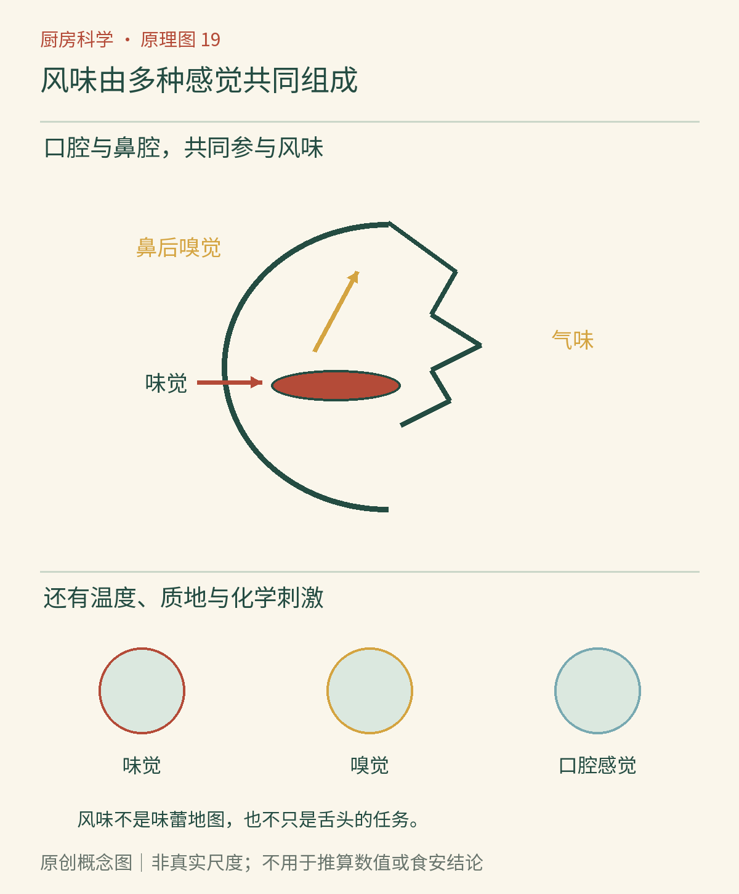

# 第19章　风味的拼图：味觉、嗅觉与口感

咬开一片烤面包，入口时有一点甜与咸，鼻腔里出现烘烤香气，牙齿听见外壳的轻响，舌头接触到柔软的内部。我们常把这些感觉合称为“味道”，但身体用不同途径接收它们。把风味拆开，不会减少吃饭的乐趣，反而能帮助我们找到一碗汤究竟缺什么。

*AI漫画教学示意。蒸汽曲线代表香气释放的情境，不是可见的气味分子。人物表情用来提示感觉有多种来源，不表示所有人都会作出同一评价。*

## 舌头能报告什么

入门学习常用甜、酸、咸、苦、鲜五种基本味来组织味觉。食物中的适当物质溶在唾液等液体中，与味觉细胞相关机制作用，信号再进入神经系统。糖、酸、盐、一些苦味物质和鲜味相关物质的结构与检测途径并不相同；我们不必先背完受体名称，也能理解味觉在报告一部分化学信息。

鲜味不能简单等同于咸味。汤里盐分足够，仍可能觉得单薄；加入富含鲜味相关成分的配料，体验会改变。但不能把鲜味理解成一种材料的专属标志，也不能靠鲜味强弱判断蛋白质含量。味精、番茄、蘑菇与高汤属于不同食材体系，各自还带来酸、香气与质地，不是可以按重量完全互换的标签。

旧式“舌尖只尝甜、舌根只尝苦”的地图不成立。能感受味觉的不同区域可以响应多种基本味，不同位置可能存在敏感性差异，却不等于划分成彼此独占的行政区。[美国国立聋病及其他交流障碍研究所：味觉资料](https://www.nidcd.nih.gov/health/taste-disorders)明确纠正了这一误解。不要用强酸、浓盐或刺激物去“测试舌头地图”。

## 香气有两条到达鼻腔的路线

食物放到面前，挥发性物质随吸气从鼻孔进入，帮助我们预判气味；咀嚼、吞咽时，口腔内释放的挥发物也能经咽部到达鼻腔，形成鼻后嗅觉。这条路线让人觉得香气似乎就在嘴里，所以我们容易把“有草莓香”直接说成“尝到了草莓味”。[该研究所的嗅觉说明](https://www.nidcd.nih.gov/health/smell-disorders)介绍了嗅觉与食物风味的密切联系。

鼻塞时，甜咸可能仍然存在，食物却显得单调，正是因为这块拼图受到影响。外观相似、甜度接近的食品，也可能因为挥发物组合不同而明显不同。另一方面，香气浓不等于所有风味都浓：一杯香气很足的茶，入口仍可以清淡；鼻前闻起来强烈的调味料，进入口腔后的释放与停留也未必相同。

温度会同时改变物质释放与感觉。热食更容易散出某些挥发性物质，但越烫并不保证越好吃，过高温度还会让我们难以舒适比较。冷食、热食的质地也可能不同：脂肪固液比例改变，凝胶软硬改变，气味到达鼻腔的过程也改变。因此，比较两份配方时应尽量控制食用温度，避免把温差误当成配方效果。

*原创概念图。箭头表示感觉信息汇合，不是食物在体内的消化路线。味觉与鼻后嗅觉分别接收信号；温度、触觉与刺激也会参与整体体验，不能把它们全画在“味蕾”一个节点里。*

## 辣、凉与涩另有来路

辣椒带来的灼热感，薄荷带来的凉感，都不仅是基本味的问题。辣椒素、薄荷醇能影响与温度和刺激感受有关的离子通道，使神经系统形成相应体验；这不要求口中物体真的像感受中那么热或冷。[2021年诺贝尔生理学或医学奖的科学说明](https://www.nobelprize.org/prizes/medicine/2021/advanced-information/)回顾了相关受体的发现。

涩则常表现为干、收敛、摩擦增加的口腔感觉，不能直接归为苦。茶里某些多酚与唾液及口腔表面相互作用，是解释涩感的重要方向。茶可以既苦又涩，也可以苦感与涩感比例不同。原始研究[茶中涩味成分的口腔处理分析](https://pubmed.ncbi.nlm.nih.gov/38329502/)进一步表明，入口后的相互作用也参与了最终感觉，而不只是杯里的物质浓度。

## 同一份味道，为什么前后感受不同

一口酥饼在刚咬开时可能以酥脆和烘烤香为主，咀嚼后甜味、油润感与更细的颗粒感逐渐出现，吞咽后又留下不同持续时间的余味。风味不是固定贴在食物上的一行说明，而是随口腔处理展开的过程。咀嚼次数、食品温度、含水量与颗粒变化，都会影响物质怎样释放和信号怎样累积。

这也让“先闻一闻”与“真正入口”得到的信息不完全相同。果酱盖子打开时的香气、抹在热面包后的香气，以及冷藏状态下的整体风味可以不同，并不必然说明其中一份产品变了质。判断储存安全仍应回到时间、温度、包装与产品要求，不能因为香气减弱就认定危险，也不能因为香气好闻就排除风险。感官很适合描述体验，却不能承担所有检测任务。

## 学会把“差一点”说清楚

“不够香”“不够咸”“太稠”“入口粗糙”和“后味苦”指向不同问题。缺香可能涉及原料、挥发物损失或释放不足；缺咸才可能需要调整盐；过稠会影响流动、裹附与香气释放；粗糙可能来自颗粒或结构。只用更多盐去修补所有问题，很容易把风味调得更失衡。

可以练习给熟悉的食品写一段感官记录，不作优劣排名。先描述闻到的气味，再描述入口的基本味，最后记录温度、质地与吞咽后停留的感觉。选择本来就正常食用、不过敏的食品，慢慢记录即可，无需憋气、蒙眼或追求极端刺激。若与别人比较，也应保留各自的描述，不把一个人的喜好当作科学仪器读数。

食品配方塑造了可感知的信息，个人经验、习惯、环境和身体状态又参与解释。感官记录应允许“我描述不出名字”，先记下清晰的差异，再逐渐建立词汇，不必用华丽香气词填满每一格。掌握这种区别后，我们可以在下一章把注意力放回杯子和锅：同一种原料，为什么被水带出来的味道会如此不同？

### 本章资料

- 美国国立聋病及其他交流障碍研究所，[味觉资料](https://www.nidcd.nih.gov/health/taste-disorders)与[嗅觉资料](https://www.nidcd.nih.gov/health/smell-disorders)。
- 诺贝尔奖委员会，[2021年生理学或医学奖科学背景](https://www.nobelprize.org/prizes/medicine/2021/advanced-information/)。
- [茶中涩味成分的口腔处理分析](https://pubmed.ncbi.nlm.nih.gov/38329502/)，2024，原始研究。

