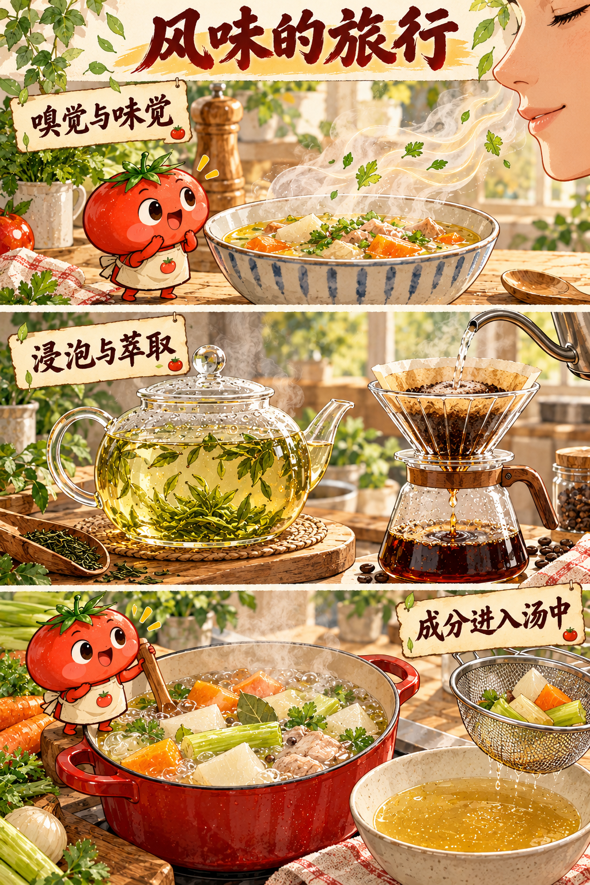
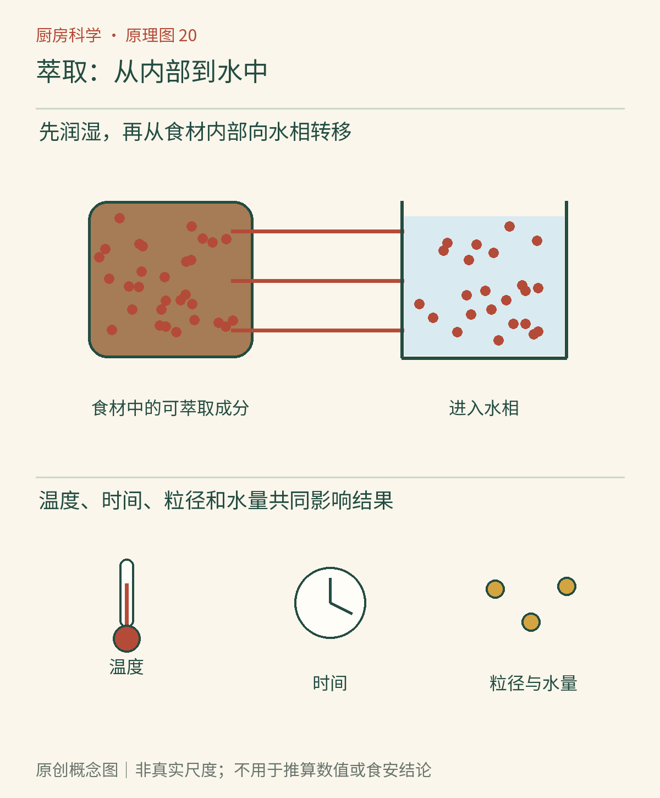

# 第20章　把味道带出来：茶、咖啡与高汤

一把茶叶能泡出几杯差异明显的茶，一份咖啡粉换一种研磨与冲法就可能变得不同，一锅肉骨汤越煮越浓却未必越来越好喝。原料没有凭空增加，改变的是哪些物质进入液体、进入多少，以及过程中又发生了什么。萃取不是“味道被水冲出来”这一个动作，而是一组需要时间的传质过程。

*AI漫画教学示意。三种情境都涉及物质进入水，但熬汤还明显包含结构改变和热反应。杯中色深仅作外观提示，不能充当萃取率或营养含量的测量值。*

## 水得先到达原料内部

干茶叶、咖啡颗粒和肉块并非表面涂着一层随时可取的“风味”。水先润湿表面，进入可到达的孔隙或组织；适合进入水相的物质溶出，再由内部向外移动。局部浓度差和液体运动影响传递。越靠近充分平衡，继续浸泡带来的增量通常越小，但真实食材也在同时膨胀、软化或改变结构。

小颗粒往往有较大的总表面积与较短的内部路径，萃取可能更快。不过“磨得更细一定更好”并不成立。细粉会影响过滤与水流，某些冲煮方式里还可能增加堵塞、流动不均的机会。粒度、时间和流速是彼此配合的变量，不是三支可以独立推到最大的旋钮。

加热常加快传质，改变溶解行为，也让原料结构变化更快；冷泡则以较长时间获得另一种过程轨迹。它们未必萃取出完全相同的比例，也不能仅凭冷热给成品贴上必然“高级”或“低酸”的标签。冲泡用水的组成、原料烘焙或加工状态也会进入结果。

## “浓”与“取得多”是两个问题

想象相同一份咖啡粉，最终进入杯中的可溶性物质相同，一杯加了较少水，另一杯加了较多水。前者浓度较高，但这并不说明它从原料里取出了更多比例的物质。浓度关注杯子，萃取率关注原料中有多少物质进入饮料。两者相关，却不是同一读数。

加州大学戴维斯分校研究者用质量守恒和实验研究全浸泡咖啡，明确区分饮料强度、萃取率以及水粉配比。[全浸泡咖啡浓度与萃取率的平衡模型](https://pmc.ncbi.nlm.nih.gov/articles/PMC7994670/)可以作为进一步阅读。日常不一定需要仪器，但保留这两个概念，便能理解为什么加水能减轻“太浓”，却不能倒转已经发生的萃取过程。

一个有启发的研究还发现，在特定滴滤咖啡条件下，若把成品浓度和萃取率控制相近，研究范围内的冲煮温度对感官轮廓影响较小。[固定浓度与萃取率时的冲煮温度研究](https://www.nature.com/articles/s41598-020-73341-4)并不是说温度无关紧要：温度本来就会改变萃取速度及达到结果所需的其他条件。它提醒我们，比较之前先问清是否同时改变了许多变量。

*原创概念图。先读原料到液体的移动路径，再区分杯中浓度与原料萃取比例。图中颗粒不代表真实孔隙尺寸，箭头表示传质方向的概括；并非每种成分都以相同速度离开原料。*

## 茶的苦与涩不会按固定时刻排队

茶叶里不同物质的溶出速度、温度响应与感觉阈值不同。咖啡因、多酚、氨基酸及香气相关物质共同形成体验；不能把冲泡过程画成“前几秒只有香，后几秒才突然出现苦”的整齐队列。更久、更细、更热的组合可能加强某些苦涩感，也可能同时损失一部分易散失香气。

涩感还取决于入口后的相互作用，不能把它视为一种叫作“单宁”的唯一物质浓度。[茶叶感官成分的原始研究](https://pubs.acs.org/doi/10.1021/jf049802u)通过分离分析与感官方法辨认了红茶中具有涩感贡献的成分。不同茶类的原料和加工不同，某一种茶的规律不应直接覆盖全部茶。

茶行业的“发酵程度”还需要与本章的冲泡区分。红茶制造中的关键酶促氧化，发生在叶片加工阶段；冲泡是在已加工的材料中进行溶出。后发酵茶又可能涉及微生物作用。不能因为一杯茶颜色深，就倒推出其微生物数量、加工等级或冲泡是否“过萃”。

## 过滤改变的是哪一部分

滤纸、金属网和细筛能留下不同大小与性质的颗粒，饮料即使来自同一份原料，外观与口感也可能不同。滤得更清，不等于所有溶解物质都更少；能穿过滤材的小分子仍留在杯里。反过来，悬浮颗粒较多的饮料看起来浓浊，也不保证萃取率更高。把“澄清程度”与“浓度”分开，可以避免用杯子的颜色代替测量。

一个不用试味的比较，是把同一份泡好并冷却至安全操作温度的茶分成两份，一份经过合适滤材，另一份保持原样，放在同样的透明容器里观察。记录细小悬浮物与沉淀，而不要声称颜色差异已经证明某种成分被除去。若需要知道咖啡因、具体多酚或矿物质含量，必须使用相应分析方法。肉眼观察的价值在于提出更好的问题，而不是给每一种看不见的物质编一个读数。

## 高汤既在萃取，也在转变

熬汤时，可溶性物质逐渐进入水，脂肪、细小颗粒也可能被分散进液体。含胶原较多的组织在湿热与时间作用下，结构改变并逐渐形成可进入汤液的明胶，冷却后可能让汤变得黏稠甚至凝固。这不只是把一块原料里原封不动的“汤精”洗出来。[探索馆：肉的多汁与柔嫩](https://annex.exploratorium.edu/cooking/meat/INT-what-makes-juicy.html)介绍了胶原与湿热烹饪的关系。

沸腾强弱还影响搅动与分散，清汤和较乳白的汤因而可以呈现不同外观；白色不自动说明钙或蛋白质更高。汤越煮越少，盐和其他物质可能因为水蒸发而浓缩，并不证明萃取还在同样快速增长。把补水量与最终体积记下来，才有条件比较两次熬汤。

想做一次简单观察，可使用同批茶叶、同量水与相同容器，只改变浸泡时间，记录颜色、香气与冷却后的沉淀，不以实验样品试味。用正常饮用的另一批茶练习感官描述时，也不要把自己的偏好写成普遍萃取规律。无论泡茶还是熬汤，热水都需要稳定容器和防烫操作。下一章里，水不再是唯一重要媒介，油与刺激感会加入香辛料的故事。

### 本章资料

- [全浸泡咖啡浓度与萃取率的平衡模型](https://pmc.ncbi.nlm.nih.gov/articles/PMC7994670/)，2021，原始研究。
- Batali等，[固定浓度与萃取率时的冲煮温度研究](https://www.nature.com/articles/s41598-020-73341-4)，2020，*Scientific Reports*。
- [红茶涩味成分的分析与人类感官研究](https://pubs.acs.org/doi/10.1021/jf049802u)，2004，*Journal of Agricultural and Food Chemistry*。
- 探索馆，[肉为什么多汁与柔嫩](https://annex.exploratorium.edu/cooking/meat/INT-what-makes-juicy.html)。

