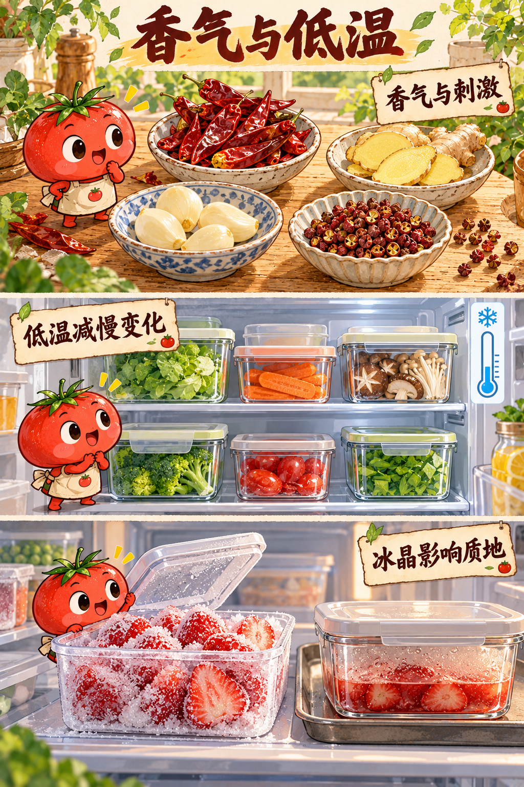
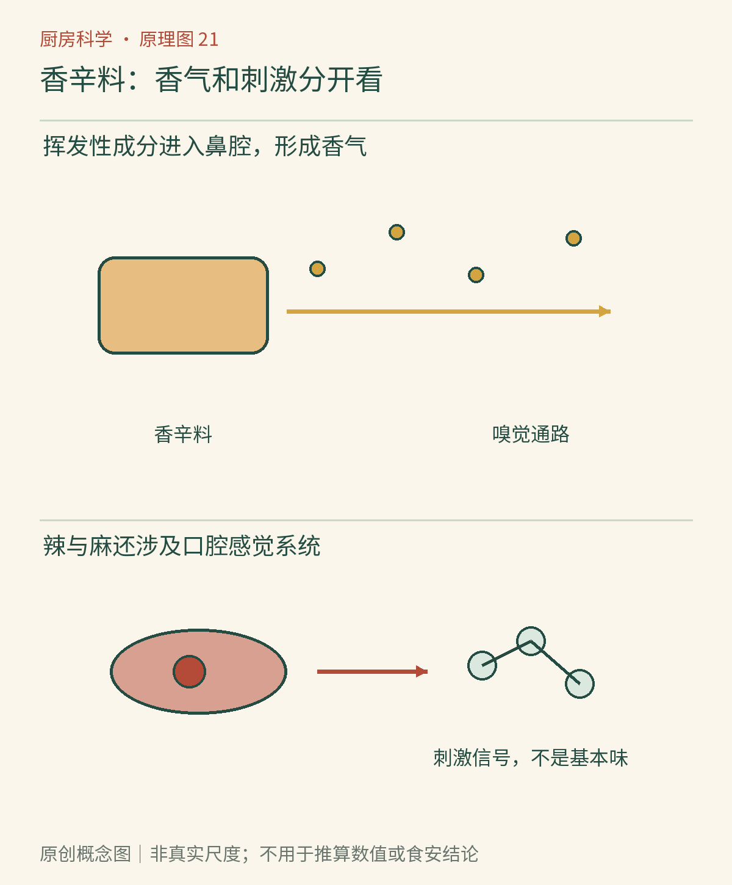

# 第21章　香辛料与刺激：葱姜蒜、辣椒和花椒

生蒜的冲、炖蒜的甜柔、辣椒的灼热、花椒的酥麻，常被归进一个宽大的词——“辣”。但它们的气味成分、形成过程与感觉途径不同。把香辛料放进油锅，也不只是让它们变热：组织受损、物质溶出、挥发、酶失活与热转变都可能在短时间里交错发生。

*图21-1｜AI漫画教学示意。上方四盘香辛料引出香气与化学刺激；中下方转向低温保存与冰晶造成的质地变化。辛辣并不等于真实温度升高，漫画也不表示所有香辛料都应以同一方式冷藏。*

## 完整蒜瓣与蒜泥不一样

剥开一颗蒜，闻到的强度与刚捣出的蒜泥往往不同。这不完全是表面积扩大后的“原有气味跑出来”：组织被破坏后，原先分隔的前体与酶接触，蒜氨酸在蒜氨酸酶参与下进入反应，生成大蒜素等相关含硫产物；随后它们还能继续变化。[美国化学会：大蒜素](https://www.acs.org/molecule-of-the-week/archive/a/allicin.html)介绍了这个明确的形成路径。

因此，切碎以后立即加热，与先切碎放置一段时间再加热，可能经历不同的反应顺序。整瓣加热又会使热量到达、组织破坏和酶活性改变的时刻不同。我们不必把这一现象转化为人人都要遵守的精确倒计时；蒜的品种、切碎程度、温度与料理目标都会影响结果。追求生蒜的尖锐或熟蒜的柔和，原本就是两种不同目标。

大蒜素也不是大蒜全部气味的唯一代表。美国化学会的[葱属植物化学讲座资料](https://www.acs.org/content/dam/acsorg/acs-webinars/2014/slides/2014-09-11-alliums-final.pdf)展示了含硫化合物变化的多样性。加热后的气味不能简单理解为“挥发掉一些生蒜味”而已；新产物与原有成分的比例会改变，过度受热又可能出现不想要的苦焦气味。

## 姜的“辣”也会改变

鲜姜中含有姜酚类等刺激性成分，加工和储存会改变它们的组成；某些姜酚可在脱水等变化后形成姜烯酚，另一些热转变则产生具有不同香气和刺激性的物质。于是干姜与鲜姜不是仅仅相差一杯水，替换时也不能只按吸水量计算。[美国化学会：姜酚、姜烯酚与姜酮](https://www.acs.org/molecule-of-the-week/archive/g/gingerol.html)提供了这些相关成分的结构与背景。

做菜时切片、切丝和磨泥还改变了接触方式。片状适合给出较温和、便于夹出的风味，细碎或磨泥更容易迅速分散，也可能让某一口的刺激更集中。这里同时存在物理分布和化学变化，不能只说“越碎释放越多营养”。本章讨论的是风味与操作，不把香辛料的成分研究直接转成治疗或保健承诺。

## 辣椒让温度信号通路参与进来

辣椒素能作用于TRPV1等感觉机制，参与形成灼热、疼痛相关体验。它并没有让口腔温度凭空升到相应程度，但刺激是真实的神经反应，过量同样可能造成不适。有关辣椒素受体的发现是2021年诺贝尔生理学或医学奖科学背景的重要部分。[诺贝尔奖委员会科学说明](https://www.nobelprize.org/prizes/medicine/2021/advanced-information/)可以帮助理解“化学物质为何带来热的感觉”。

辣椒的香气和辣度也应分开。甜椒能有鲜明植物香而刺激较弱，一种很辣的椒未必带来我们想要的全部香气。不同部位、品种与成熟度使刺激性成分的分布不同，不能简单说所有辣都集中在种子里。处理较辣的椒时避免揉眼，必要时戴手套；不以试吃极辣原料作为感官练习。

*原创概念图。把三层分开读：切碎与加热改变成分，水油体系影响分布与释放，嗅觉及刺激感觉途径形成体验。所有路径均为简化概括，不代表一种香辛料只有一个有效分子或一个受体。*

## 麻感不是另一种辣度

花椒的酥麻与山椒素类成分有关，涉及触觉相关感觉纤维的活动。研究者曾让参与者把花椒引起的麻刺感与机械振动感觉作比较，发现两者共享某些感觉处理特点。[Hagura等：亚洲香辛料与振动感觉](https://pmc.ncbi.nlm.nih.gov/articles/PMC3779329/)是原始研究。这个结果不表示嘴唇真的像电动牙刷那样持续振动，也不应被写成所有花椒、所有人都会得到的精确常数。

一份菜可以又麻又辣，是不同刺激叠加的结果；它还会同时有咸、酸、鲜与香气。用“麻辣强度”一项评分描述整道菜，会遗漏许多结构。懂得区分后，调整配方时便能问得更准确：需要增强辣椒香、灼热感、花椒香，还是麻感？这些目标不一定通过增加同一种原料实现。

## 整粒、研碎和久放的差别

完整香辛料的外部结构限制了部分成分与空气、液体接触。研碎增加表面积，做菜时可能更快释放香气，也让储存时的挥发和氧化有更多机会发生。因此，一罐细粉放久后变得平淡，不能只靠多加一点就保证恢复原来的香气比例。不同成分损失的速度并不相同，剩下的混合物不一定只是原来风味的等比例缩小版。

为日常使用，可以按实际消耗量购买，保持容器清洁干燥，避免让水汽和油污进入，并遵守产品标示的保存要求。对照练习可选相同来源的整粒与刚研碎香辛料，分别放在干净小碟中作短时间外观与气味记录，不把粉末靠近鼻孔吸入。若材料已受潮、污染或出现异常，不以“再烘一烘就好”作安全处理。风味管理和食品卫生仍需同时考虑。

## 油锅不是香气的保险箱

许多香气与刺激相关物质更容易进入油相，温热油脂也能帮助从材料中释放和分布这些成分。不过，溶进油不代表永远不会挥发或降解，油温越高也不等于风味越好。细蒜末与整片姜的受热速度不同，把所有材料同时下入很热的锅，可能先让细碎部分焦掉。

观察时可以比较同一香辛料的完整、切碎和普通熟制状态，记录气味与外观即可，不贴近热油深吸，不把鼻子当烟雾检测器。爆香的目标是得到想要的风味，不是追求冒烟。香辛料进入一顿饭后，还会继续随温度、时间与储存改变；接下来，我们会把注意力转向餐后的冰箱，理解如何让想要的变化慢一些，让不想要的风险远一些。

### 本章资料

- 美国化学会，[大蒜素](https://www.acs.org/molecule-of-the-week/archive/a/allicin.html)与[葱属植物化学讲座](https://www.acs.org/content/dam/acsorg/acs-webinars/2014/slides/2014-09-11-alliums-final.pdf)。
- 美国化学会，[姜酚、姜烯酚与姜酮](https://www.acs.org/molecule-of-the-week/archive/g/gingerol.html)。
- 诺贝尔奖委员会，[2021年生理学或医学奖科学背景](https://www.nobelprize.org/prizes/medicine/2021/advanced-information/)。
- Hagura等，2013，[亚洲香辛料与振动感觉](https://pmc.ncbi.nlm.nih.gov/articles/PMC3779329/)，*Proceedings of the Royal Society B*。
