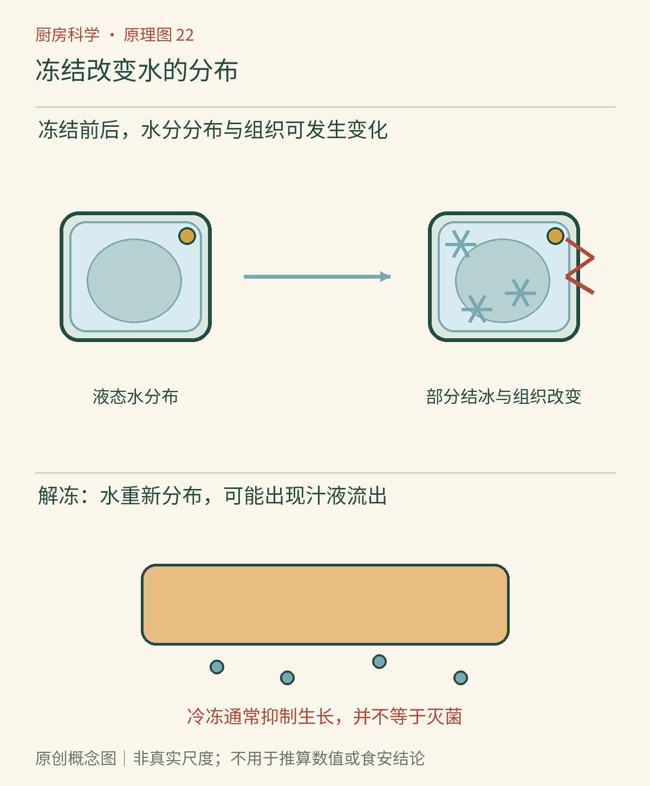

# 第22章　低温的作用：冷藏、冷冻与解冻

一盒草莓进了冷藏室，第二天仍能拿起来；另一盒进了冷冻室，解冻后却瘫软出汁。后者不一定已经腐败，前者也不会因为外观完整就永远安全。低温同时影响微生物、化学反应和食物结构，但这三件事的变化速度并不相同。理解冷藏与冷冻，首先要把“好吃”和“安全”分开判断。

## 冷并不是停止键

微生物繁殖需要合适环境，低温通常会让这一过程变慢；许多引起风味变化的反应也会减慢。但冰箱不会把原先的污染清零，更不会消除食物冷却前已经经历的室温停留。一盘放坏的菜，后来冻得再硬，也不能据此恢复为安全食物。

美国农业部把家用冷藏室保持在40°F以下作为消费者建议，约为4.4℃；本书为方便家庭设置，采用“不高于4℃”这一较保守目标，并建议用独立冰箱温度计核实。家用冷冻常用目标为0°F，即约−18℃。这里的数字是该机构的家庭储存建议，不是所有食品通用的保质期限。[资料：USDA《冷冻与食品安全》](https://www.fsis.usda.gov/food-safety/safe-food-handling-and-preparation/food-safety-basics/freezing-and-food-safety)

冷冻能抑制许多微生物的活动，却不是可靠灭菌方式。解冻后，幸存的微生物可能重新活动，因此“冷冻过”不能成为生食肉类、海鲜或生面团的理由。工业产品的原料控制、杀菌步骤、包装和冷链各司其职，不能只复制其中一个低温步骤。

*图22-1　AI漫画教学示意。看图时分别观察草莓解冻后的形状与食品的储存位置：前者帮助理解质地变化，后者帮助理解污染控制。拟人表情不能显示微生物数量，也不能用来判断食物是否安全。*

## 冰晶为什么会改变口感

食物中的水不是一整块纯水：它分布在细胞内外，与糖、盐、蛋白质及其他成分相处。降温时，一部分水先形成冰，剩余液相中的溶质因而变得更集中。也就是说，冻结除了把水变硬，还同时改变了局部环境。

形成的冰晶会改变组织完整性。一般而言，较快通过大量结冰的阶段，更有利于形成较小冰晶；较慢冻结和储存中的温度起伏，容易使冰晶长大。草莓原先依靠细胞和组织保持形状，解冻后水分难以完全回到原位，便容易出汁。熟汤没有需要维持脆度的完整植物组织，通常比生黄瓜更能承受这种变化。[资料：USDA《冷冻与食品安全》](https://www.fsis.usda.gov/food-safety/safe-food-handling-and-preparation/food-safety-basics/freezing-and-food-safety)

因此，冻草莓适合打果泥，解冻黄瓜却很难恢复为原来的清脆凉菜。这不是冷冻“抽走营养”的简单故事，而是结构改变了食材适合的用途。冷冻的目的可以是延长储存，也可以是主动制造新质地；做选择时要先问希望保留什么。

## 分装比把冰箱调得更冷更容易落实

同样一锅汤，深桶中心到冷源的距离长，浅盒中心到冷源的距离短。分成适量小份，也方便以后只取本次要吃的部分。包装要适合冷冻、能减少水分散失，并留出内容物膨胀所需空间；不要把“盖得上”误当成“适合冷冻”。

薄一些不等于把所有盒子紧紧堆在一起。食物需要与周围冷空气交换热量，刚放入的大量温热食品还会影响冰箱其他区域。比较合适的做法是规划烹调量、及时分装、避免一次超负荷装入，同时保持冷空气通道。食品日期和名称比“这盒应该是上星期的”更可靠。

*图22-2　原创概念图。图示应沿着“液态水分布—部分结冰—解冻后水分重新分布”阅读。冰晶和细胞只是概念尺度；真实食物的变化还受冻结速度、配方和储存波动影响。*

## 解冻时，最先变暖的并非中心

一大块肉外层已软，中心还像石头。中心的冰不能证明外层一直足够冷；热从外面进入，温度差本来就是解冻的组成部分。把肉放在台面上长时间等待，恰好让外层先进入更适合微生物繁殖的环境。

优先提前安排冷藏解冻，并用能承接汁液的容器放在不污染即食食品的位置。USDA还列出冷水和微波解冻方法，但它们有各自操作条件：冷水法要有防漏包装并按官方方法管理水温与换水；微波或冷水法解冻后应立即烹调。本章不把这两种方法缩写成“泡水就行”或“打软就能再放一天”。[资料：USDA《安全解冻方法》](https://www.fsis.usda.gov/food-safety/safe-food-handling-and-preparation/food-safety-basics/big-thaw-safe-defrosting-methods)

## 表面干斑与冰箱里的水分迁移

冷冻肉表面有时出现干燥、发白或发暗的区域，常被称为冻烧。低温环境中，食品仍可能缓慢失水；包装阻隔不充分、食品暴露以及温度波动，都可能影响表面品质。冻烧本身主要是品质问题，不能据此直接断定有病原污染；同样，没出现冻烧也不证明安全。[资料：FDA《你是否正确储存食品》](https://www.fda.gov/consumers/consumer-updates/are-you-storing-food-safely)

这让包装的价值变得具体：它不是为了让冷冻食品“透气”，而是尽量维持原有水分与风味，同时避免污染和串味。盒子里预留膨胀空间，与食品周围留很大一团空气也不是同一回事。合适包装应兼顾材料适用性、食品形状和取用方式。

购买冷冻食品时，也应考虑回家途中和家中储存，而非只看商店里的状态。把本来持续冷冻的食品在路上长时间变暖，再放回冷冻室，不能用最后结硬的外观覆盖此前经历。家中日期记录除了何时放入，还可以写是否已经解冻处理。

## 再冷冻的问题，要同时问温度和品质

“解冻过的一律不能再冻”过于绝对，“再冻就能保存”同样不成立。按USDA指导，在冷藏中安全解冻、且未超出适宜冷藏时间的食物，可以再次冷冻，但口感可能下降；冷水或微波解冻的食品则应先充分烹调，再考虑冷冻。实际决定仍要结合食品类别、包装说明和完整温度经历，不能只看有没有冰碴。

可以做一个不涉及食用的质地观察：把同一根香蕉切成相近厚度，分别留一小份新鲜样品和一小份冷冻后安全解冻的样品，用勺背轻压，比较形变和出汁，不通过品尝判安全。记录颜色、柔软度和液体三个项目，便能看到低温的效果不是一个“新鲜分数”。

下一章会把视线从温度移向水、酸度和包装：许多保存方法并非把食物变得更冷，而是在改变微生物所处的环境。

## 本章资料

- USDA FSIS：[冷冻与食品安全](https://www.fsis.usda.gov/food-safety/safe-food-handling-and-preparation/food-safety-basics/freezing-and-food-safety)。用于冷冻边界、温度及品质解释。
- USDA FSIS：[安全解冻方法](https://www.fsis.usda.gov/food-safety/safe-food-handling-and-preparation/food-safety-basics/big-thaw-safe-defrosting-methods)。用于解冻与再冷冻条件。
- FDA：[你是否正确储存食品](https://www.fda.gov/consumers/consumer-updates/are-you-storing-food-safely)。用于冻烧与品质边界。
