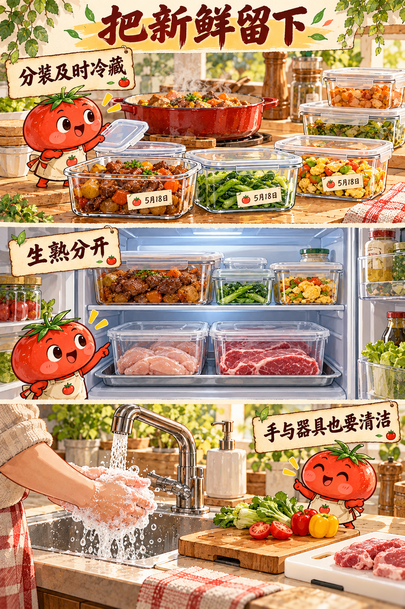
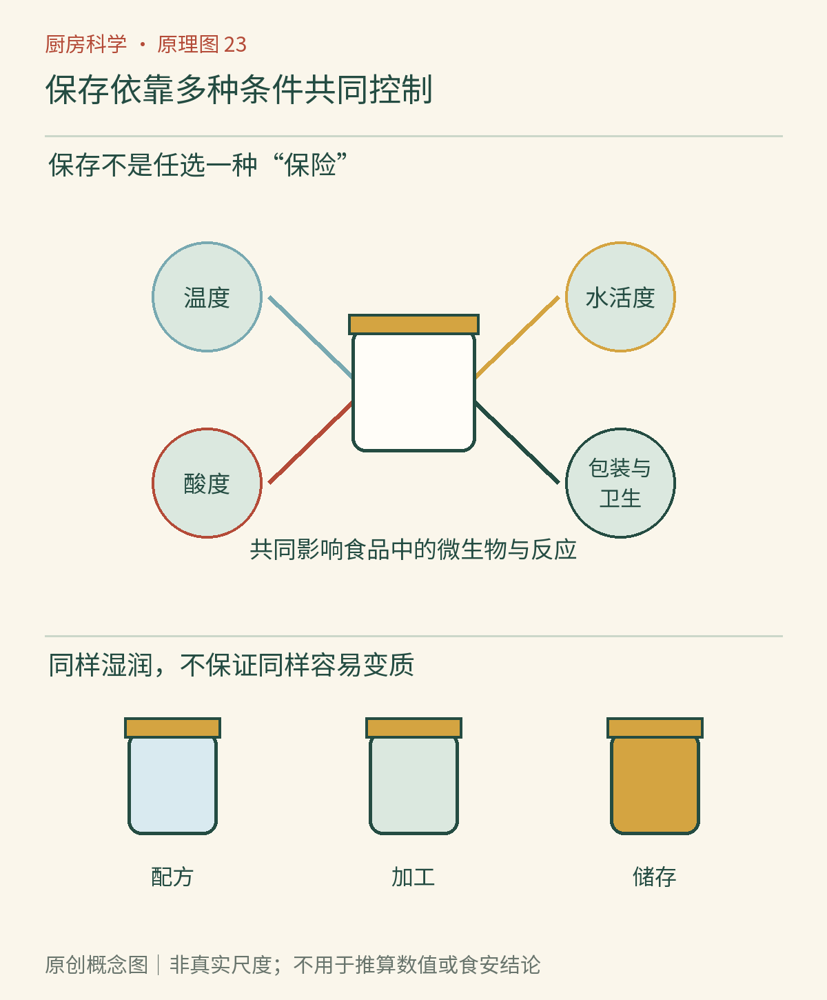

# 第23章　保存的科学：水活度、酸度与包装

饼干受潮会变软，面包失水会变硬，果酱看起来湿润却常比切开的水果耐放。仅凭“里面有多少水”，不能解释这些差别。食品保存要同时考虑水怎样与其他物质相处、微生物能否利用环境，以及食品暴露在怎样的温度、氧气和污染机会中。

## 水分含量和水活度，回答不同问题

水分含量描述总共有多少水。水活度则用另一种方式描述水的状态：在同一温度下，食品中水的平衡蒸气压与纯水蒸气压的比值，记作a_w。它没有单位，纯水在相应条件下作为接近1的参照。这个定义听起来远离餐桌，却能解释为什么两种摸起来都湿润的食品，保存表现可能不同。[资料：FDA《食品中的水活度》](https://www.fda.gov/inspections-compliance-enforcement-and-criminal-investigations/inspection-technical-guides/water-activity-aw-foods)

把盐或糖加入水中，会改变水与溶质之间的相互作用，降低水活度；干燥则直接移走部分水。日常说法常把它概括为“把水锁住”，这个比喻只能帮助入门，不能理解为水真的被装进了打不开的小盒子，更不能据口感估计数值。

*图23-1｜AI漫画教学示意。上方分成浅盒有利于后续及时冷藏；中间熟食在上、生肉置于下方容器中，强调减少滴漏接触；下方清洁双手和分用砧板。图中未显示水活度或酸度测量，不能据盒数或日期标签推算保质期。*

## 从果酱和饼干看两种路径

传统高糖果酱既涉及糖对水活度的影响，也涉及酸度、加热与密封等条件。把同样体积的果酱改成“少放一半糖”，不只是甜度变化，凝胶、风味和保存条件都可能改变。不能把原本配方的常温保存结论原封不动移植过去。

饼干则主要依赖低水分和合适包装保持酥脆。打开后，它和潮湿空气不断交换水分，即使外面没有水滴，口感也会变化。把干饼干与湿润点心直接放在同一个密闭盒中，水还可能从水活度较高的一方向较低的一方转移。密闭盒阻止了与室外交换，却没有阻止盒内食物彼此影响。[资料：加州大学推广体系《水活度及其在食品保存中的作用》](https://ucanr.edu/program/uc-master-food-preserver-program/article/water-activity-and-its-role-food-preservation)

这个对照也说明，保存品质和防止致病微生物生长不是同一条界线。饼干变软通常首先是品质问题；某些食品外观正常，却可能已经存在食安风险。家庭不能用“仍然很脆”“糖很多”替代经过验证的保存条件。

## 酸度是环境条件，不是万能盾牌

酸性环境能够抑制某些微生物，但不同微生物承受条件不同，食品内部各处的酸度也未必相同。一罐蔬菜外面的汁很酸，并不证明每一块蔬菜中心都已经达到相应状态。块的大小、组织、液体比例和处理时间都可能影响酸化的均匀性。

因此，醋腌、发酵和罐藏不能仅凭“尝起来够酸”判断可靠。NCHFP明确要求使用经验证的配方，并提醒不要随意改变醋、食品和水的比例。这里不提供自创常温罐藏或自然发酵配方，也不把某一个pH数值列为家庭自制食品的单项通行证。[资料：NCHFP《发酵与腌渍通用说明》](https://nchfp.uga.edu/how/ferment/general-information-on-fermenting/general-information-on-fermenting/)

## 包装改变交换，不会自动消灭污染

氧气会参与油脂氧化，也为某些微生物提供有利条件；阻氧包装能延缓相关变化。阻湿包装则帮助食品保持原本含水状态。两项任务不完全相同，一层看起来结实的包装，不一定对水蒸气、氧气和光都具有同样阻隔能力。

真空包装主要减少包内空气，不能把已有微生物全数去除，也不能让需要冷藏的食品突然获得常温储存能力。某些危险微生物反而能适应低氧环境，因此应遵守产品冷藏要求。包装鼓起、破损、渗漏时应警惕，但未鼓包也不构成安全证明。[资料：香港食安中心《真空包装并非灭菌》](https://www.cfs.gov.hk/english/multimedia/multimedia_pub/multimedia_pub_fsf_226_02.html)

*图23-2　原创概念图。把温度、水活度、酸度、包装和卫生看成共同影响保存的条件，而不是任选其一的“五种保险”。图中区域是关系示意，不是可用来推算保质期的数值模型。*

## 多道条件相互配合

食品工业常把多种抑制条件组合使用，可以理解为设置多道“障碍”。一种条件适度改变，再由其他条件补充，有机会在风味和保存之间取得平衡。这个思路不等于家庭可以凭经验删掉其中一项：从配方到包装，某个不起眼的环节可能正是整体成立的前提。

例如，酸奶的保存不能只归功于“有乳酸菌”，还涉及酸化、原料处理、冷链和后续污染控制；一瓶商业常温饮品也不能只用“包装密封”解释。生产线对初始污染和工艺的一致控制，是家庭随手装瓶难以复制的部分。

## 一份自制酱，为什么不能照抄商品期限

家中做了一罐番茄酱，外观与商品很像，却缺少了许多无法从外观读出的信息：原料初始污染多少，各处受热是否充分，最终酸度是否均匀，容器和封口经过怎样处理。这些因素中的任何一项，都可能改变后续储存结果。相似成品并不代表相似生产过程。

理解保存原理，反而会让人更谨慎地使用类比。看到某种商业酱在常温货架上，并不意味着自己做的同名酱也能放在常温；看到腌菜带盐，也不能仅凭咸味决定存放天数。对于自制食品，按已验证的方法、可靠配方与适合的冷藏安排处理，比根据名称找一个期限更有依据。

“障碍”之间还可能存在相互影响。例如，调整配方改变的不一定只有一个参数，减少糖也可能改变稠度与水分分布；改变块大小可能改变受热和酸化过程。家庭不需要自行设计一套工业验证实验，却应认识到为什么随手修改可能越过原先方法的边界。

## 保质期是带条件的承诺

标签上的保质期通常与未开封及规定储存条件相联系。开封后，原先设计的污染屏障已经改变，取食时的勺子、手和环境又会带来新机会。开封后的说明要单独阅读，不能继续只盯生产日期算天数。

选三个家中未开封的商业产品，只读标签，不拆封做微生物实验：找出各自的温度要求、避光要求和开封后要求。把信息写成“在什么条件下、到什么时候”的句子。如果条件缺了一半，就先别替它补一个自信的期限。

水活度、酸度和包装帮助我们理解保存，却不能让肉眼看到所有危险。接下来需要学习的是，怎样把看不见的风险转化为可执行的厨房流程。

## 本章资料

- FDA：[食品中的水活度](https://www.fda.gov/inspections-compliance-enforcement-and-criminal-investigations/inspection-technical-guides/water-activity-aw-foods)。用于定义与测量边界。
- UC ANR：[水活度及其在食品保存中的作用](https://ucanr.edu/program/uc-master-food-preserver-program/article/water-activity-and-its-role-food-preservation)。用于水分迁移和保存原理。
- NCHFP：[发酵与腌渍通用说明](https://nchfp.uga.edu/how/ferment/general-information-on-fermenting/general-information-on-fermenting/)。用于配方不可随意改变的边界。
- 香港食物安全中心：[真空包装并非灭菌](https://www.cfs.gov.hk/english/multimedia/multimedia_pub/multimedia_pub_fsf_226_02.html)。用于低氧包装与冷藏边界。
