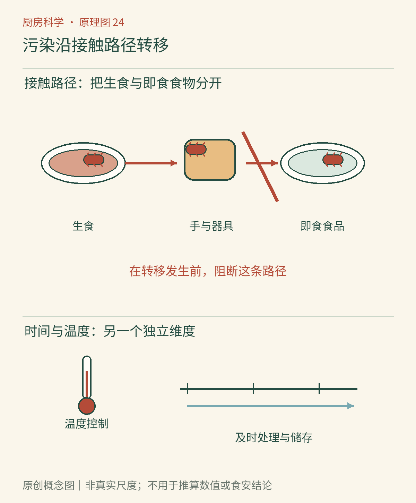

# 第24章　看不见的风险：食安与交叉污染

砧板上刚处理过生鸡肉，转头又切了一根准备生吃的黄瓜。刀和板也许没有显眼污物，黄瓜也不会立刻变色，但微生物已经有了从生食材移动到即食食品的机会。食安的重要部分发生在“看起来还好”的阶段，因此需要流程和测量，而不只是依赖感官。

## 污染是一条移动路径

微生物不会因为食品摆在不同盘子里，就自动遵守盘子的边界。手碰过生肉，再去开冰箱、拿调味罐，之后又摸熟食，便连接出一条传播路径。生肉汁滴到下层蔬果、共用的夹子接触熟肉、擦过生肉台面的布继续擦餐桌，也都可能形成交叉污染。[资料：USDA《清洗食物是否提升食品安全》](https://www.fsis.usda.gov/food-safety/safe-food-handling-and-preparation/food-safety-basics/washing-food-does-it-promote-food)

理解路径，比记住一张长长的“危险物品表”更有用。可以把一次做饭画成几站：原料包装、砧板、双手、锅、餐盘。凡是原料与熟食共用的站点，都应检查有没有清洁或更换步骤。为即食食品预留干净区域，也能减少临时发现“菜好了却没地方放”的混乱。

*图24-1　AI漫画教学示意。重点看手、砧板、夹子和食品之间的接触关系。干净的外观不表示没有微生物；画中的“分区”应落实为实际的器具管理、清洁与避免滴漏。*

## 为什么不靠冲洗生鸡肉解决问题

冲洗似乎能把表面的东西带走，却也可能让带有污染的水滴落到水槽、台面和附近食物。USDA不建议在烹调前清洗生禽肉；可靠的做法是控制接触与汁液扩散，并通过适当烹调降低风险。这个建议不意味着蔬果也不用清洗，更不意味着所有食材采取完全相同流程。

洗手、清洗食物接触面和清洗食材是三个相关但不同的任务。处理生肉后应先清洁双手，再接触熟食和干净工具。生食材包装也要按污染物管理：不要把用过的包装袋翻过来，垫在熟食下方，或把曾盛生肉的盘子直接用于盛菜。

## 加热要到需要保护的位置

煎得很香的表面，不能保证厚肉中心已经充分受热。肉的颜色会受色素、加工和其他条件影响，粉红与否不是可靠温度计。家庭食物温度计的作用，是把注意力放到最不容易受热的位置，而不是从锅边的热气猜整个食品的状态。

以美国USDA的家庭消费者指导为例，禽肉应达到165°F，约74℃的最低内部温度；该数字是针对禽肉的建议，不能拿来概括所有食品的完整杀菌工艺。测量要进入合适厚处，避免只量骨头、锅面或局部最热处，并按温度计说明操作。[资料：USDA《鸡肉从农场到餐桌》](https://www.fsis.usda.gov/food-safety/safe-food-handling-and-preparation/poultry/chicken-farm-table)

## 熟了以后仍有时间问题

煮熟并不是永久安全状态。后续取食可能重新带入污染；一些微生物形成的孢子还可能承受普通烹调，并在合适条件下重新生长。熟饭就是很好的提醒：风险不由“隔夜”这个日历界线决定，而与烹调后如何储存紧密相关。

香港食物安全中心介绍，蜡样芽孢杆菌相关中毒可涉及烹调后在室温放置过久的米饭等食品，部分毒素耐热。因此，“待会儿再炒一次”不能用来挽救已经经历不当储存的饭。[资料：香港食安中心《炒饭中的蜡样芽孢杆菌》](https://www.cfs.gov.hk/sc_chi/multimedia/multimedia_pub/multimedia_pub_fsf_192_03.html)

*图24-2　原创概念图。沿接触路径寻找污染转移点，再沿时间轴寻找温度失控的机会。它显示两个维度的风险控制，不表示某一个清洁动作能够抵消此前全部不当处理。*

## 别让一大锅成为慢冷却的中心

USDA对易腐剩菜的家庭建议是及时分成浅容器冷藏，不要在室温等待整锅自然冷透。其消费者指导提出：通常应在两小时内冷藏；环境高于90°F、约32℃时缩短为一小时。这是对相应食物室温停留的上限建议，不是鼓励把计时用满。若已超过条件，应按官方建议舍弃，而不是靠重新煮沸“重置”。[资料：USDA《剩菜与食品安全》](https://www.fsis.usda.gov/food-safety/safe-food-handling-and-preparation/food-safety-basics/leftovers-and-food-safety)

把食物及时分装还有组织上的好处：干净餐具盛出的待存份，可以在开饭前就安排好；上桌反复夹取的部分，则不必与未取用的部分重新混在一起。处理份量、容器深度与冰箱容量，是比“饭后记得收拾”更具体的计划。

## 微波热透，也需要给热量分配时间

微波炉的加热并非处处相同。食品形状、组成、摆放及炉内场分布可能让某些位置先热，另一些位置仍冷；一角冒热气，不能证明整盒都达到目标状态。在适宜情况下搅拌、翻动，并遵守产品要求的静置时间，有助于让较热区域向较冷区域传热。[资料：USDA《使用微波炉烹调》](https://www.fsis.usda.gov/food-safety/safe-food-handling-and-preparation/food-safety-basics/cooking-microwave-ovens)

静置不是把所有食品随意放在室温等待，而是按照特定烹调说明完成过程的一部分。检查内部温度时，也应考虑多个可能较冷的位置。盒子烫、盖子鼓或汤汁很热，都不能单独证明肉块中心充分受热；容器与食品吸收、传递热量的方式并不相同。

这也解释了为什么换微波炉功率或装得更满时，不能只机械复制同一个分钟数。食品安全说明与设备说明共同定义了方法的条件；需要调整时，应围绕受热均匀性和测量来做，而不是凭声音或蒸汽多少猜测。

## 气味提供线索，却不能签发安全证明

酸败、发黏、异常霉变或包装异常都值得警惕，但许多致病风险不会提前给出明显气味。不能用“闻着正常”或尝一小口来证明安全。对不知道储存经历的食品，最关键的信息缺口是经历本身；味觉填不回这个缺口。

儿童、孕妇、老年人和免疫功能较弱者更需要避免高风险食物。家庭聚餐人数多、菜品多，反而应该简化流程：分批准备、留足冷藏空间、用干净工具分餐。把安全步骤嵌入顺手的动作中，比开饭前最后检查一遍更可靠。

一次整理就能开始改善：检查冰箱中哪件食品可能滴汁、哪盒熟食没有日期、哪把夹子生熟共用。无需培养细菌或故意放坏食物，就能发现实际可改的环节。

## 本章资料

- USDA FSIS：[清洗食物是否提升食品安全](https://www.fsis.usda.gov/food-safety/safe-food-handling-and-preparation/food-safety-basics/washing-food-does-it-promote-food)。用于生禽冲洗与交叉污染。
- USDA FSIS：[鸡肉从农场到餐桌](https://www.fsis.usda.gov/food-safety/safe-food-handling-and-preparation/poultry/chicken-farm-table)。用于禽肉内部温度与颜色判断边界。
- USDA FSIS：[剩菜与食品安全](https://www.fsis.usda.gov/food-safety/safe-food-handling-and-preparation/food-safety-basics/leftovers-and-food-safety)。用于家庭冷却与室温停留条件。
- 香港食物安全中心：[炒饭中的蜡样芽孢杆菌](https://www.cfs.gov.hk/sc_chi/multimedia/multimedia_pub/multimedia_pub_fsf_192_03.html)。用于熟饭与耐热毒素说明。
- USDA FSIS：[使用微波炉烹调](https://www.fsis.usda.gov/food-safety/safe-food-handling-and-preparation/food-safety-basics/cooking-microwave-ovens)。用于冷点、搅拌和静置。
