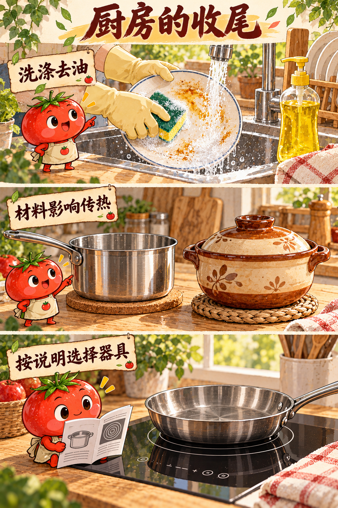
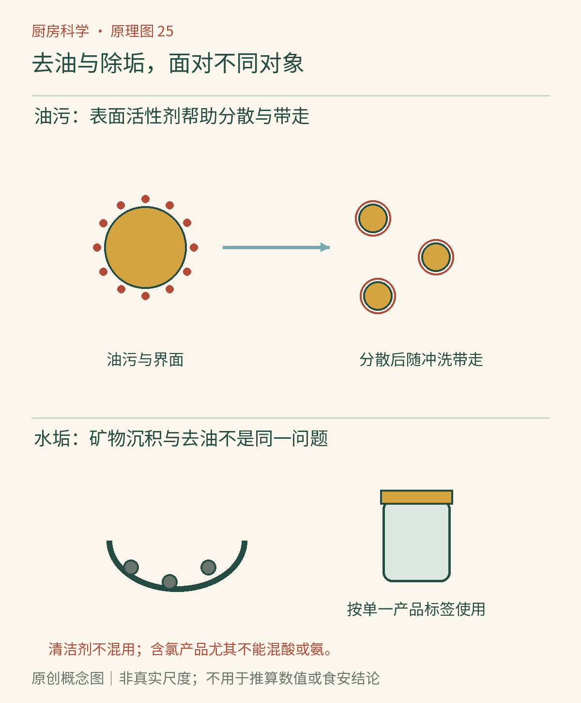

# 第25章　洗净厨房：油污、水垢与清洁剂

同一块抹布擦过油锅边缘，再擦水壶外壁，未必能把两处都擦干净。前者主要是油脂和食物残渣，后者可能是矿物沉积。清洁首先是一道识别题：污物是什么，附着在哪里，表面材料承受得了什么处理。药剂更强、泡沫更多，都不能代替这一步判断。

## 水为什么洗不走所有油

水与油之间的相容性有限，清水常在油膜上形成水珠，难以充分接触被油包住的表面。只加大水量，可能冲掉松散残渣，却留下那层发滑的薄膜。食物遇到的油水分层，在水槽里仍然成立。

洗涤剂中的表面活性剂具有亲水与亲油的部分，能够帮助水铺展、接触污物，也帮助油污脱离并分散在水中，再随冲洗离开。形成胶束是相关机制之一，但实际洗净还依赖擦洗、温度、接触时间与配方，并非每一滴油都严格装进一个大小相同的“小球”。[资料：ACS《合成洗涤剂的发展》](https://www.acs.org/education/whatischemistry/landmarks/tidedetergent.html)

*图25-1｜AI漫画教学示意。上方用单一明确用途的洗涤产品清洗油盘；中间不同材质锅具和下方炉灶说明书连接到下一章。水垢处理另由正文与原理图解释，本漫画不示范混用清洁产品。*

## 擦洗、温度和用量怎样合作

先刮除可以安全移走的固体残渣，洗涤剂就不必把大量食物一起处理。擦洗能破坏污物与表面的附着，使洗涤液进入原先接触不到的缝隙。适当温水可能降低部分油脂的黏度，但不能简单推论越烫越好：手部烫伤、材料变形和产品使用条件都需要考虑。

更多洗涤剂有时只带来更多冲洗负担。产品有自己的推荐用量和适用场景；手洗餐具的洗涤液与洗碗机专用产品也不应互换。洗碗机需要控制泡沫，否则设备的工作过程会被影响。泡沫是气液结构，洗净力则涉及与污物和表面的作用，两者相关却没有简单的一对一关系。[资料：ACI《清洁的化学》](https://www.cleaninginstitute.org/understanding-products/science-soap/chemistry-cleaning)

## 水垢为何走另一条路

水壶反复加热后出现的浅色硬层，常与水中钙、镁等离子的沉积有关，其中可能含有碳酸盐。它不像油膜那样靠普通乳化就容易带走。[资料：USGS《水的硬度》](https://www.usgs.gov/water-science-school/science/hardness-water)适合材料和设备的除垢剂，往往通过酸与沉积物反应，使其更容易去除。

如果沉积物中含碳酸钙，酸可以促进其溶解，并释放二氧化碳。出现气泡说明可能发生了相应反应，却不代表所有表面都适合酸洗。天然石材、某些金属和涂层可能被酸损伤，电器还涉及密封件与电气结构。操作应服从设备与产品说明，不能把一个水壶里的效果推广到整间厨房。

## 水本身也会改变清洗结果

硬水中较多的钙、镁离子，会与普通皂类发生作用，形成不易溶解的皂垢。这是“明明用了肥皂，表面却留了灰白薄层”的一种解释。它与单纯没有冲掉的泡沫不同，也提醒我们，清洗结果来自水、污物、表面和配方的共同作用。[资料：USGS《硬水、软水与皂垢》](https://www.usgs.gov/faqs/why-does-it-take-so-long-rinse-soap-my-hands-what-are-hard-water-and-soft-water)

现代洗涤剂可以通过不同表面活性剂和其他配方成分改善对硬水的适应性。因此，从一种肥皂的表现，不能推断所有洗涤剂在同样水质中都会失败。也不要仅凭起泡多少，反推出水是否适合饮用；泡沫观察并不是饮用水检测方法。

若餐具反复出现白色残留，先核对产品用量、冲洗方式和设备说明，再判断是否需要处理水质或矿物沉积。未经识别便不断增加药剂，可能让新的残留盖在旧的残留上，使问题更难判断。

## 醋加小苏打，热闹不等于更强

食醋和小苏打相遇会释放二氧化碳，气泡让它看起来很有清洁力。但二者也在互相消耗酸碱性；混合后的效果取决于用量和剩余成分，不等于同时保留“强除垢”和“强去油”两套能力。

气泡可能帮助松动局部残渣，不能据此宣称能消毒或处理各种油垢。本书中的食醋与食用小苏打反应观察，应在敞口容器进行，且不与清洁产品混用。真正的清洁选型，应回到污物和材料，而不是反应是否壮观。

*图25-2　原创概念图。去油路径强调润湿、脱附和分散；除垢路径强调沉积物与适合的化学处理。亲水头、亲油尾和污物颗粒均为关系示意，不是按真实比例绘制的分子结构。*

## 清洁和消毒不是同义词

清洁主要把污物和一部分微生物从表面移走；消毒针对适当范围内的微生物降低风险。表面沾满食物残渣时，直接喷消毒剂可能达不到预期效果，因为产品必须在合适浓度和接触条件下接触目标表面。

CDC建议先清洁明显脏污表面，再按需要和说明进行消毒。家庭并不是每件物品都要反复消毒，食品接触面尤其要核对产品是否适用、需要保持湿润多久，以及处理后是否需要饮用水冲洗。不能只看包装上一个“杀菌”词就跳过完整说明。[资料：CDC《何时及如何清洁和消毒家庭环境》](https://www.cdc.gov/hygiene/about/when-and-how-to-clean-and-disinfect-your-home.html)

## 清洁剂不做混合实验

含氯漂白剂不能与食醋、酸性除垢剂、含氨产品或其他清洁剂混用，可能产生危险气体。CDC的消费者建议更直接：不要混合漂白剂或消毒剂与其他清洁、消毒产品。本书不列“试一点看看”的例外，也不提供混合配方。[资料：CDC《使用漂白剂清洁与消毒》](https://www.cdc.gov/hygiene/about/cleaning-and-disinfecting-with-bleach.html)

更换产品也不能只是在同一滩液体上继续添加。应按说明完成一次处理、冲洗及通风，再判断是否需要其他步骤。清洁剂保留原容器和标签，远离食品；饮料瓶不适合作为分装瓶，因为外观相似本身就会制造误饮风险。

## 一套更顺手的收尾顺序

先移走食品并处理固体残渣，再清洗器具和接触面，按需要消毒，最后让物品充分干燥并妥善放置。潮湿的海绵和抹布也要纳入管理；不能用一块反复擦所有位置的布，替代生熟区的清洁安排。

做一次无需药剂的观察：洗盘子前，比较沾油处与干净处的水珠形状；正常按说明洗净并冲清后，再看水铺展的变化。它能提示油膜可能已被去除，却不能证明完成消毒。厨房里的判断需要知道观察能说明什么，也知道它说明不了什么。

## 本章资料

- ACS：[合成洗涤剂的发展](https://www.acs.org/education/whatischemistry/landmarks/tidedetergent.html)。用于表面活性剂及亲水、亲油作用。
- American Cleaning Institute：[清洁的化学](https://www.cleaninginstitute.org/understanding-products/science-soap/chemistry-cleaning)。用于润湿、分散与机械清洗。
- CDC：[何时及如何清洁和消毒家庭环境](https://www.cdc.gov/hygiene/about/when-and-how-to-clean-and-disinfect-your-home.html)。用于清洁与消毒的区分。
- CDC：[使用漂白剂清洁与消毒](https://www.cdc.gov/hygiene/about/cleaning-and-disinfecting-with-bleach.html)。用于不得混合清洁剂的边界。
- USGS：[硬水、软水与皂垢](https://www.usgs.gov/faqs/why-does-it-take-so-long-rinse-soap-my-hands-what-are-hard-water-and-soft-water)。用于钙镁离子与皂垢。
- USGS：[水的硬度](https://www.usgs.gov/water-science-school/science/hardness-water)。用于加热后的碳酸钙沉积。
