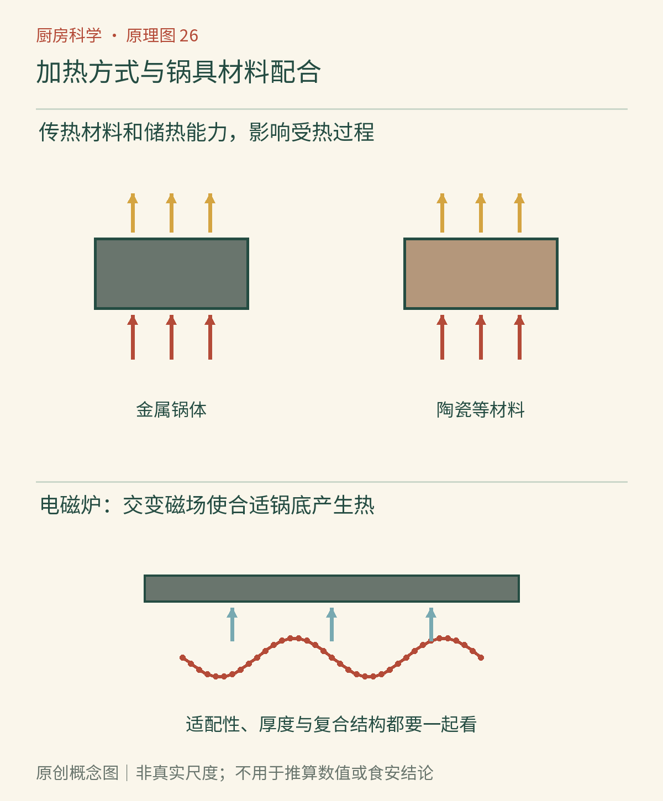

# 第26章　锅具与炉灶：材料、能量与选择

同样一片土豆，放进薄锅与厚锅，翻面时机可能不同；同一口锅换了炉灶，也未必还能照搬原来的旋钮位置。锅具是热从能源走向食物的中间层，它既传递热，也暂时储存热，还决定食物在哪里与热源接触。

## 先分开两种材料性格

导热能力描述热在材料中传递得快不快。热容量描述整个物体改变温度需要多少热量，它由质量和比热容共同决定。一口锅可以导热快却储热不多，也可以很重、储热较多，却并不善于迅速把局部热量铺开。

设想两口同材质、形状相似但重量不同的锅：在相近条件下，较重的锅往往需要更多能量升到同样温度，也更不容易被少量冷食材迅速降温。不过这不是无条件的优点；需要迅速降低温度时，已经储存的热也不会因为关火立刻消失。热容量与导热系数是不同量，不能把“厚实”“均匀”“反应快”混成一个评价。[资料：OpenStax《热、比热与量热》](https://openstax.org/books/university-physics-volume-2/pages/1-4-heat-transfer-specific-heat-and-calorimetry)

*图26-1｜AI漫画教学示意。关注中间两种材料锅具和下方锅底与炉灶的适配。它们用于引出传热与响应差异，并未给出相同厚度、质量的实验对照，不能据图直接给材料排性能名次。*

## 热点不是食物的错

炉头把能量输入锅底的某些区域，锅底再把热量沿厚度和横向传开。若输入很集中，而横向铺热速度不足，便容易出现热点。同一张饼靠近热点处先焦，其他位置仍然苍白。此时只缩短总时间，可能会让整张饼都未熟；改善接触、调整火力或换适合的锅，才是在改变原因。

导热、接触面积、材料厚度与两侧温差都会影响传热。实际烹饪还叠加了食物释放水分、锅底形状和油层的影响，因此教科书关系用于理解方向，不适合直接把一条公式算成每家灶上的煎饼秒数。[资料：OpenStax《传热机制》](https://openstax.org/books/university-physics-volume-2/pages/1-6-mechanisms-of-heat-transfer)

## 复合锅为何不只用一种材料

不锈钢耐用、便于维护，但锅的性能不必完全由接触食品的那一层承担。许多复合锅采用不同层次的材料，让一层负责食品接触与耐用，另一层帮助传热。这体现的是分工，而不是把所有好性质集中到某一种“神奇金属”。

铸铁锅常以较大的质量和储热能力见长，适合某些需要稳定接触加热的任务；它仍可能出现热点，需要合理预热。铜和铝具有较好的导热表现，但食品接触、表面保护和酸性食物相容性需要具体看产品结构。不能因为金属名一样，就把裸金属、氧化处理、内衬与涂层产品当成同一件物品。[资料：加拿大卫生部《安全使用锅具与烤具》](https://www.canada.ca/en/health-canada/services/household-products/safe-use-cookware.html)

## 不粘与耐高温是两项问题

不粘表面减少食物黏附，能让煎蛋、薄饼等操作更容易，但不表示可以任意空烧，也不表示无需阅读温度限制。涂层、基体和把手可能具有不同适用温度，是否能进烤箱也要看整件产品，而不只是锅身。

清洗也属于材料使用的一部分：粗糙磨具、金属铲、酸碱清洁剂或温差冲击，都可能与某些产品不相容。厂家说明中的器具、清洁与更换条件，应优先于网上“一种锅全部这样养”的经验口号。

*图26-2　原创概念图。沿“能源输入—锅底响应—食物表面—食物内部”阅读。关火只中止或减少能源输入，锅体已经储存的热仍可继续传入食物。箭头表达能量方向，不代表各处温度相同。*

## 电磁炉是在锅体中产生热

电磁炉利用变化磁场在适配锅具中产生感应电流等损耗，使锅体发热，再由锅传热给食物。它并不是把玻璃面板先烧热、再完全依靠面板加热锅。与此同时，锅也会把热回传给面板，所以停机后面板仍可能烫手。[资料：美国能源部《改用电磁炉》](https://www.energy.gov/articles/making-switch-induction-stoves-or-cooktops)

适配性要看锅底材料和产品标识，而不仅看锅身叫“不锈钢”还是“铝锅”。复合底可能让原本不适配的锅身获得适配能力。锅底尺寸、平整度与设备说明也影响使用；不能用“磁铁能吸住”作为对所有性能的完整保证。

燃气灶、辐射电炉和电磁炉的输入方式不同，旋钮也不是统一温标。“中火”在不同设备、锅径和食材负载下可能对应不同过程，因此记录烹调状态往往比只记火力档位更便于复现。

## 能量效率与菜的口感不是同一个指标

能源有多少最终进入食物，与锅面是否均匀、食物是否达到喜欢的质地，需要分别评价。一个设备把能量更有效地送到锅中，不等于每种菜都自动更好做；控制响应、锅形、操作空间和人的使用习惯也参与结果。

实际节能可以从任务看起：锅与炉头尺寸是否匹配，是否加热远超本次需要的水，能盖盖时是否让热量持续散失，等待时是否仍保持过大的输入。每一项都围绕减少无用的能量流，而不是要求所有烹饪都使用同一种锅。

反过来，不能为了节能而压缩必要的安全加热，或把尚未完成的食品只靠模糊的“余温”处理。余热有时可以纳入经过验证的烹调方法，但它必须是方法的已知部分，而不是见锅还热就临时减掉关键步骤。选择器具时，也要把清洁、耐用和可维护性纳入实际使用成本。

## 把锅和任务配起来

煮汤以水为主要传热介质，锅内流动参与热量分配，对锅面瞬时均匀度的要求与煎薄饼不同。煎蛋强调表面接触和温度控制，炖煮强调较长时间内的稳定供热。选择锅具时先确定任务，再看尺寸、重量、易清洁程度和炉灶适配性，比按价格排性能更有效。

可以在一次正常烹饪中观察：同一锅里两片相近厚度的土豆是否同时上色；翻动或改变位置后差别是否跟着位置移动。不要为测试而空烧锅，也不要滴水到高温油中。把位置差异记录下来，就能知道以后哪些位置需要更早翻面。

材料给我们更多控制手段，却不会消除食材差异。下一章把这种“看功能、看条件”的思路转向包装：食品配料表同样需要理解组成与作用，而不是凭名称好恶做判断。

## 本章资料

- OpenStax：[热、比热与量热](https://openstax.org/books/university-physics-volume-2/pages/1-4-heat-transfer-specific-heat-and-calorimetry)；[传热机制](https://openstax.org/books/university-physics-volume-2/pages/1-6-mechanisms-of-heat-transfer)。用于热容量、导热和能量路径。
- 加拿大卫生部：[安全使用锅具与烤具](https://www.canada.ca/en/health-canada/services/household-products/safe-use-cookware.html)。用于材料相容性和产品使用边界。
- 美国能源部：[改用电磁炉](https://www.energy.gov/articles/making-switch-induction-stoves-or-cooktops)。用于电磁加热原理。
