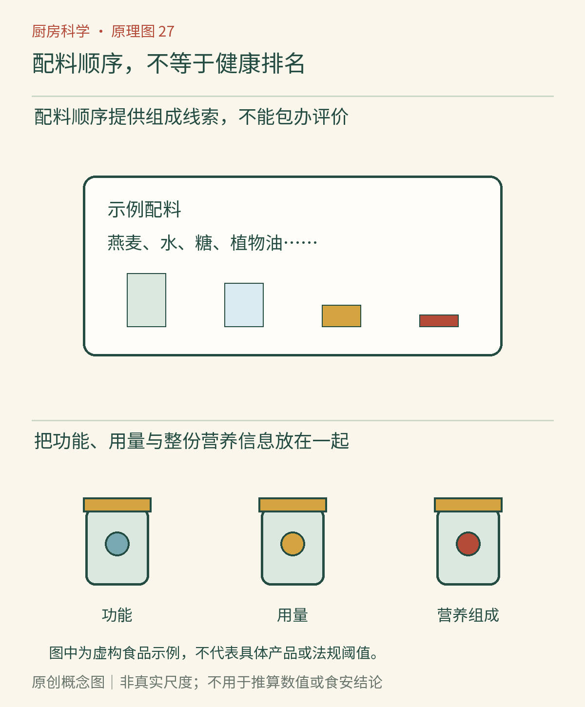

# 第27章　读懂配料表：添加剂与加工食品

拿起两杯酸奶，一杯配料只有几项，另一杯多了果粒、糖、果胶和其他成分。长短确实不同，但“字少”不能独自回答哪杯更适合自己。读标签的目的，是把组成、食用量、储存要求与个人需要连接起来，而不是把陌生字数当成食品优劣的计分器。

## 配料表是一张组成线索图

配料表告诉我们制作时加入了什么，但不一定给出所有配料的确切百分比。阅读时应先抓住主体：这是以乳、谷物、水还是其他原料为基础的产品；再看糖、油、盐以及其他功能成分处在什么位置。

以中国内地GB 7718—2011的相应规则为例，配料一般按加工时加入量递减排列，但存在加入量不超过2%的配料可不按递减顺序等例外。因此，顺序能提供大致线索，不能直接把第二位换算成“占两成”，也不能把相邻两位之间的差距想象得很大。[资料：国家卫生健康部门《GB 7718—2011问答》](https://www.nhc.gov.cn/zwgkzt/wsbysj/201201/54021.shtml)

*图27-1　AI漫画教学示意。看图时把注意力放在食品类别、组成和实际食用量上；虚构包装仅作教学例子，不代表真实品牌或合规标签样板。陌生名称的多少不能直接代表安全水平。*

## 添加剂首先有具体工作

乳化剂帮助维持油水混合状态，增稠剂改变流动与稠度，膨松剂让某些面糊膨起，抗氧化剂延缓氧化，防腐剂抑制某些微生物。它们不是同一种作用的不同名字，也不是每一种食品都需要全部使用。[资料：FDA《食品配料的类型》](https://www.fda.gov/food/food-additives-and-gras-ingredients-information-consumers/types-food-ingredients)

前面章节已经提供了理解入口：油醋汁会分层，说明乳化稳定有真实技术问题；果冻依靠网络成形，说明“稠”和“能切块”来自结构；油脂可能氧化，说明包装与抗氧化措施并非只为改变外观。知道作用之后，再评价某个配方，就不必在“完全没用”和“越多越先进”之间二选一。

## 安全评价离不开使用条件

一种物质是否适合用于食品，要看允许的食品类别、用途、使用量和相关安全评价。获准使用不表示可以无限量摄入，也不表示擅自添加或违规超量同样可靠。反过来，天然来源也不是无需评价的理由。

新加坡食品局介绍，添加剂有具体技术用途，并通过相关监管限量等要求管理。不同地区的法规体系和准许范围可能不同，所以不能把一份外国清单直接当成中国某产品的合规结论。消费者若需核对具体添加剂，应查销售地现行规定和该产品类别。[资料：SFA《食品添加剂安全吗》](https://www.sfa.gov.sg/food-safety-tips/food-risk-concerns/risk-at-a-glance/food-additives-are-they-safe)

“化学名称”只是命名方式，不是危险等级。柠檬酸、碳酸氢钠和卵磷脂都可能让人联想到熟悉的厨房过程，但这种熟悉也不能代替剂量与用途。科学判断要避开两种捷径：看到长名称就害怕，以及看到天然来源就放松所有限制。

## 比较数字前，先对齐分母

营养成分表中的每100克、每100毫升与每份，是不同的比较尺度。两个食品要比较，先对齐同一种分母，再结合一次真正会吃多少。例如，甲每100克含钠600毫克、一次吃20克，则这次约摄入120毫克钠；乙每100克300毫克、一次吃100克，则约摄入300毫克。数字都正确，但若只看单位重量，容易错判一次摄入。

这个例子是算术练习，不是营养处方，也不说明甲必然更健康。食品的蛋白质、总能量、糖、脂肪、膳食结构以及个体需求都可能重要。用同一个数字给所有食品排序，往往把具体用途抹掉了。

*图27-2｜原创概念图。上方以虚构食品呈现配料组成与相对用量，下方区分图示原料的工艺功能。图中没有数值换算或真实合规标签；单位含量与实际食用量的比较方法见正文，不能把一项功能汇总成健康总分。*

## 标签之外，还要检查条件

含乳、蛋、大豆、坚果等原料可能与过敏者相关；个人需要时必须仔细核对配料及过敏原提示，而不能凭食品名称猜。无糖、低脂等声称也只描述符合相应定义的某些指标，不自动意味着适合每个人或可以不限量食用。

储存条件、开封后说明、生产日期与保质期同样重要。配料表很简短的鲜食产品，可能比复杂配方的常温产品更需要严格冷链。另一方面，保质期较长也不自动证明加入了防腐剂，加热工艺、酸度、水分和包装都可能参与其中。

## 把技术功能、营养与合规拆开问

同一件食品可以在技术上很好地保持质地，却未必符合某个人的饮食目标；也可能配料十分简单，却不适合某位过敏者。技术功能、营养构成、个人适宜性和法规合规，是互相关联但不能互相替代的几个问题。

例如，乳化剂帮助饮料保持均匀，解释的是产品状态；一次喝下多少能量，解释的是食用份量与营养构成；是否含个人需要回避的成分，则是另一层筛选。先说清自己在比较哪一件事，讨论才不会从“这项功能有用”突然跳到“这款食品应当每天多吃”。

标签也有信息边界。没有标出某种微量成分的百分比，不等于它一定没有；看见原料名称，也不一定能知道原料的全部加工经历。对于真正影响选择而标签不能回答的问题，可以查产品说明、向厂家核实或选择信息更明确的替代品，而不是用想象补完配方。

## 阅读标准也要看生效时间

本稿核查日期为2026年10月26日。GB 7718—2025与GB 28050—2025已经发布，规定的实施日期为2027年3月16日；不能因为名称里有“2025”，就把所有新要求描述成此刻所有在售产品已经必须遵守的规则。过渡安排和具体标签适用性，应结合生产日期及官方说明核对。[资料：淮南市市场监管局《新版食品标签国标施行提示》](https://scjgj.huainan.gov.cn/xwdt/tzgg/551868449.html)

本章采用的组成、功能与份量比较方法，不依赖把尚未实施的规则提前当成统一现状。未来更新本书时，法规日期与标签示例应一起复核，不能只替换标准编号。

## 在超市完成一次小调查

挑两种同类别产品，先分别写下“它是什么”，再列出主体配料、计划食用量和储存条件。若想比较某项营养指标，先统一单位，再计算实际份量。最后补一句选择理由，例如“准备今晚吃完，所以接受较短储存期”，或“用于烘焙，需要特定脂肪结构”。这样的理由比“配料表更干净”具体得多，也更容易检验。

下一章会把这些阅读方法放回一次真正的备餐，让选择、烹调、保存与收尾接成同一个过程。

## 本章资料

- 国家卫生健康部门：[GB 7718—2011问答](https://www.nhc.gov.cn/zwgkzt/wsbysj/201201/54021.shtml)。用于配料顺序及其例外。
- FDA：[食品配料的类型](https://www.fda.gov/food/food-additives-and-gras-ingredients-information-consumers/types-food-ingredients)。用于添加剂的技术功能，不作为中国法规依据。
- SFA：[食品添加剂安全吗](https://www.sfa.gov.sg/food-safety-tips/food-risk-concerns/risk-at-a-glance/food-additives-are-they-safe)。用于有条件安全评价的监管思路。
- 淮南市市场监管局：[新版食品标签国标施行提示](https://scjgj.huainan.gov.cn/xwdt/tzgg/551868449.html)。用于2027年3月16日的实施节点。
