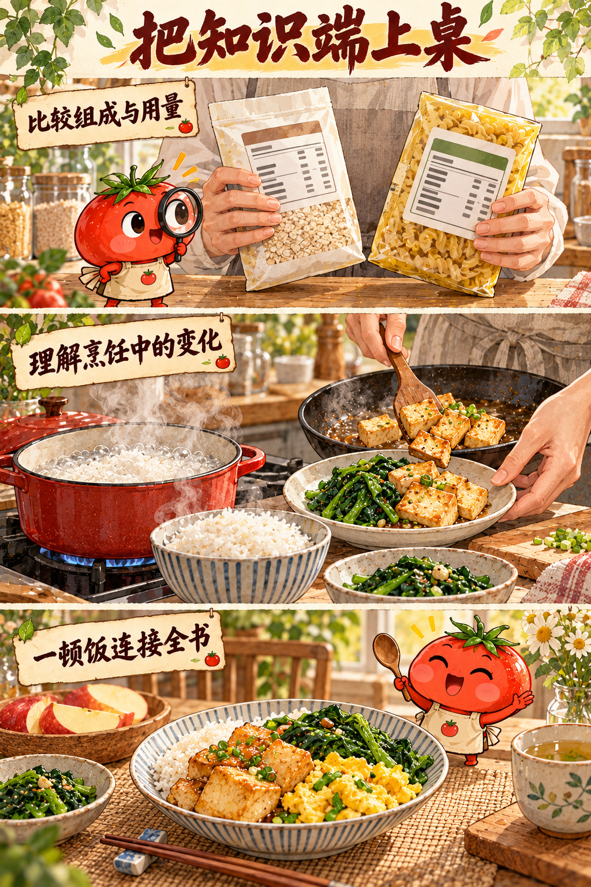
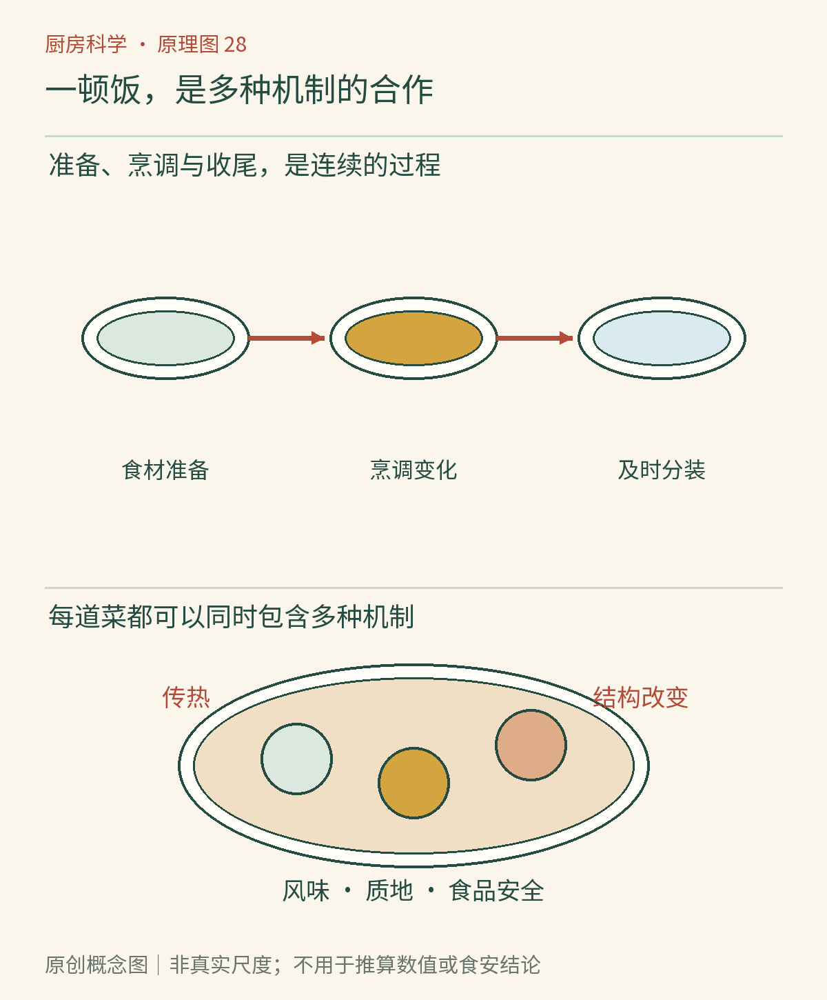

# 第28章　一顿饭的科学推演：从准备到收尾

把米饭、番茄炒蛋、清炒蔬菜和一杯茶放在桌上，看起来只是普通家常饭，却已经包含了溶解、传热、淀粉变化、蛋白质网络、植物组织、风味释放和食品保存。全书最后不增加一张需要背诵的术语表，而是跟着这顿饭检查：每一步希望改变什么，又有哪些条件需要保留。

## 开始前，先安排不能拖延的事

决定人数和份量，再检查冷藏空间与食品状态。冷冻食材如果要用，提前按适宜方式解冻；需要洗的蔬果和即食食品先在干净区域处理。若增加肉菜，还应预留生肉工具、承接汁液的容器和清洁步骤。

菜单也可以帮助安排实验变量。初学者不必同时换米、水量、锅和火力，否则做出来的饭即使不同，也难以知道差别来自哪里。先固定大部分条件，下次只改变一项，做饭经验便更容易从“凭感觉”变成可复用的观察。

*图28-1｜AI漫画教学示意。画面从比较食品信息转向烹调和上桌，连接原料选择、过程变化与餐食安排。图中没有展示全部准备和收尾步骤，实际操作还需生熟分开、温度检查与剩菜及时管理。*

## 米饭：水量决定的并非只有湿润程度

生米吸收水分，受热后淀粉颗粒发生变化，米粒由坚硬变得柔软。水太少，内部可能无法按预期充分变化；水多到形成大量流动液体，成品又会向粥的质地靠近。同样的水量还要经过蒸发，所以锅盖、容器和加热方式也参与结果。

这里需要观察的是米粒中心和整体含水状态，而不是把冒出第一缕蒸汽当成完成信号。电饭煲通过设备设计管理加热过程，普通锅则需要更多人工控制；同一份说明不能无条件跨设备复制。熟饭冷却后还会继续发生质地变化，不能以为离火之后淀粉便保持原状。

把“今天米饭偏硬”拆成几个问题：米是否相同，称量是否一致，水是否被量杯刻度误读，锅盖是否频繁打开。这样的排查比直接给所有偏硬米饭套上一个原因更可靠。

## 鸡蛋：把流动变成网络

鸡蛋下锅，原本透明流动的蛋白逐渐发白凝固，蛋黄也改变稠度。加热使部分蛋白质展开并相互作用，形成能够容纳水分的网络；继续加热则可能让质地变紧、析出更多水。想得到柔软口感，需要控制受热强度和持续时间，而不是只追求最快变色。[资料：Exploratorium《温和加热鸡蛋》](https://annex.exploratorium.edu/cooking/eggs/gentle.html)

番茄带来水、酸和植物组织，加入后会改变锅内环境。若在蛋液尚未形成合适结构时大量加入番茄汁，整锅受热与成形方式都会不同；先让鸡蛋形成较大块，再与番茄组合，是一种把两段变化分别管理的办法。这里不需要宣称唯一正确顺序，重点是理解顺序为何可能改变结果。

盛出时还要考虑余热：锅没有因为关火就立刻变凉。如果需要结束鸡蛋继续受热，把菜移入适当餐盘比留在热锅中等待更有效。口感目标与安全熟度要同时兼顾，不能为了“嫩”而默认生蛋风险可以忽略。

## 蔬菜：颜色和脆度一起观察

蔬菜在切开、受热和失水时改变结构。脆嫩不仅取决于“煮了几分钟”，还与切块大小、原先成熟程度、组织特点和锅中温度有关。一锅装得太满，释放的水分来不及散去，过程可能更接近在汁液中焖煮，成品口感便会改变。

可以比较同锅中较薄和较厚的菜梗：前者通常更快受热、软化。由此反推，切得相近有助于同步完成；需要保留不同口感时，也可以有意利用大小差别。观察只取正常烹调中的样品，不把未熟原料的品尝当成必需步骤。

颜色提供信息，却不能单独替代所有判断。绿色鲜亮不自动说明营养最好，深色也不必然代表焦糊；需要结合食材色素、加热方式与实际状态。厨师的观察经验有价值，但应知道每一种线索的解释范围。

*图28-2｜原创概念图。上方串起食材准备、烹调变化和及时分装；下方同一个餐盘同时联系传热、结构改变、风味、质地与食品安全。箭头为过程关系，不能从成品外观倒推出完整温度经历。*

## 茶：水把一部分风味带到杯里

茶叶与热水接触，能够进入水相的成分逐步迁移；温度、接触时间、茶水比例和叶片状态都会影响结果。茶汤更浓，不一定意味着同一种风味成分按相同比例增加。若觉得上一杯过强，先只改一个变量，比同时减少茶叶、降温和缩时更容易理解原因。

饮品也能提醒我们，气味和入口感受会互相影响。杯口、饮用温度和闻香机会都可能改变体验。这里不把主观喜好硬写成一个“最佳萃取值”，而是让记录服务于重现自己喜欢的状态。

## 收尾仍属于这顿饭

上桌前用干净餐具分出计划保存的份量，饭后及时处理余下食品。美国CDC的家庭预防建议强调清洁、分开、煮熟、冷藏四类行为；这套框架能检查整段流程，而不仅检查锅里那几分钟。[资料：CDC《预防食源性疾病》](https://www.cdc.gov/food-safety/prevention/)

不要把待存食物在室温放到完全冷透才考虑冰箱。分装浅容器、及时冷藏，并记录名称日期；USDA的剩菜指导还要求结合食品种类和温度经历管理后续食用。再次加热不是把不当储存经历删除，所以“明天反正还要热”不能代替今天的处理。[资料：USDA《剩菜与食品安全》](https://www.fsis.usda.gov/food-safety/safe-food-handling-and-preparation/food-safety-basics/leftovers-and-food-safety)

## 留下一页有用的厨房记录

记录不必写满实验表。用四句话就够：希望得到什么，实际做了什么，看见哪些变化，下次只准备改哪一项。例如“米饭中心偏硬；米和锅没换；本次水量比上次少；下次恢复水量，其他条件保持一致”。这种记录保留了可以验证的因果线索。

当一次结果不符合预期时，优先检查输入、过程与观察是否完整，再决定解释。厨房科学的收获，不是每道菜都能算出唯一答案，而是越来越能分辨哪些变化可以主动控制、哪些结论需要测量，以及什么时候应停止猜测。下一顿饭可以继续从一个小而具体的现象开始。

## 本章资料

- Exploratorium：[温和加热鸡蛋](https://annex.exploratorium.edu/cooking/eggs/gentle.html)。用于鸡蛋受热与口感的例子。
- CDC：[预防食源性疾病](https://www.cdc.gov/food-safety/prevention/)。用于整餐流程中的清洁、分开、煮熟与冷藏。
- USDA FSIS：[剩菜与食品安全](https://www.fsis.usda.gov/food-safety/safe-food-handling-and-preparation/food-safety-basics/leftovers-and-food-safety)。用于餐后分装与保存边界。
- 本章过程拆解与记录法为作者教学设计；淀粉、蛋白质、植物组织与萃取的原理，分别参见第10、11、16与20章及各章来源。
